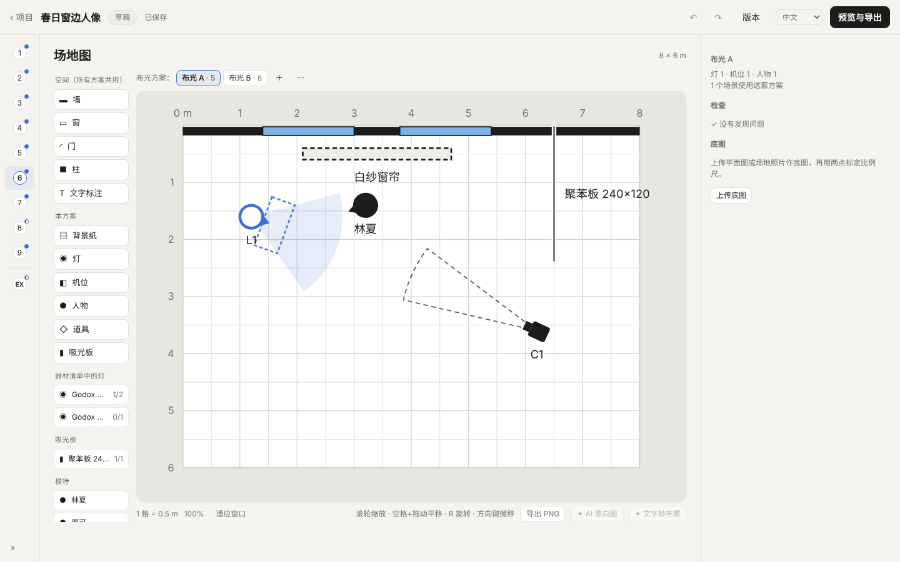
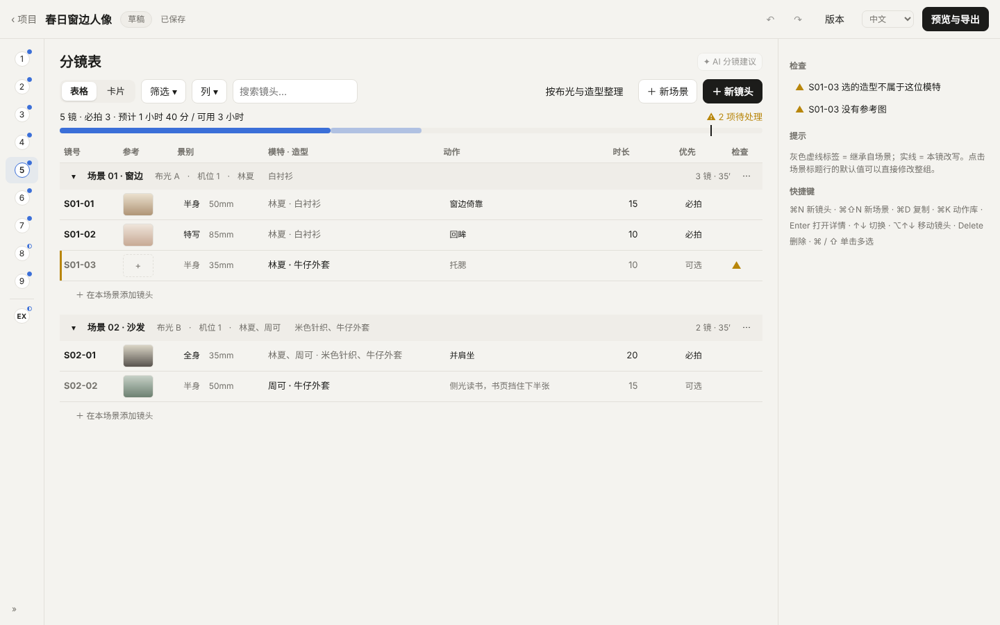
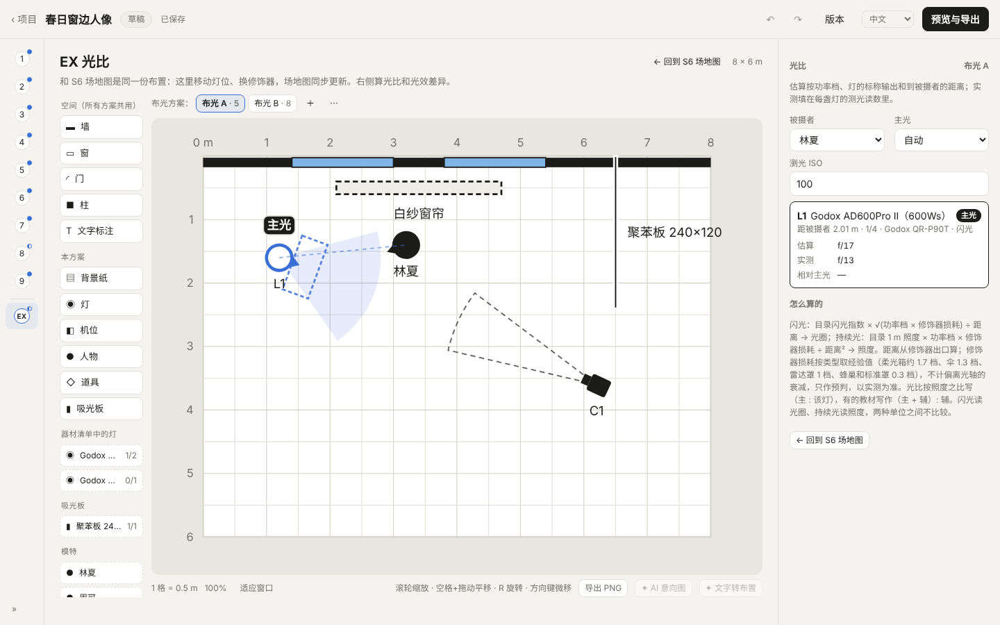
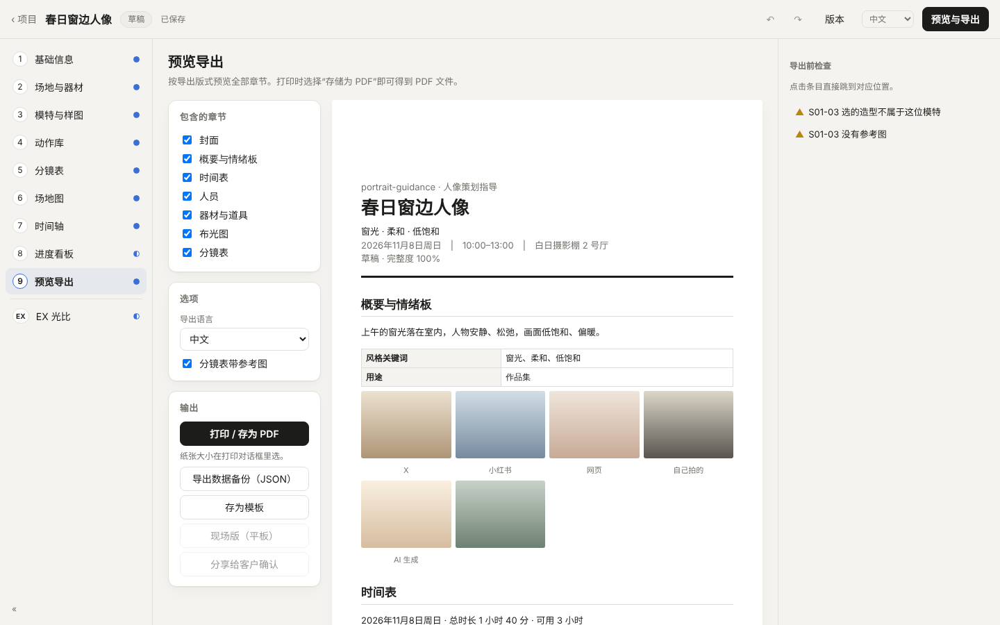

# 人像策划指导 · portrait-guidance

> 给人像摄影师的拍摄策划工具。从「这次想拍什么」开始，一步步整理模特、情绪板、动作、分镜、灯位和时间表，最后导出一份可以发给团队、打印带进棚里的策划案。

<p>
  
  
</p>

**中文 · English · 日本語 · 한국어**　|　本机运行，不用联网，不用账号　|　只用 Python 标准库，零依赖

---

## 目录

- [它解决什么问题](#它解决什么问题)
- [快速开始](#快速开始)
- [一次拍摄的完整流程](#一次拍摄的完整流程)
- [几个关键设计](#几个关键设计)
- [数据与隐私](#数据与隐私)
- [版本与进度](#版本与进度)
- [路线图](#路线图)
- [开发](#开发)
- [协作方式](#协作方式)

---

## 它解决什么问题

一次棚拍或外景人像，拍之前要想清楚的事情很多，通常散落在聊天记录、备忘录、手绘草图和脑子里：

- 模特是谁，身高尺码多少，带几套衣服，什么时候到、什么时候必须走；
- 想要什么感觉，参考图分别想借鉴光线、色调、构图还是动作；
- 每一镜拍什么景别、用什么焦段、摆什么动作；
- 灯放在哪、离人多远、从哪个角度打，主辅光比大概多少；
- 换装、换灯要多久，整天的时间排不排得下。

这个工具把这些整理成一份**结构化的项目**。各部分互相关联：分镜引用模特的服装套组和动作库里的动作，时间轴按分镜自动排程，场地图上的灯位直接用来估算光比。所以改一处，其他地方会跟着更新，也能检查出矛盾，比如付费模特的收工时间排不下所有镜头、某个镜头引用的服装还没准备。

它的目标不是替你决定怎么拍，而是让你**拍之前想得更完整、现场少翻资料**。

## 快速开始

需要 Python 3（macOS 自带的就行），不用安装任何包。

| 方式 | 操作 |
|---|---|
| macOS | 双击 `启动人像策划指导.command` |
| Windows | 双击 `启动人像策划指导.bat` |
| 命令行 | `python3 server.py`（可选 `--data 数据目录`、`--port 端口`、`--no-browser`） |

启动后浏览器会自动打开界面。关掉终端窗口就退出了。

第一次用，建议先生成一个填好的示例项目「春日窗边人像」，各页都有内容可以看：

```bash
python3 tools/make_demo.py
```

## 一次拍摄的完整流程

左侧导航按拍摄准备的顺序排列。每页右上角显示完成度，没填全的会提示。

| 步骤 | 页面 | 在这一步做什么 |
|---|---|---|
| S0 | **项目列表** | 新建、从模板新建、复制、归档；按状态筛选；导入 JSON（支持旧版 Grok 格式转换） |
| S1 | **基础信息** | 主题、风格关键词、用途；拍摄日期、时区、到场时间；工作人员；地点 |
| S2 | **场地与器材** | 场地尺寸和条件；器材清单（内置神牛、爱图仕、Bron 的灯具与修饰器目录参数）；道具；打包清单，可以逐项勾「已装箱」 |
| S3 | **模特与样图** | 模特档案：基本信息、尺码、工作照、服装套组、角色设定；付费模特的工时、动作清单、MCN 登记。**情绪板**：每张参考图写清楚借鉴什么（光线、色调、构图、服装、动作、妆发、场景），再写一段整体风格说明 |
| S4 | **动作库** | 跨项目共用。每个动作有分解步骤、重心、手、视线、常见问题、引导话术，以及情绪、姿态、重点部位、道具、场景五个维度的标签。自带约 30 个起步动作 |
| S5 | **分镜表** | 按场景分组；每镜填景别、焦段、模特和造型、动作、时长、优先级；场景设置会继承给下面的镜头；顶部实时显示时长预算 |
| S6 | **场地图** | 俯视平面图，可以摆墙、窗、背景纸、灯、机位、人物、站位点。灯可以挂修饰器，显示光束角。选中元素时实时画出距离和相对角度。可以从机位看 20 mm 三维预览 |
| S7 | **时间轴** | 按到场时间、化妆提前量和每镜时长自动排程，换装换灯处自动插缓冲；可以拖动锁定时间；超出收工时间时提示 |
| S8 | **进度看板** | 拍摄当天用：开始、完成、跳过、重拍；可以导出 `.plan.json` 给选片工具 Photo-cull 按镜头分组 |
| S9 | **预览导出** | 勾选章节（封面、情绪板、时间表、人员、模特资料、通告单、器材、布光图、分镜表），选导出语言，打印或存成 PDF |
| EX | **光比** | 和 S6 用同一份布置，在图上标出每盏灯到被摄者的估算光圈或照度和光比，并和现场测光读数对照 |

<p>
  
  
</p>

## 几个关键设计

### 一份布置，两种视图
S6 场地图和 EX 光比读写的是同一份 `project.layout` 数据。在任意一边移动灯位，另一边会同步。一个项目可以有多套布光方案（布光 A、布光 B……），分镜里每一镜选用哪一套。

### 坐标和角度
- **坐标原点在棚子左下角**，X 向右、Y 向上，单位米。界面显示、输入和导出都用这个坐标系。
- **左和右都按棚坐标说**：X 更小的一侧是「左」。这样摄影师、灯光助理和模特看同一张图时不会因为各自朝向不同而理解反。
- **角度只用 15° 一档**：朝向和俯仰输入时自动取最近一档（填 50° 会变成 45°），相对夹角也四舍五入到 15° 显示。现场摆灯本来就精确不到个位数的度数，15° 一档更好沟通。
- 光位名称按灯相对被摄者朝向的夹角来取：0° 正面光、15–30° 斜前光、45° 伦勃朗光、60–90° 侧光、105–135° 侧逆光、150–180° 逆光。
- **灯位中心高要人工填写**：现场量好后填进去，程序不估算。没填时不显示高度角和斜距。

显示示例：`L1 · 2.30 m · 方位 135°（左后）· 伦勃朗光 45°`

### 光比怎么估算
- 闪光灯：目录闪光指数 × √(功率档 × 修饰器损耗) ÷ 距离 → 光圈
- 常亮灯：目录 1 m 照度 × 功率比例 × 修饰器损耗 ÷ 距离² → 照度

距离从修饰器出口算起。修饰器损耗取经验值（柔光箱约 1.7 档、伞 1.3 档、雷达罩 1 档、蜂巢和标准罩 0.3 档）。光圈和照度两种单位之间不比较。这些估算只用来预判，**以现场测光为准**。实测读数可以填回每盏灯，和估算值并排显示。

### 参考图统一入口
情绪板、动作库和分镜用同一个「添加参考图」窗口，有五个入口：

1. 上传：选文件或拖进窗口；
2. 粘贴：⌘V 直接粘贴剪贴板里的图；
3. 去搜索：在浏览器打开小红书、Pinterest、Google 图片、花瓣的搜索结果页，看中的图拖回来；
4. 从情绪板选：只在动作库和分镜里出现；
5. AI 生成：默认关闭，要自己在设置里填 Gemini API Key 才能用；生成前显示张数和预估费用，生成的图固定标「AI」。

每张图都记录来源和链接。

### 撤销、版本和完整度
- 改动自动保存，可以撤销和重做 80 步。
- ⌘S 手动存一个版本，定稿时也会自动存一份。
- 完整度检查会列出缺项和矛盾，例如镜头引用的服装还是「待准备」，或者排程超出了模特收工时间。

## 数据与隐私

所有数据都在你自己的电脑上，默认在 `~/Documents/portrait-guidance/`：

| 位置 | 内容 |
|---|---|
| `projects/<id>/project.json` | 项目数据。每个项目一个文件夹，可以整个拷走或备份 |
| `projects/<id>/images/` | 情绪板、参考图、底图、场地照片 |
| `projects/<id>/versions/` | 手动保存和定稿时自动保存的版本 |
| `library/` | 跨项目共用的动作库、场地库和模板 |

- 服务器只监听 `127.0.0.1`，请求要带随机令牌，局域网里的其他设备访问不到。
- 模特的**联系方式、费用、MCN 合同信息默认不进导出的策划案**，导出时勾选才会带上。
- 程序里不提供身份证件号码这类信息的录入位置。
- 除了你主动开启的 AI 生成，程序不会访问网络。

## 版本与进度

| 版本 | 状态 | 主要内容 |
|---|---|---|
| 0.1.0 | 完成 | 基线：本机服务、项目文件存储、各页面雏形 |
| 0.2.0 | 完成 | 页面按 S0–S9 重排并合并；进度看板和 `.plan.json` 导出；器材尺寸库与吸光板；导入 JSON 和旧版 Grok 数据转换；四种语言打磨 |
| 0.3.0 | 完成（`main`） | EX 光比；机位三维预览重写；神牛、Bron、爱图仕器材目录；多处问题修复 |
| 0.4.0 | **复核中** | 只完善 S2–S9：通用二级编辑层、模特档案、情绪板借鉴点、动作库、参考图模块、场地图坐标和相对夹角、站位点、通告单和模特资料导出 |

0.4.0 的代码在分支 `cursor/v040-closeout-080d` 上，复核后发现的问题合成了修正卡 T26。改完、复核通过后会合进 `main`。

分支命名：`main` 是已经复核通过的版本；`cursor/*` 是开发中或待复核的分支。

## 路线图

**下一步（0.4.x）**
- T26：0.4.0 复核修正。包括选中元素旁边的快捷条、补齐灯相对机位的角度、灯到背景的距离、机位画面高度估算，以及画布标注避让。

**之后**
- T15：Profoto 灯具与修饰器目录
- T16：导入世光 Sekonic L-858D 测光表的记录，自动填进实测读数（需要导出样例文件）

**暂时只留入口**
- AI 起草、文字转布置、AI 意向图、AI 分镜建议
- 现场简化版、分享给客户

## 开发

### 代码结构

```
server.py              本机服务、文件存储、接口（只用标准库）
web/index.html
web/css/               设计变量 tokens.css 和样式 app.css
web/js/model.js        领域逻辑：继承、镜号、排程、检查、完整度、坐标换算、相对角度、光比（纯函数，有测试）
web/js/store.js        当前项目、自动保存、撤销 / 重做、资料库
web/js/canvas.js       场地图绘制（编辑器、缩略图、导出共用）
web/js/camview3d.js    机位三维预览（原生 Canvas）
web/js/editlayer.js    通用二级编辑层
web/js/refimages.js    参考图获取模块
web/js/strings.js      四种语言的界面文字
web/js/pages/*.js      各页面
web/data/              器材尺寸库和厂商目录（只读参考，出处见 docs/gear-catalog/）
tools/                 示例数据、界面文字检查、各版本截图脚本
tests/                 测试
```

前端是原生 ES 模块，**不用框架、不用打包**，改完刷新浏览器就能看到效果。

### 测试

```bash
node --test tests/*.mjs                    # 领域逻辑
python3 -m unittest tests/test_server.py   # 接口
node tools/check_i18n.mjs                  # 四种语言是否齐全
python3 tests/e2e_smoke.py                 # 浏览器流程（需要 Playwright）
```

每个版本的四语界面截图在 `docs/screenshots/<版本>/`。

### 约定
- 新的领域计算写进 `model.js`，同时补测试；页面只负责显示。
- 新字段在 `normalize()` 里补默认值，保证旧版本的项目文件能直接打开。
- 新的界面文字必须四种语言齐全。
- 不引用外部 CDN 或字体，程序必须能离线使用。

## 协作方式

这个项目由 Hastin 主导，Claude 和 Grok 两个 AI 协作开发：

- `交接板.md`：任务卡和状态（待办 → 进行中 → 待复核 → 完成）；
- `交接日志.md`：每一步做了什么；
- 界面卡要交四种语言的截图，含 1280×800 窄窗口；复核通过后才改为「完成」；
- 较大的需求先写成「工作意向确认」，由 Hastin 签署后再开工。

### 与 Photo-cull 的关系
Photo-cull 是同一作者的选片工具，和这个工具一样是本机程序。S8 进度看板导出的 `.plan.json` 记录了每一镜的实际拍摄时间段，Photo-cull 读入后可以按镜头自动给照片分组。

---

© Hastin. 暂未开源，仓库目前为私有。
