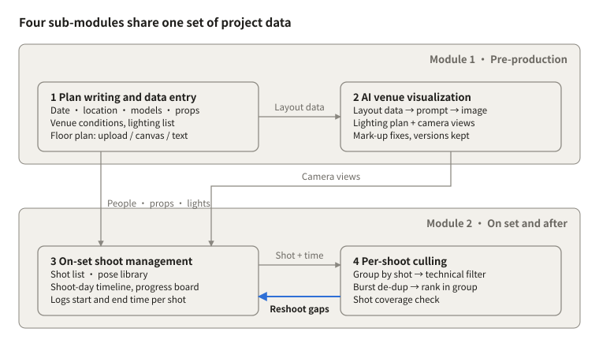
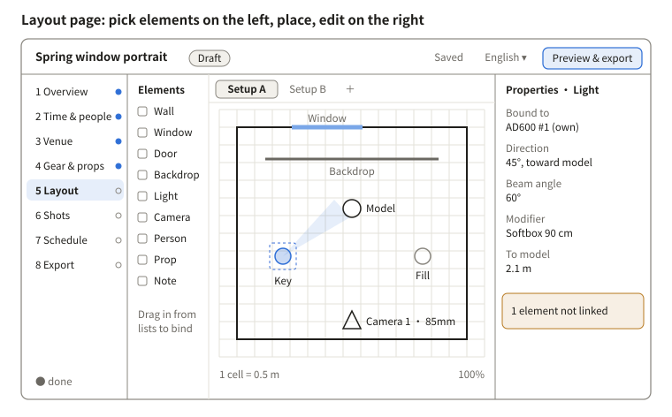
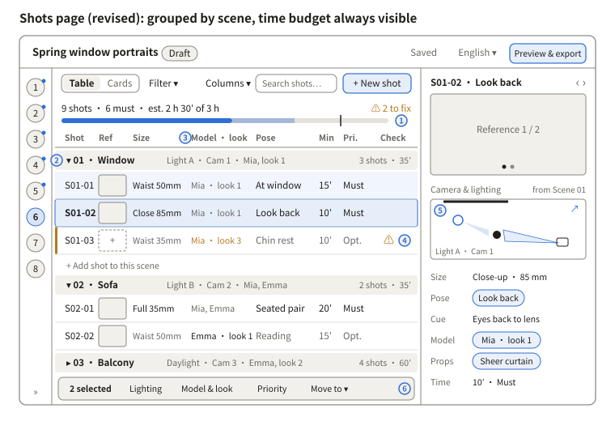

# portrait-guidance · Plan and Module Design

Oct 27, 2026

> **Design snapshot**: exported on 2026-10-29 from the four-language online design doc kept in Claude. The online doc is the master; this is a read-only copy with the diagrams converted to SVG. Page numbers below are the design numbering; the “Implementation status” section maps them to the app. For the current app version, see the [README](../../README.md).
>
> Other languages: [中文](zh.md) · [日本語](ja.md) · [한국어](ko.md)


## Implementation status (0.3.0)

The program is at 0.3.0: all ten pages S0–S9 and the new EX lighting ratios page work. It lives in the Claude-portrait-guidance folder on the desktop; double-click “启动人像策划指导” to start it. The page order follows Grok’s scheme, so the page list and the two wireframes below still use the design numbering; the table maps them.

| Page in the program | Design number | Status in 0.3.0 |
| --- | --- | --- |
| S0 Projects | S0 | Works; imports JSON, including Grok’s older format |
| S1 Basics | S1 + S2 merged | Works; adds time zone |
| S2 Venue & gear | S3 + S4 merged | Works; gear size library, flags |
| S3 Models & references | S2 people + S1 mood board | Works; mood-board source links |
| S4 Pose library | S7 | Works |
| S5 Shot list | S6 (wireframe “S6 shots page”) | Works; built to the revised design |
| S6 Floor plan | S5 (wireframe “S5 layout page”) | Works; adds a 20 mm 3D camera preview and meter readings |
| S7 Timeline | S8 | Works |
| S8 Progress board | Was on hold, now in scope | Works; status and times only, exports shot windows for Photo-cull |
| S9 Preview & export | S9 | Works; lighting table shows meter readings and ratio to key |
| EX lighting ratios | New | Works; see below |

**EX lighting ratios**: shares the S6 floor plan’s layout, so moving a light or changing a modifier on either page updates the other. The panel estimates each light’s f-stop or lux at the subject from its catalogue output (guide number or lux at 1 m), power setting, distance and a rule-of-thumb modifier loss, compares that with on-set meter readings, and gives the ratio of each light to the key. It flags a subject outside the beam and readings more than 1 EV off the estimate. It does not count toward plan completeness.

**Gear catalogue**: 98 entries with photometric data for Godox, Broncolor and Aputure / amaran, for reference only; Profoto comes later.

Still on hold: AI features, the on-set view, client sharing, culling and result comparison, Sekonic meter import (waiting for a sample export).

## Architecture

portrait-guidance has two modules: pre-production (data entry + AI venue visualization) and on set and after (shoot management + culling). All four sub-modules share one set of project data, so anything entered once is referenced everywhere else.



*Architecture · 2 modules, 4 sub-modules*

Data flows from entry to culling; when culling finds a shot with no usable frame, it writes back to shoot management and marks a reshoot, closing the loop.

## Current scope (revised 2026-10-28)

The tool is primarily for building the shoot plan: entering information, drawing the venue layout, planning shots and poses, producing the shoot-day schedule and exporting a complete plan. This stage covers only the functional spec and GUI definition: no code, no testing.

| Content | Status |
| --- | --- |
| Sub-module 1 plan writing and data entry | Core in this stage |
| Sub-module 2 visualization: top-down lighting plan (vector) | Core in this stage |
| Sub-module 2 visualization: AI concept images | Entry point kept, feature on hold |
| Sub-module 3 shots, pose library, shoot-day schedule | Core in this stage |
| Sub-module 3 on-set progress board | On hold |
| Sub-module 4 culling, Photo-cull integration, result-vs-plan comparison | On hold |
| AI image-generation test, Photo-cull integration test | On hold |

Sections marked “on hold” stay in the second half of this document as reference for later.

**Platform assumption**: same as Photo-cull — a program that runs on your own computer (local service + web UI, packageable as a Mac app), desktop first, minimum window width 1280 px; the “on-set view” page is tablet-friendly. Still to be confirmed.

## Functional spec (planning)

The planning tool has 38 features: P0 must be in the first version (28), P1 should follow soon after (5), P2 depends on AI or open questions (5). Priorities can be changed directly in the tables.

### A · Projects

| ID | Feature | Description and rules | Priority |
| --- | --- | --- | --- |
| F01 | Project list | Create, duplicate, archive, search; cards show cover (first mood-board image), shoot date, status, completeness | P0 |
| F02 | Plan status | Draft / awaiting approval / final; editing a final plan requires “unlock” first, which saves a version automatically | P0 |
| F03 | Templates | Save a project as a template (venue, gear, common shots and poses) and pick it when creating a project | P1 |
| F04 | Autosave and versions | Every change saves automatically; “save version” with a note; versions can be viewed and restored | P0 |

### B · Overview and mood board

| ID | Feature | Description and rules | Priority |
| --- | --- | --- | --- |
| F05 | Basics | Project name, theme statement, style keywords (tags, multiple), client and purpose (optional) | P0 |
| F06 | Mood board | Drop in images, grid or free layout; notes and tags per image; one click sets an image as a shot reference | P0 |
| F07 | AI draft statement | Drafts the theme statement from keywords and mood board; written only after manual confirmation | P2 |

### C · Time and people

| ID | Feature | Description and rules | Priority |
| --- | --- | --- | --- |
| F08 | Shoot time | Date, start / end, venue availability, make-up and set-up lead time; arrival times are calculated automatically | P0 |
| F09 | People | Models (height, sizes, number of looks, available hours) and crew (role, contact); looks become “look” entries that shots can reference | P0 |

### D · Venue

| ID | Feature | Description and rules | Priority |
| --- | --- | --- | --- |
| F10 | Venue library | Venues are saved on their own and reusable across projects: address, contact, size, indoor/outdoor, photos, conditions (windows and orientation, daylight hours, wall and floor materials and colours, power, usable and off-limits areas) | P0 |
| F11 | Venue gear | Gear the venue provides, by type (lights, modifiers, stands, backdrops, reflectors, other) with model and quantity; saved with the venue for reuse | P0 |

### E · Gear and props

| ID | Feature | Description and rules | Priority |
| --- | --- | --- | --- |
| F12 | Gear list | Merges venue gear and own gear with source marked; shows “used in layout / total” and warns when a lighting setup uses more than exists | P0 |
| F13 | Prop list | Name, quantity, size, source, owner, status (to prepare / ready) | P0 |
| F14 | Packing list | A tickable, printable list built from own gear and own props | P1 |

### F · Venue layout (core)

| ID | Feature | Description and rules | Priority |
| --- | --- | --- | --- |
| F15 | Canvas | Scaled grid from the venue size (default 1 cell = 0.5 m); elements: wall, window, door, pillar, backdrop, light (direction, beam angle, modifier, power level), camera (focal length and view cone), person, prop, text note | P0 |
| F16 | Element binding | Lights, props and people dragged from the lists are bound to their entries; unbound elements are flagged yellow | P0 |
| F17 | Underlay | Upload a floor plan or photo as underlay; set scale with two points; adjustable opacity; lockable | P0 |
| F18 | Lighting setups | Several lighting setups per venue; each shot references one; setups can be duplicated and compared side by side | P0 |
| F19 | Measuring and helpers | Shows light–subject, subject–backdrop and camera–subject distances; align, snap to grid, rotate | P1 |
| F20 | Export lighting plan | PNG / PDF with legend and distances | P0 |
| F21 | Text to layout | Generates draft elements from a text description; they take effect only after confirmation on the canvas | P2 |
| F22 | AI concept images | Concept images from a lighting setup + camera position; only the entry point in this stage | P2 |

### G · Shots and poses

| ID | Feature | Description and rules | Priority |
| --- | --- | --- | --- |
| F23 | Shot list | Fields as in sub-module 3 (status belongs to the on-set board, on hold); grouped by scene, where each scene sets default lighting setup, camera, model and look and shots fill in only what differs; table and card views; drag to reorder; shot IDs numbered “scene-number” automatically | P0 |
| F24 | Reference fields | Scene and camera, lighting setup, model, look, props and pose are all picked from existing entries (as tags), never typed; deleting a referenced entry first shows which shots are affected | P0 |
| F25 | Reference images | Several per shot: from the mood board, uploads, or lighting-plan snapshots | P0 |
| F26 | Pose library | Entries: name, illustration, key points (weight, hands, eyeline), suitable framing, number of people, tags; filterable; new entries can be created from a shot | P0 |
| F27 | Bulk edit | Select several shots and change lighting setup, model or priority at once | P1 |
| F28 | AI shot suggestions | Drafts shot and pose combinations from theme and mood board, accepted one by one | P2 |

### H · Shoot-day schedule

| ID | Feature | Description and rules | Priority |
| --- | --- | --- | --- |
| F29 | Auto schedule | Schedules from arrival time, make-up lead time and each shot’s estimate; groups shots with the same lighting setup and look; inserts buffers for wardrobe and light changes (default 10 minutes, editable) | P0 |
| F30 | Manual adjustment | Drag time bars, lock a shot’s time; when the total exceeds venue availability, shows the overrun and lists “optional” shots that can be cut | P0 |

### I · Preview and export

| ID | Feature | Description and rules | Priority |
| --- | --- | --- | --- |
| F31 | Plan preview | Previews every section in the export layout; choose which sections to include | P0 |
| F32 | PDF export | Cover, overview and mood board, schedule, people, gear and props, lighting plan, shot list with references; in the selected language | P0 |
| F33 | On-set view | Tablet-friendly read-only page: schedule + shot cards (large reference, pose key points); opens offline | P1 |
| F34 | Sharing and client approval | Read-only link or export package; client can comment and approve; depends on whether the tool is client-facing | P2 |

### J · General

| ID | Feature | Description and rules | Priority |
| --- | --- | --- | --- |
| F35 | Four-language UI | Chinese, English, Japanese, Korean; all text in language packs; exports follow the selected language | P0 |
| F36 | Undo / redo | On canvas and tables, at least 50 steps | P0 |
| F37 | Completeness check | Completion per step from required fields; before export, lists missing items and conflicts with links to each | P0 |
| F38 | Local storage and backup | Each project is one folder (data + images) that can be copied or backed up as a whole; no account needed | P0 |

### Required fields and consistency checks (rules for F37)

| Check | Level | Trigger |
| --- | --- | --- |
| Project name, shoot date, venue | Required | Any is empty |
| Venue size | Required | Without it the scaled canvas cannot be created |
| Lighting setup and model per shot | Required | A shot has none selected |
| Gear over-use | Warning | Usage of an item in one lighting setup > quantity |
| Unbound element | Warning | A light or prop on the canvas is not linked to the lists |
| Look–model mismatch | Warning | A shot uses a look that does not belong to its model |
| Time overrun | Warning | Scheduled total exceeds venue availability or model hours |
| Props not ready | Notice | Plan marked final while props are still “to prepare” |

## GUI definition

The interface is one window with four fixed regions: top bar, left step navigation, main work area, right properties panel. The left navigation is the planning flow itself, from “Overview” to “Export”, with completeness shown per step.

### Design principles

- Same look as Photo-cull: share its design tokens (tokens.css) and components such as buttons, segmented controls and step bars; only neutral grey around images and the canvas.
- Visible flow: the left navigation is the steps, dots show completeness, and export lists anything missing.
- Reference, don’t retype: cross-page data always appears as tags (chips); clicking jumps to the source entry; one edit updates everywhere.
- Progressive disclosure: each page shows common fields; secondary fields fold under “More”.
- All four languages are first-class: no fixed widths for text, design for the longest (English); Japanese uses `line-break: strict`; add Apple SD Gothic Neo and Malgun Gothic to the Korean font stack.
- Main tasks can be done by keyboard; local and offline, fonts and icons ship with the program.

### Window shell

| Region | Size | Content |
| --- | --- | --- |
| Top bar | 56 px high | Project name, plan status badge (draft / awaiting approval / final), save status, language switch, “Preview & export” button |
| Left step navigation | 220 px wide, collapsible to a 64 px icon rail | 8 steps + completeness dots; “Back to projects” at the top |
| Main work area | Flexible | Content of the current step |
| Right properties panel | 320 px wide, collapsible | Details, hints and conflicts for the selected object |

Minimum window 1280 × 800; below 1440 px wide the right panel starts collapsed and slides out as a drawer.

### Page list

| ID | Page | Features | Main area | Right panel |
| --- | --- | --- | --- | --- |
| S0 | Project list | F01–F03 | Project card grid, search, status filter, “New / New from template” | None |
| S1 | Overview and mood board | F05–F07 | Top: basics form; bottom: mood board (grid / free layout) | Notes and tags of the selected image |
| S2 | Time and people | F08–F09 | Left: shoot time and lead times, arrival times calculated; right: people cards | Details and looks of the selected person |
| S3 | Venue | F10–F11 | Pick from the venue library or create; venue details, photo strip, venue gear table | Venue condition hints (e.g. daylight hours) |
| S4 | Gear and props | F12–F14 | Three tabs “Gear / Props / Packing list”, all editable tables | Entry details; which lighting setups and shots use it |
| S5 | Layout | F15–F22 | Left: element palette; centre: canvas with lighting-setup tabs; bottom: scale and zoom | Properties of the selected element, distances, unbound warnings |
| S6 | Shots | F23–F28 | Table / cards grouped by scene, time budget bar, filters and column settings, bulk-action bar | Single-shot detail: reference images, camera and lighting thumbnail, fields, check results |
| S7 | Pose library | F26 | Pose grid + tag filter; can also open as a dialog from S6 | Pose details and where it is used |
| S8 | Schedule | F29–F30 | Gantt-style timeline: one bar per shot, coloured by lighting setup; draggable, lockable | Overruns and conflicts, “optional” shots that can be cut |
| S9 | Preview and export | F31–F34 | Left: section checklist; centre: paged preview | Export language, paper size, whether to include references |

### Key page wireframes



*S5 layout page wireframe (sample data)*

The layout page is the heart of the tool: elements are dragged from the left onto the canvas, lights dragged from the gear list bind to their entries automatically, and the tabs at the top switch between lighting setups for the same venue.



*S6 shots page wireframe (revised, sample data)*

The revised shots page groups shots by scene. The scene header row sets the lighting setup, camera position, model and look the group shares, and each shot fills in only what differs. A time budget stays at the top of the page. The detail panel now includes a thumbnail of the layout, so you can see where the shot is taken and how it is lit.

### S6 shots page in detail

**What changed from the previous version**

| Problem in the previous version | Change |
| --- | --- |
| Every shot repeated the same lighting, model and look choices | Scenes become groups with defaults that shots inherit; overridden values show in dark text |
| No way to tell whether the total ran past the venue's available time without going to S8 | A time budget bar stays at the top of the page |
| Missing fields and conflicts only showed up just before export | A Check column on every row and a “to fix” count at the top; click to jump to the problem |
| The table had no camera or props column, and reference thumbnails were too small | Camera shows on the scene row; props sit in the detail panel and can be added from Columns; larger thumbnails, with a dashed placeholder when there is no reference |
| The detail panel only listed fields and had no link to the layout | It now has a layout thumbnail that highlights this shot's camera and lights; click to open S5 |
| The 220 px nav left too little room for table columns | On the shots page the nav collapses to the 64 px icon bar by default |

**Callouts**

| Callout | Area | Rule |
| --- | --- | --- |
| ① | Time budget | Dark segment = must-have, light segment = optional, vertical line = available time (the shorter of the venue's window and the models' availability). The total includes changeover buffers for looks and lighting (F29, default 10 minutes). When over, it shows “x min over, n optional shots could go” |
| ② | Scene header row | Scene name, default lighting setup · camera · model and look, shot count and subtotal. Click ▾ to collapse. Click a default to change it; shots that have not overridden it update too |
| ③ | Inherited vs overridden | Grey = inherited from the scene; dark = set on this shot. Hover an overridden cell to “reset to scene default” |
| ④ | Check | Applies the F37 rules row by row: missing required fields in red; look not belonging to the model, gear over-allocated or no reference image in yellow. Hover for the reason; click to open the detail panel at that field |
| ⑤ | Camera and lighting thumbnail | The layout of this shot's lighting setup, with only this shot's camera cone and the lights it uses highlighted; ↗ opens the same setup in S5 |
| ⑥ | Bulk-action bar | Appears when several rows are selected: change lighting, model and look, priority, or move to another scene |

**Table columns**

Eight columns by default: shot ID, reference, size (with focal length), model · look, pose, minutes, priority, check. Columns ▾ adds props, camera, lighting setup and notes; which columns show and their order is saved per project. Shot IDs renumber automatically by scene and order; a shot ID you lock stays as it is.

**Card view**

Each card has a large reference image (4:3), shot ID and pose, size · focal length, model tag, minutes and priority, and the check icon. Cards are grouped by scene, 3–4 per row. Use it to walk models or clients through the plan; it is also the style source for the shot cards in the on-set view (F33).

**Detail panel**

Top to bottom: reference images (swipe between them; drag in from the mood board or upload) → camera and lighting thumbnail → size · focal length → pose (a tag; open it to see the pose library entry) and cue → model · look → props → minutes and priority → notes. Every field is editable in place; ‹ › or ↑↓ moves to the previous or next shot.

**Choosing a pose**

Click the pose cell or press ⌘K to open the pose library picker: search and tag filters (size, number of people, mood) at the top, a grid of sketches below. If nothing fits, “New pose” creates an entry on the spot (F26).

**Page states**

| State | What shows |
| --- | --- |
| No scenes yet | One line of explanation and a “New scene” button; if S5 already has lighting setups, it offers “Create scenes from lighting setups” |
| A scene with no shots | Only “+ Add shot to this scene” under the scene header |
| Warnings | A yellow bar on the left of the row, and the count at the top goes up |
| Over time | The budget bar turns to the warning colour and optional shots are marked “suggest cutting” |
| Filtered | The toolbar shows the filters in use with a one-click clear; the time budget still counts every shot |

**Keyboard**

⌘N new shot (after the current one), ⌘⇧N new scene, ⌘D duplicate, ⌘K pose library, Enter opens the detail panel, ↑↓ moves between shots, ⌥↑↓ moves a shot, Delete deletes (with confirmation).

### Interaction rules

| Situation | Rule |
| --- | --- |
| Saving | Autosaves about 1 second after a change; top bar shows “Saving / Saved”; ⌘S saves a version with a note |
| Undo | ⌘Z undo, ⇧⌘Z redo, on canvas and tables alike |
| Reference tags | Click to jump to the source; hover for a summary; when the source is deleted the tag turns red and struck through |
| Drag and drop | List → canvas (binds); mood board → shot reference; drag shot rows to reorder; drag time bars to change time |
| Canvas | Space + drag to pan, scroll to zoom, R rotates 15°, arrow keys nudge, Shift + arrow for big steps, Delete removes |
| Shots | ⌘N new shot, ⌘⇧N new scene, ⌘D duplicate, ⌘K open pose library, Enter opens the detail drawer, ⌥↑↓ moves a shot |
| Completeness | Navigation dots: hollow = not started, half = items missing, solid = done; before export a list of missing items and conflicts, each clickable |
| Empty states | Each page has one “what to do next” line + button, e.g. the layout page asks for the venue size first when it is empty |
| Risky actions | Deleting a referenced entry first lists the affected shots; “unlock final plan” asks for confirmation |
| Languages | Buttons and labels size to their text; dates and numbers formatted per language; switching language keeps the current page and selection |

### Components and states to design

Components: step navigation item, plan status badge, reference tag, editable table, card, properties panel group, canvas toolbar and elements, lighting-setup tabs, time bar, bulk-action bar, empty state, confirmation dialog.

Each component needs: default, hover, selected, disabled, warning, error; each page needs: empty, loading, normal, with warnings.

Next: once the wireframes are agreed, S0–S9 can be drawn as high-fidelity screens (light / dark × four languages).

## 1 · Plan writing and data entry

This module records everything about a shoot before the day as structured data; the other three modules read from it, so nothing is typed twice.

### Entry form

| Group | Fields | Used for |
| --- | --- | --- |
| Basics | Project name, theme, style keywords, mood-board images | Style keywords feed the AI prompt directly |
| Time | Shoot date, start/end, venue availability, lead time for make-up and set-up | Builds the shoot-day timeline |
| Location | Name, address, contact, indoor/outdoor, size (L × W × ceiling height) | Size sets the floor-plan scale |
| Venue conditions | Window positions and orientation, daylight hours, wall and floor materials and colours, power outlets and capacity, usable and off-limits areas | Affects lighting and the AI views |
| Venue-supplied gear | Light model, type, power, quantity; modifiers (softbox, beauty dish, grid); stands, backdrops, reflectors | Merged with your own gear into one list, source marked |
| Own gear | Bodies, lenses, lights, triggers | Same as above |
| Props | Name, quantity, size, source (own / rented / venue), owner | Builds the prop list, referenced by shots |
| People | Number of models; per model: name, height, clothing size, number of looks; make-up artist, assistants | Shots are assigned per person |
| Wardrobe and looks | Number of looks, matching scenes | Scheduling minimises changes |

### Floor-plan entry

The three methods can be mixed; all end up as the same layout data: a list of elements with coordinates, orientation and a link to the gear or prop entry. This layout data is the input to sub-module 2.

1. Upload: a venue floor plan or on-site photo, with a scale marked on it.
2. Canvas: a true-to-scale grid where you drag walls, windows, doors, backdrops, lights (with direction and beam angle), camera positions, model marks and props; each element is bound to an entry in the form.
3. Text: describe the layout freely; AI parses it into draft elements that you then correct on the canvas.

### Plan document output

One click produces the plan, exportable as PDF: summary, schedule, people, gear and prop lists, floor plan, mood board. AI can help draft the theme statement and style description.

## 2 · AI venue visualization

Layout data is turned into prompts automatically to produce preview images of the set before the day. Exact light positions follow the vector lighting plan; AI images only show mood and look.

### Generation flow

1. Collect data: read room size, materials, light sources (type, position, direction, modifiers), props and model marks from the layout data.
2. Scene description: assemble natural language in a fixed order — room → backdrop and floor → lights → props → people → style keywords.
3. Prompt templates: one per view; the user can edit before generating.
4. Generate: text-to-image when there is only text; when a floor plan or venue photo exists, use it as a composition reference (depth, line-art and other structural controls) so spatial relationships stay closer to reality.
5. Multiple views:
   - Top-down lighting plan: drawn as vectors straight from the canvas data, no AI, so positions are exact.
   - Camera view: from a given camera position towards the model, AI-generated; can serve as a shot reference.
   - Wide mood view: the overall look of the set, AI-generated.
6. Correction and versions: circle problems on the image, adjust the layout data or prompt, regenerate; every version is saved against its layout-data version.

### Prompt template example

```
[View] Eye level from {camera position}, {focal length}
[Room] {length}×{width} m interior, {wall material and colour}, {floor}
[Backdrop] {backdrop colour}, {distance} m behind the model
[Lights] Key {light type}+{softbox}, {side} of the model at 45°; fill …; rim …
[People] {count} model(s), {marks and poses}, {wardrobe}
[Style] {style keywords}, {colour grade}
```

### Design notes

- The generation service is a swappable interface (input: prompt + optional reference image + view; output: image), not tied to one vendor.
- Images of the same venue use fixed style parameters and random seed so they stay consistent.
- Every AI image is labelled “concept image” so it is not mistaken for a set-building drawing.

## 3 · On-set shoot management: shots and poses

The shot list is the core: it turns pre-production data into a checklist for the day and records each shot’s status and time as you go.

### Shot list fields

| Field | Content |
| --- | --- |
| Shot ID | Auto-numbered, e.g. S01-03 (scene 01, shot 3) |
| Scene and camera | References a set area and camera position on the floor plan |
| Framing and focal length | Full / half / close-up; focal length |
| Models | From the people list, multiple allowed |
| Look | Wardrobe and make-up set |
| Pose | From the pose library, or free text |
| Lighting setup | A light combination from the floor plan; one setup can serve several shots |
| Props | From the prop list |
| Reference | Mood-board image, or a camera view from sub-module 2 |
| Estimated time | Minutes |
| Priority | Must-have / optional; optional shots are dropped first when time runs short |
| Status | To shoot / shooting / done / needs reshoot |
| Notes | On-site text, voice or phone photos |

### Pose library

- Each pose: name, illustration (sketch or reference photo), key points (weight, hands, eyeline), suitable framing, number of people (single / pair / group), mood and style tags.
- Filter by tag; new entries accumulate from past shoots.
- Can be shown full-screen to the model on set, cutting down verbal direction.

### Shoot-day management

- Timeline: scheduled automatically from the time data and estimated shot lengths — arrival, make-up, set-up, each scene, buffers for wardrobe and set changes, wrap. Shots are grouped by lighting setup and look to minimise relighting and changes.
- Progress board: columns by status; tapping “done” records start and finish time automatically (sub-module 4 uses these windows to group photos).
- Slippage alerts: when you fall behind the timeline, it warns and lists optional shots that can be cut.
- AI help: suggests shot and pose combinations from the theme and venue views; reorders shots for the time left.
- Form factor: tablet first, works on poor connections (local cache, syncs when back online).

## 4 · Per-shoot culling (on hold)

This sub-module calls Photo-cull (version 1.7-beta, on your desktop) to do the culling; portrait-guidance adds only the four things Photo-cull does not have: grouping by shot, coverage checks, reshoot write-back, and result-vs-plan comparison.

### What Photo-cull already does (confirmed from its source)

| Capability | How | Defaults |
| --- | --- | --- |
| Missed focus / shake | “Re-blur” metric on the sharpest region only, so shallow-depth portraits are not misjudged | 0.58 warns, 0.75 rejects |
| Exposure | Mean luminance, clipped highlights and crushed shadows | Luminance below 18 or above 238 rejects |
| Faces and closed eyes | OpenCV Haar detection; flags only, never rejects | — |
| Burst / same-scene grouping | Capture-time gap + image similarity | Burst 15 s, same scene 60 s, similarity 0.6 |
| Local score | Sharpness 60% + exposure 30% + faces 10%; best in group is the pick | — |
| AI review | Shortlisted frames resized to 1024 px; scores composition, light, subject, moment, technical (1–10), plus 1–5 stars, genre, comment and improvements; cached per provider + model + language + image | Claude, ChatGPT, Grok, Gemini, DeepSeek or any OpenAI-compatible endpoint |
| Rating write-back | XMP stars and colour labels: sidecar for RAW, embedded for JPEG; read by Lightroom Classic and Capture One | Picks 4–5★ green, usable 3★ yellow, burst alternates at most 2★, rejects flagged and red |
| Other | RAW + JPEG pairing, delete to Trash, organised output and renaming, HTML report and results.csv, Chinese/English/Japanese UI | — |

### Culling flow

1. Run Photo-cull on the shoot folder via its command line (cull.py) or its GUI; results go to photo-cull-report/ inside the folder.
2. Group by shot: match each photo’s capture time (already read by Photo-cull) against the start–finish window logged in sub-module 3; unmatched photos go to “ungrouped” for manual assignment.
3. Review: rate, reject and delete in the Photo-cull report as usual.
4. Coverage check: count photos rated 3★ or higher per shot; shots with none are flagged red and sub-module 3 is set to “needs reshoot”.
5. Result-vs-plan comparison: see that section below.
6. Export: Photo-cull has already written stars and labels to XMP; portrait-guidance adds a list ordered by shot.

### Fields portrait-guidance adds per photo

Photo-cull’s own fields stay as they are; only these four are added.

| Field | Content |
| --- | --- |
| Shot ID | Assigned by time window, or manually |
| Assignment | Automatic / manual |
| Counts towards coverage | Yes when rated 3★ or higher and not deleted |
| Comparison result | Matches / deviates / intentional change, with a note |

## Data model, phasing and open questions

All modules share one project database; each entity is entered once and referenced by the others.

### Core entities

| Entity | Main content | Used by |
| --- | --- | --- |
| Project | Theme, time, style keywords, status | All |
| Venue | Size, conditions, contact | 1, 2 |
| Gear | Model, type, quantity, source (venue / own) | 1, 2, 3 |
| Prop | Name, quantity, source, owner | 1, 3 |
| Person | Models and crew | 1, 3 |
| Layout | Element list, coordinates, orientation, version | 2, 3 |
| Concept image | View, prompt, image, matching layout version | 2, 3 |
| Shot | See sub-module 3 fields | 3, 4 |
| Pose | Pose library entry | 3 |
| Shoot log | Actual start and finish per shot, notes | 3, 4 |
| Photo | File, EXIF, shot ID, culling record | 4 |

### Suggested phasing

1. Phase 1: sub-module 1 data entry and plan export + sub-module 3 shot list and progress board. No AI dependency; gets the data backbone working first.
2. Phase 2: sub-module 4 culling, reusing Photo-cull and adding time-window grouping and coverage checks.
3. Phase 3: sub-module 2 AI venue visualization, plus AI shot and pose suggestions; their quality depends on how complete the earlier data is.

### Open questions

- Form factor: web, desktop app or tablet app? On the day, do photographer, assistant and make-up artist need to view it at the same time?
- How to align the clocks of several camera bodies on a multi-camera shoot (affects shot grouping).
- Image-generation service preference: cloud or self-hosted?
- Client-facing or not: plans sent to clients for approval, selections handed to clients to choose?

## AI image-generation feasibility test (on hold)

Before building sub-module 2, run one comparison round of about 135 images for about $7; build only if it passes, otherwise fall back to “vector lighting plan + reference-image library”.

### Four questions to answer

1. Is spatial layout controllable: do lights, backdrop and model marks land where the layout data says?
2. Is the lighting believable: do key direction, hardness and contrast match the light positions?
3. Are views consistent: do the wide view and the camera views read as the same place?
4. Are cost and wait acceptable: how many generations and how long does one usable image take on average?

### Candidate approaches

| Approach | Method | Candidate models | Reference price |
| --- | --- | --- | --- |
| A Text only | Template prompts only | Gemini Nano Banana 2.1 | $0.0336 / image (1K) |
| B Photo edit | Venue photo as base; add lights, backdrop and people by prompt | Nano Banana 2.1 edit; GPT Image 2.5 Sunburst edit | Same; GPT Image 2.5 is $30 / 1M output tokens |
| C Structural control | Floor plan or photo converted to depth / line art as a composition constraint | FLUX.1 \[dev\] + ControlNet (fal) | $0.075 / megapixel |

### Test set and scoring

- Samples: 3 real venues (small studio, room with windows, outdoors), each with on-site photos for comparison.
- Each venue × each approach × 3 views (wide, camera 1, camera 2) × 5 generations = 135 images.
- Score each image: layout match (1–5), light direction correct (yes / no), cross-view consistency (1–5), usable or not, generation time.

### Suggested pass criteria

| Metric | Threshold |
| --- | --- |
| Usable rate (usable ÷ generated) | ≥ 50%, i.e. one usable image within 2 tries on average |
| Mean layout-match score | ≥ 4 |
| Light-direction accuracy | ≥ 70% |
| Cost per scene (3 views) | ≤ $1 |

### Test budget

Approach A: 45 images × $0.0336 ≈ $1.51; approach B about $1.6 (plus a little image-input cost); approach C: 45 images × $0.075 ≈ $3.38. About $7 in total.

Models change fast: OpenAI retired gpt-image-1 on 2026-10-23 and plans to retire gpt-image-1.5 on 2026-12-01. Record model versions with the test results and keep the generation service behind a swappable interface.

## Cost checklist for all modules

Per-call AI charges are concentrated in sub-module 2; the other modules either run locally for free or make very few calls. Check each line and change the status in the last column. Prices are USD list prices found in 2026-10.

| Module | Cost item | Billing | Reference price (USD) | Check |
| --- | --- | --- | --- | --- |
| 1 | AI drafting of the plan, parsing text venue descriptions | Per token | Gemini 3.5 Flash-Lite: input $0.30, output $2.50 / 1M tokens | To check |
| 1 | Plan PDF export | Generated locally | $0 | To check |
| 2 | Camera views, wide mood views (approaches A/B) | Per image | Nano Banana 2.1: 1K $0.0336, 2K $0.0504 | To check |
| 2 | Structure-controlled generation (approach C) | Per megapixel, rounded up | FLUX.1 \[dev\] + ControlNet: $0.075 / MP | To check |
| 2 | High-quality fallback | Per image | Nano Banana Pro: 1K/2K $0.134 | To check |
| 2 | Top-down lighting plan | Local vector drawing | $0 | To check |
| 2 | Image-generation feasibility test | One-off | About $7 | To check |
| 3 | AI shot and pose suggestions | Per token | Same as module 1 | To check |
| 4 | Focus, closed-eye and exposure checks, burst de-dup | Local (Photo-cull) | $0 (uses your computer) | To check |
| 4 | Cloud AI review (optional) | Per token | Flash-Lite image input $0.30 / 1M tokens | To check |
| Shared | Preview and generated-image storage | Per GB-month | Cloudflare R2: $0.015 / GB-month, first 10 GB free, free egress | To check |
| Shared | App hosting and database | Monthly | Quote after choosing a stack | To check |
| Shared | Development effort | One-off | Not included in this list | To check |

RAW originals stay on your computer and only compressed previews are uploaded; that is what keeps storage cost low.

## Running costs (by each vendor’s token price)

At 8 shoots a month, the economy combination costs about $8 a month and the high-quality one about $54; the gap comes from the image model and the model chosen for Photo-cull’s AI review. Prices are each vendor’s standard (non-batch) list prices in 2026-10, in USD.

### Token assumptions per shoot

| Use | Input tokens | Output tokens | Notes |
| --- | --- | --- | --- |
| Sub-module 1 drafting and parsing + sub-module 3 shot suggestions | 20K | 12K | 5 text calls |
| Sub-module 4 AI review (run by Photo-cull, optional) | 900K | 150–480K | 600 shortlisted photos; Photo-cull’s own estimate is about 1,500 input tokens per photo and about 250 (Claude / Gemini) or 800 (OpenAI) output tokens |
| Sub-module 2 image generation | — | 24 images | 6 needed images × 4 generations on average |

Photo-cull shows the photo count and estimated usage and asks before calling; photos already reviewed are served from cache at no charge. Actual usage follows the usage the API returns. Once the result-vs-plan comparison is merged into the same review call in phase 2, it has no separate cost.

### Text and vision models: cost per shoot

| Vendor | Model | Input / output (per 1M tokens) | Per shoot |
| --- | --- | --- | --- |
| Anthropic | Claude Haiku 5.5 | $0.10 / $0.50 (prompts ≤ 100K tokens) | $0.17 |
| OpenAI | gpt-6-luna | $0.10 / $0.50 | $0.34 |
| Google | Gemini 3.5 Flash-Lite | $0.30 / $2.50 | $0.68 |
| Google | Gemini 3.8 Flash (Photo-cull’s Gemini default) | $0.75 / $3.75 | $1.30 |
| OpenAI | gpt-6.1-terra | $1.00 / $5.00 | $3.38 |
| Anthropic | Claude Sonnet 5.5 (Photo-cull’s Claude default) | $2.00 / $10.00 | $3.46 |

Without AI review, only the text calls of sub-modules 1 and 3 remain: under $0.17 per shoot.

### Image models: cost per shoot (24 images)

| Vendor | Model | Billing | Per image | Per shoot |
| --- | --- | --- | --- | --- |
| Google | Nano Banana 2.1 | Image output $30 / 1M tokens, 1,120 tokens per 1K image | $0.0336 | $0.82 |
| Google | Nano Banana Pro | Image output $120 / 1M tokens | $0.134 | $3.23 |
| OpenAI | gpt-image-2.5-flare / sunburst | Image output $30 / 1M tokens; tokens per image vary by quality | About $0.03–0.15 (at 1,000–5,000 tokens) | About $0.72–3.60 |
| fal | FLUX.1 \[dev\] + ControlNet | Per megapixel, not tokens | $0.075 | $1.80 |
| Anthropic | — | No image generation | — | — |

### Combinations: per shoot and per month

| Combination | Text / vision | Image | Per shoot | Per month (8 shoots) |
| --- | --- | --- | --- | --- |
| Economy | Claude Haiku 5.5 | Nano Banana 2.1 | $0.99 | $7.95 |
| Balanced | Gemini 3.5 Flash-Lite | Nano Banana 2.1 | $1.50 | $12.00 |
| Structural control | Gemini 3.5 Flash-Lite | FLUX + ControlNet | $2.48 | $19.85 |
| High quality | Claude Sonnet 5.5 | Nano Banana Pro | $6.69 | $53.50 |

Plus storage: about $0–0.93 a month in the first year (R2, first 10 GB free). Prices have expiry dates: Gemini 3.8 Flash’s current price is listed until 2026-12-31 and doubles from 2027-01-01.

## Photo-cull integration (on hold)

Conclusion: reuse, do not sync. Photo-cull’s core is already separate from its UI and its results are saved as data files, so portrait-guidance can call its command line and read the results; phase 1 needs no change to Photo-cull, and phase 2 adds only one optional parameter.

### What Photo-cull is today (read from its folder)

- Version 1.7-beta, MIT-licensed, a local Python program.
- cull.py is the culling core and command line; gui.py is a web service that runs only on your computer (127.0.0.1); the UI lives in web/ and can be packaged as a Mac app. editor.py is a separate photo editor.
- Results go to photo-cull-report/ in the photo folder: result data, results.csv, report.html, ai\_cache.json.
- Issue flags and genres are stored as codes (blur, soft, under, eyes…; portrait, street…), independent of UI language and easy to read from code.
- UI languages: Simplified Chinese, English, Japanese; no Korean yet.

### Three options compared

| Option | How | Benefit | Cost |
| --- | --- | --- | --- |
| A Full sync | Two apps sync shots, photos and culling results both ways in real time | Both UIs show everything | Photo-cull has no plan data, so a sync layer is needed; inconsistencies are hard to debug |
| B Call the CLI, read results (recommended) | portrait-guidance runs cull.py, reads photo-cull-report/ and maps shots by time | No change to Photo-cull in phase 1; review, XMP writing and organised output are all reused | Shot grouping depends on capture time; multi-camera shoots need clocks aligned first |
| C Merge | Photo-cull folded into portrait-guidance | One codebase | Photo-cull is also used for editing and for everyday culling without a plan; both get heavier |

### Two phases

1. Phase 1, Photo-cull unchanged: run `cull.py <folder>` (add `--ai --provider …` for AI review), read the results from photo-cull-report/, assign shot IDs by capture time.
2. Phase 2, add one optional parameter to Photo-cull (for example `--plan shot-file`); without it, behaviour is unchanged:
   - results carry the shot ID directly;
   - the AI review prompt includes the shot’s planned intent (framing, pose, light direction) and the same call also returns “matches the plan or not”, so the result-vs-plan comparison costs nothing extra;
   - add a Korean language pack ko.json to match portrait-guidance’s four languages.

### Who owns what

| Capability | Owner |
| --- | --- |
| Focus, exposure and closed-eye checks, burst grouping, local score | Photo-cull (existing) |
| AI review, caching, usage confirmation before calling | Photo-cull (existing) |
| Rating review, XMP writing, delete to Trash, organised output | Photo-cull (existing) |
| Grouping by shot, coverage checks, reshoot write-back | portrait-guidance |
| Result-vs-plan comparison and report | portrait-guidance (phase 2 uses Photo-cull’s AI call) |

### Validation steps

1. Run cull.py on one real shoot and confirm the capture-time precision in the results is enough to map shots.
2. For multi-camera shoots, try the “photograph a clock, compute the offset” method: every body photographs the same tablet clock before the shoot.
3. Make phase 2 changes on a Photo-cull branch and rerun its existing automated tests.

## Result-vs-plan comparison (on hold)

Recommended, in two steps: first a no-AI side-by-side of reference image and selected frame with a manual checklist, then optional AI deviation analysis; at about $0.01–0.13 per shoot, cost is not the obstacle.

### What it adds

The coverage check in sub-module 4 only answers “does this shot have a usable frame”; the comparison answers “how does what we shot differ from what we planned”. The first decides reshoots; the second serves delivery sign-off and review.

| Use | Who looks | Value |
| --- | --- | --- |
| Same-day review | Photographer | Catch shots with the wrong framing or light direction before wrapping |
| Delivery sign-off | Client | Shot-by-shot check against the plan, fewer “that’s not what we agreed” disputes |
| Review and learning | Photographer | Record which lighting setups and poses worked, feeding the pose library and the next plan |

### Comparison dimensions

| Dimension | Basis | Step 1 (manual) | Step 2 (AI) |
| --- | --- | --- | --- |
| Framing and focal length | Shot fields vs EXIF focal length and the image | Tick if it matches | Detect framing automatically |
| Camera position and composition | Reference image vs result | Side-by-side look | Describe composition differences |
| Pose | Pose library entry vs result | Tick if it matches | Judge whether key points (hands, eyeline) are right |
| Light direction and ratio | Lighting setup vs result | Tick if it matches | Judge key direction and contrast |
| Props and wardrobe | Shot references vs result | Tick if present | Detect whether present |
| Colour and mood | Mood board vs result | Score 1–5 | Describe the difference |

### Design notes

- Use the shot’s structured fields as the main basis and image similarity only as a hint: reference images are mostly AI concept images that already differ from the real venue, so pixel comparison would misjudge.
- Record deviations, do not penalise them: on-set improvisation is often the better result, so the UI lets the photographer mark “intentional change”.
- Output a one-page shot-by-shot report that can go to the client or be written back to shot notes.

### Rollout

1. Step 1, built with sub-module 4: selected frames attach to their shot automatically, reference and result shown side by side with a manual checklist.
2. Step 2, optional: a vision model compares reference image, shot fields and result for each shot and writes a deviation note. In phase 2 this merges into Photo-cull’s AI review call: the prompt carries the shot’s intent and the same call returns the match verdict, adding almost no cost; as a separate call, about $0.01–0.13 per shoot for 30 shots.
3. Step 3, after 5–10 shoots: compute how often each lighting setup and pose was executed as planned, to improve future plans.

### How to validate

Take your most recent finished shoot and build one shot-by-shot comparison by hand: did it reveal deviations you had not noticed, and would the client read it? If both answers are no, keep only the step-1 side-by-side view.

## Price sources

- [Gemini Developer API pricing](https://ai.google.dev/gemini-api/docs/pricing): Nano Banana 2.1, Nano Banana Pro, Gemini 3.5 Flash-Lite, Gemini 3.8 Flash
- [OpenAI API pricing](https://developers.openai.com/api/docs/pricing): gpt-6-luna, gpt-6.1-terra, gpt-image-2.5
- [Claude API pricing](https://platform.claude.com/docs/en/about-claude/pricing): Claude Haiku 5.5, Claude Sonnet 5.5
- [fal · FLUX.1 \[dev\] with ControlNet](https://fal.ai/models/fal-ai/flux-general)
- [GPT Image 2 pricing and gpt-image-1 / 1.5 retirement dates](https://unifically.com/de/blogs/gpt-image-2)
- [Cloudflare R2 pricing summary](https://www.spendbase.co/?p=35561)
