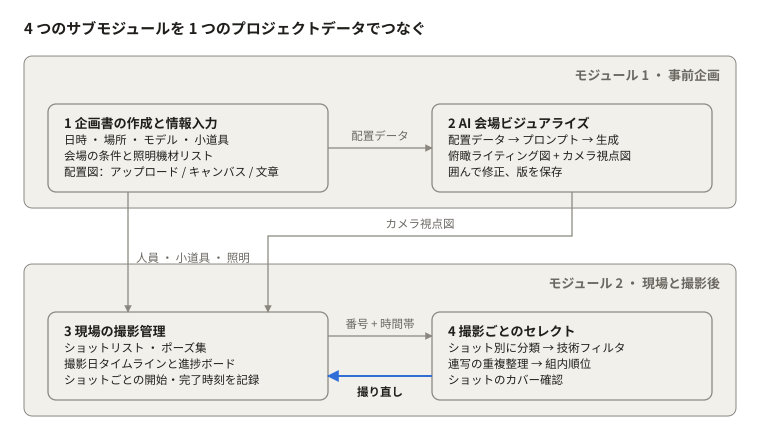
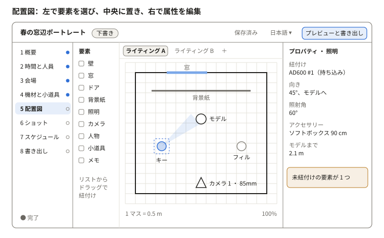
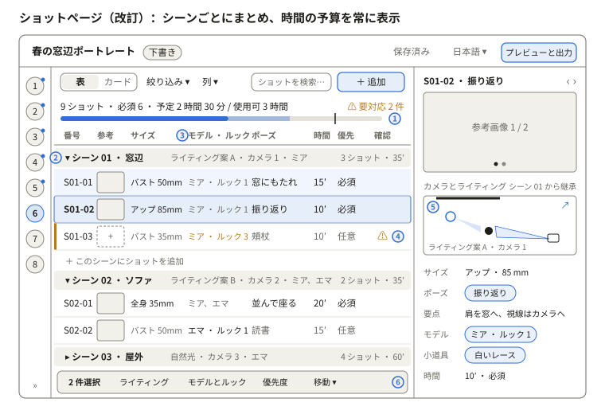

# portrait-guidance 人物撮影プランニング · 企画とモジュール設計

Oct 27, 2026

> **設計書のスナップショット**：Claude 上の 4 言語オンライン設計書から 2026-10-29 に書き出したものです。原本はオンライン版で、ここは図を SVG に変換した読み取り専用のコピーです。ページ番号は設計時の番号で、アプリとの対応は「実装状況」の節を参照してください。アプリの現行版は [README](../../README.md) を参照してください。
>
> 他の言語：[中文](zh.md) · [English](en.md) · [한국어](ko.md)


## 実装状況（0.3.0）

プログラムは 0.3.0 です。S0–S9 の 10 ページと新しい EX 光比ページが使えます。デスクトップの Claude-portrait-guidance フォルダにあり、「启动人像策划指导」をダブルクリックで起動します。ページ順は Grok 案に合わせたため、下の「ページ一覧」と 2 枚のワイヤーフレームは設計時の番号のままです。対応は次の表のとおりです。

| プログラムのページ | 設計時の番号 | 0.3.0 の状態 |
| --- | --- | --- |
| S0 プロジェクト一覧 | S0 | 使用可。JSON 読み込み（Grok 旧形式を含む） |
| S1 基本情報 | S1 + S2 を統合 | 使用可。タイムゾーンを追加 |
| S2 会場と機材 | S3 + S4 を統合 | 使用可。機材サイズ集、吸光板 |
| S3 モデルと参考画像 | S2 人員 + S1 ムードボード | 使用可。ムードボードの出典リンク |
| S4 ポーズ集 | S7 | 使用可 |
| S5 ショットリスト | S6（ワイヤーフレーム「S6 ショットページ」） | 使用可。改訂後の設計で実装 |
| S6 配置図 | S5（ワイヤーフレーム「S5 配置図ページ」） | 使用可。カメラ位置の 20 mm 3D プレビューと測光値を追加 |
| S7 タイムライン | S8 | 使用可 |
| S8 進行ボード | 保留から今期へ | 使用可。状態と時刻のみ。Photo-cull 用のショット時間窓を書き出せる |
| S9 プレビューと出力 | S9 | 使用可。ライティング表に測光値とメイン比 |
| EX 光比 | 新規 | 使用可（下記） |

**EX 光比**：S6 配置図と同じ配置を使うため、どちらでライトを動かしても修飾器を替えても、もう一方に反映されます。右側では、カタログ値（ガイドナンバーまたは 1 m 照度）、出力設定、被写体までの距離、修飾器ロスの目安から各ライトの絞り値か照度を推定し、現場の測光値と比べて、メインライトと各ライトの光比を出します。被写体が照射角の外にあるときと、実測と推定の差が 1 EV を超えるときに知らせます。企画の完成度には含めません。

**機材カタログ**：Godox、Broncolor、Aputure / amaran の光学データ 98 件（参考値）。Profoto は後で追加します。

引き続き保留：AI 関連、現場版、クライアント共有、セレクトと仕上がり比較、セコニック測光データの読み込み（書き出しサンプル待ち）。

## 全体構成

portrait-guidance（人物撮影プランニング）は、事前企画（情報入力 + AI 会場ビジュアライズ）と現場・撮影後（撮影管理 + セレクト）の 2 モジュールです。4 つのサブモジュールは 1 つのプロジェクトデータを共有し、一度入力した内容を後工程でそのまま参照します。



*全体構成 · 2 モジュール、4 サブモジュール*

データは入力からセレクトへ流れます。セレクトで使えるカットのないショットが見つかると、撮影管理に「撮り直し」として書き戻し、ループが閉じます。

## 現在の範囲（2026-10-28 変更）

このツールは「企画書づくり」が主目的です。情報の入力、会場の配置図の作成、ショットとポーズの計画から、撮影日のタイムテーブル作成、完成した企画書の書き出しまでを扱います。この段階では機能仕様と GUI の定義だけを書き、プログラムの作成とテストは行いません。

| 内容 | 状態 |
| --- | --- |
| サブモジュール 1 企画書の作成と情報入力 | この段階の中心 |
| サブモジュール 2 可視化：俯瞰ライティング図（ベクター） | この段階の中心 |
| サブモジュール 2 可視化：AI イメージ画像 | 入口だけ残し、機能は保留 |
| サブモジュール 3 ショット、ポーズ集、撮影日タイムテーブル | この段階の中心 |
| サブモジュール 3 現場の進捗ボード | 保留 |
| サブモジュール 4 セレクト、Photo-cull 連携、仕上がり比較 | 保留 |
| AI 画像生成の検証、Photo-cull 連携の検証 | 保留 |

「保留」と付いた章は、今後の設計の参考として本書の後半に残します。

**プラットフォームの前提**：Photo-cull と同じく、手元のパソコンで動くプログラム（ローカルサービス + Web 画面、Mac アプリにまとめられる）。デスクトップ優先で最小ウィンドウ幅は 1280 px、「現場版」ページはタブレットで閲覧できる。この点は確認待ち。

## 機能仕様（企画書）

企画書の機能は全 38 項目です。P0 は第 1 版に必須（28 項目）、P1 は第 1 版のあと早めに追加（5 項目）、P2 は AI や未確認事項次第（5 項目）。優先度は表の中で直接変更できます。

### A · プロジェクト

| 番号 | 機能 | 説明とルール | 優先度 |
| --- | --- | --- | --- |
| F01 | プロジェクト一覧 | 新規、複製、アーカイブ、検索。カードに表紙（ムードボードの先頭画像）、撮影日、状態、充足度を表示 | P0 |
| F02 | 企画の状態 | 下書き / 確認待ち / 確定。確定後に編集するには「確定を解除」が必要で、その時点の版を自動保存 | P0 |
| F03 | テンプレート | プロジェクトをテンプレートとして保存（会場、機材、よく使うショットとポーズ）し、新規作成時に選べる | P1 |
| F04 | 自動保存と版管理 | 変更のたびに自動保存。「版を保存」でメモ付きの版を残し、閲覧・復元できる | P0 |

### B · 概要とムードボード

| 番号 | 機能 | 説明とルール | 優先度 |
| --- | --- | --- | --- |
| F05 | 基本情報 | プロジェクト名、テーマの説明、スタイルキーワード（タグ、複数可）、顧客と用途（任意） | P0 |
| F06 | ムードボード | 画像をドラッグで追加、グリッドまたは自由配置。画像ごとにメモとタグ。ワンクリックでショットの参考画像にできる | P0 |
| F07 | AI による説明の下書き | キーワードとムードボードからテーマ説明の下書きを作る。人が確認してから反映 | P2 |

### C · 時間と人員

| 番号 | 機能 | 説明とルール | 優先度 |
| --- | --- | --- | --- |
| F08 | 撮影時間 | 日付、開始 / 終了、会場の利用可能時間、メイクと設営の準備時間。各自の入り時刻を自動計算 | P0 |
| F09 | 人員 | モデル（身長、サイズ、ルック数、撮影可能時間）とスタッフ（役割、連絡先）。ルック数から「ルック」項目を自動生成し、ショットから参照 | P0 |

### D · 会場

| 番号 | 機能 | 説明とルール | 優先度 |
| --- | --- | --- | --- |
| F10 | 会場ライブラリ | 会場を単独で保存し、複数のプロジェクトで使い回す：住所、担当者、広さ、屋内外、写真、条件（窓と向き、自然光の時間帯、壁と床の素材・色、電源、使用可能エリアと立入禁止エリア） | P0 |
| F11 | 会場の備品機材 | 会場が用意する機材を種類別（照明、アクセサリー、スタンド、背景、レフ、その他）に型番と数量で登録。会場と一緒に保存し、次回も使える | P0 |

### E · 機材と小道具

| 番号 | 機能 | 説明とルール | 優先度 |
| --- | --- | --- | --- |
| F12 | 機材リスト | 会場の備品と持ち込み機材をまとめ、出どころを表示。「配置図で使用 / 総数」を示し、1 つのライティングで数量を超えたら警告 | P0 |
| F13 | 小道具リスト | 名称、数量、サイズ、入手先、担当者、準備状況（準備中 / そろった） | P0 |
| F14 | 持ち物リスト | 持ち込み機材と自前の小道具から、チェックでき印刷できるリストを作る | P1 |

### F · 会場の配置図（中心機能）

| 番号 | 機能 | 説明とルール | 優先度 |
| --- | --- | --- | --- |
| F15 | キャンバス | 会場の広さから縮尺どおりのグリッドを作る（既定 1 マス = 0.5 m）。要素：壁、窓、ドア、柱、背景紙、照明（向き、照射角、アクセサリー、出力段階）、カメラ位置（焦点距離と画角）、人物、小道具、文字メモ | P0 |
| F16 | 要素の紐付け | 照明・小道具・人物はリストからドラッグするとその項目に紐付く。紐付いていない要素は黄色で表示 | P0 |
| F17 | 下絵 | 平面図や写真を下絵として読み込み、2 点で縮尺を合わせる。透明度の調整とロックが可能 | P0 |
| F18 | ライティング案 | 1 つの会場に複数のライティング案を保存し、ショットはその 1 つを参照。複製と並べての比較ができる | P0 |
| F19 | 距離表示と補助 | 照明—人物、人物—背景、カメラ—人物の距離を表示。整列、グリッドへの吸着、回転 | P1 |
| F20 | ライティング図の書き出し | PNG / PDF。凡例と距離付き | P0 |
| F21 | 文章から配置 | 文章の説明から要素の下書きを作る。キャンバスで確認してから反映 | P2 |
| F22 | AI イメージ画像 | ライティング案 + カメラ位置からイメージ画像を作る。この段階では入口のみ | P2 |

### G · ショットとポーズ

| 番号 | 機能 | 説明とルール | 優先度 |
| --- | --- | --- | --- |
| F23 | ショットリスト | 項目はサブモジュール 3 と同じ（「状態」は現場の進捗ボードに属し、保留）。シーンごとにまとめ、シーンに既定のライティング案・カメラ・モデルとルックを持たせ、ショットには違うところだけ入力。表とカードの表示切り替え、ドラッグで並べ替え、番号は「シーン-連番」で自動採番 | P0 |
| F24 | 参照項目 | シーンとカメラ位置、ライティング案、モデル、ルック、小道具、ポーズはすべて既存の項目から選ぶ（タグ形式）。参照されている項目を削除する前に影響するショットを表示 | P0 |
| F25 | 参考画像 | 1 ショットに複数：ムードボード、アップロード、ライティング図の切り抜きから | P0 |
| F26 | ポーズ集 | 項目：名前、図解、要点（重心、手の位置、目線）、向いているサイズ、人数、タグ。絞り込み可。ショットから直接新規作成できる | P0 |
| F27 | 一括編集 | 複数のショットを選んでライティング案・モデル・優先度をまとめて変更 | P1 |
| F28 | AI によるショット提案 | テーマとムードボードからショットとポーズの組み合わせを下書きし、1 件ずつ採用 | P2 |

### H · 撮影日のタイムテーブル

| 番号 | 機能 | 説明とルール | 優先度 |
| --- | --- | --- | --- |
| F29 | 自動スケジュール | 入り時刻、メイクの準備時間、各ショットの予定時間から組む。同じライティング案・同じルックのショットをまとめ、着替えや照明変更に余裕を入れる（既定 10 分、変更可） | P0 |
| F30 | 手動調整 | 時間バーのドラッグ、ショットの時刻ロック。合計が会場の利用可能時間を超えたら超過分を表示し、削れる「任意」ショットを一覧表示 | P0 |

### I · プレビューと書き出し

| 番号 | 機能 | 説明とルール | 優先度 |
| --- | --- | --- | --- |
| F31 | 企画書のプレビュー | 書き出しの版面で全章をプレビューし、含める章を選べる | P0 |
| F32 | PDF 書き出し | 表紙、概要とムードボード、タイムテーブル、人員、機材と小道具、ライティング図、ショットリスト（参考画像付き）。選んだ言語で出力 | P0 |
| F33 | 現場版 | タブレット向けの閲覧専用ページ：タイムテーブル + ショットカード（大きな参考画像、ポーズの要点）。オフラインで開ける | P1 |
| F34 | 共有と顧客の確認 | 閲覧専用リンクまたは書き出しパッケージ。顧客がコメントして承認できる。「顧客向けかどうか」次第 | P2 |

### J · 共通

| 番号 | 機能 | 説明とルール | 優先度 |
| --- | --- | --- | --- |
| F35 | 4 言語の UI | 中国語、英語、日本語、韓国語。文字はすべて言語パックに。書き出しも選んだ言語で | P0 |
| F36 | 元に戻す / やり直し | キャンバスと表の両方で、50 手以上 | P0 |
| F37 | 充足度チェック | 必須項目から各ステップの充足度を計算。書き出し前に不足と矛盾を一覧表示し、クリックで該当箇所へ | P0 |
| F38 | ローカル保存とバックアップ | プロジェクトごとに 1 つのフォルダ（データ + 画像）。丸ごとコピー・バックアップできる。アカウント不要 | P0 |

### 必須項目と整合性チェック（F37 のルール）

| チェック | レベル | 条件 |
| --- | --- | --- |
| プロジェクト名、撮影日、会場 | 必須 | いずれかが空 |
| 会場の広さ | 必須 | 空だと縮尺どおりのキャンバスを作れない |
| ショットのライティング案とモデル | 必須 | 未選択のショットがある |
| 機材の使いすぎ | 警告 | 1 つのライティング案での使用数 > 数量 |
| 紐付いていない要素 | 警告 | キャンバス上の照明や小道具がリストと未関連 |
| ルックとモデルの不一致 | 警告 | ショットのルックがそのモデルのものではない |
| 時間超過 | 警告 | 合計時間が会場の利用可能時間やモデルの撮影可能時間を超える |
| 小道具の準備不足 | お知らせ | 「確定」にした時点で「準備中」の小道具が残っている |

## GUI の定義

画面は 1 つのウィンドウと 4 つの固定領域（トップバー、左のステップナビ、メイン作業領域、右のプロパティパネル）です。左のナビがそのまま企画の流れで、「概要」から「書き出し」まで順に進み、各ステップに充足度を表示します。

### デザインの原則

- Photo-cull と同じ見た目：デザイン変数（tokens.css）とボタン、セグメントコントロール、ステップバーなどの部品を共有。画像とキャンバスの周りは中性グレーのみ。
- 流れが見える：左ナビがステップで、丸印で充足度を示し、書き出し前に不足を一覧表示。
- 再入力ではなく参照：ページをまたぐデータはすべてタグ（チップ）で表示し、クリックで元の項目へ。1 か所直せば全体に反映。
- 段階的な開示：各ページはよく使う項目だけを出し、それ以外は「その他」にたたむ。
- 4 言語を同じように扱う：文字を固定幅に入れず、最も長い英語で設計。日本語は `line-break: strict`、韓国語のフォントに Apple SD Gothic Neo と Malgun Gothic を追加。
- 主な操作はキーボードで完結。ローカル・オフラインで、フォントとアイコンはプログラムに同梱。

### ウィンドウの構成

| 領域 | サイズ | 内容 |
| --- | --- | --- |
| トップバー | 高さ 56 px | プロジェクト名、企画の状態バッジ（下書き / 確認待ち / 確定）、保存状態、言語切り替え、「プレビューと書き出し」ボタン |
| 左のステップナビ | 幅 220 px、64 px のアイコン列にたためる | 8 ステップ + 充足度の丸印。最上部に「プロジェクト一覧へ」 |
| メイン作業領域 | 可変 | 現在のステップの内容 |
| 右のプロパティパネル | 幅 320 px、たためる | 選択中の対象の詳細、ヒント、矛盾 |

最小ウィンドウは 1280 × 800。幅が 1440 px 未満のときは右パネルをたたんだ状態で始め、ドロワーとして引き出す。

### ページ一覧

| 番号 | ページ | 対応機能 | メイン領域 | 右パネル |
| --- | --- | --- | --- | --- |
| S0 | プロジェクト一覧 | F01–F03 | プロジェクトのカード一覧、検索、状態で絞り込み、「新規 / テンプレートから新規」 | なし |
| S1 | 概要とムードボード | F05–F07 | 上：基本情報フォーム、下：ムードボード（グリッド / 自由配置） | 選択中の画像のメモとタグ |
| S2 | 時間と人員 | F08–F09 | 左：撮影時間と準備時間、入り時刻を自動計算。右：人員カード | 選択中の人の詳細とルック |
| S3 | 会場 | F10–F11 | 会場ライブラリから選ぶか新規作成。会場情報、写真の帯、備品機材の表 | 会場条件のヒント（自然光の時間帯など） |
| S4 | 機材と小道具 | F12–F14 | 「機材 / 小道具 / 持ち物リスト」の 3 タブ。いずれも編集できる表 | 項目の詳細、どのライティング案とショットで使われているか |
| S5 | 配置図 | F15–F22 | 左：要素パネル、中央：キャンバスとライティング案のタブ、下：縮尺とズーム | 選択中の要素の属性、距離、未紐付けの警告 |
| S6 | ショット | F23–F28 | シーンごとにまとめた表 / カード、時間の予算バー、絞り込みと列の設定、一括操作バー | 1 ショットの詳細：参考画像、カメラとライティングのサムネイル、項目、確認結果 |
| S7 | ポーズ集 | F26 | ポーズの一覧 + タグで絞り込み。S6 からダイアログでも開ける | ポーズの詳細と使用履歴 |
| S8 | スケジュール | F29–F30 | ガント風のタイムライン：ショットごとに 1 本、ライティング案で色分け。ドラッグとロックが可能 | 超過と矛盾の一覧、削れる「任意」ショット |
| S9 | プレビューと書き出し | F31–F34 | 左：章の選択、中央：ページ単位のプレビュー | 書き出し言語、用紙、参考画像を含めるか |

### 主要ページのワイヤーフレーム



*S5 配置図ページのワイヤーフレーム（サンプルデータ）*

配置図はこのツールの中心となるページです。要素を左からキャンバスへドラッグし、機材リストから入れた照明は自動でその項目に紐付きます。上のタブで同じ会場のライティング案を切り替えます。



*S6 ショットページのワイヤーフレーム（改訂、サンプルデータ）*

改訂後のショットページは、ショットをシーンごとにまとめます。シーンの見出し行で、そのグループが共通で使うライティング案、カメラ位置、モデルとルックを決め、各ショットには違うところだけを入力します。ページ上部には時間の予算を常に表示します。右の詳細には配置図のサムネイルが加わり、そのショットをどこで撮り、どう光を当てるかが分かります。

### S6 ショットページの詳細設計

**前の版から変えた点**

| 前の版の問題 | 変更 |
| --- | --- |
| ショットごとに同じライティング案・モデル・ルックを選び直す | シーンをグループにして既定値を持たせ、ショットはそれを引き継ぐ。変えた値は濃い文字で表示 |
| 合計時間が会場の利用時間を超えるか、S8 を開かないと分からない | ページ上部に時間の予算バーを常に表示 |
| 未入力や矛盾が書き出しの直前まで見えない | 各行に「確認」列、上部に「要対応」の件数。クリックで該当箇所へ |
| 表にカメラ位置と小道具がなく、参考画像が小さい | カメラ位置はシーン行に表示。小道具は詳細に置き、「列」からも追加できる。サムネイルを大きくし、参考画像がないときは破線の枠 |
| 詳細が項目の並べただけで、配置図とつながっていない | 詳細に配置図のサムネイルを追加。このショットのカメラと使うライトを強調し、クリックで S5 へ |
| 左ナビが 220 px を使い、表の列が収まらない | ショットページではナビを 64 px のアイコンバーにたたんで開く |

**図の番号**

| 番号 | 部分 | ルール |
| --- | --- | --- |
| ① | 時間の予算 | 濃い部分 = 必須、薄い部分 = 任意、縦線 = 使える時間（会場の利用時間とモデルの撮影可能時間の短い方）。合計には着替えとライト変更の余裕（F29、既定 10 分）を含む。超えたときは「x 分超過、削れる任意ショット n 件」と表示 |
| ② | シーンの見出し行 | シーン名、既定のライティング案 · カメラ · モデルとルック、ショット数と小計。▾ でたたむ。既定値をクリックして直接変更でき、変えていないショットもそれに従う |
| ③ | 引き継ぎと上書き | 灰色 = シーンから引き継いだ値、濃い文字 = このショットで変えた値。上書きしたセルにカーソルを当てると「シーンの既定に戻す」 |
| ④ | 確認 | F37 のルールで行ごとにチェック。必須項目の未入力は赤、ルックとモデルの不一致・機材の使いすぎ・参考画像なしは黄。カーソルで理由を表示、クリックで詳細を開いてその項目へ |
| ⑤ | カメラとライティングのサムネイル | そのショットのライティング案の配置図で、このショットのカメラの扇形と使うライトだけを強調。↗ で同じ案を S5 で開く |
| ⑥ | 一括操作バー | 複数行を選ぶと表示：ライティング案、モデルとルック、優先度の変更、別のシーンへの移動 |

**表の列**

既定は 8 列：番号、参考、サイズ（焦点距離を含む）、モデル · ルック、ポーズ、時間、優先、確認。「列 ▾」から小道具、カメラ、ライティング案、メモを追加できる。列の表示と順序はプロジェクトごとに保存。番号はシーンと並び順で自動的に振り直し、ロックした番号は変えない。

**カード表示**

カードごとに大きな参考画像（4:3）、番号とポーズ、サイズ · 焦点距離、モデルのタグ、時間と優先度、確認アイコン。シーンごとに区切り、1 行 3–4 枚。モデルやクライアントと企画を確認するときに使い、「現場版」（F33）のショットカードもこの見た目に合わせる。

**詳細ドロワー**

上から順に：参考画像（左右で切り替え、ムードボードからドラッグまたはアップロード）→ カメラとライティングのサムネイル → サイズ · 焦点距離 → ポーズ（タグ。開くとポーズ集の項目を表示）と要点 → モデル · ルック → 小道具 → 時間と優先度 → メモ。どの項目もその場で編集できる。‹ › または ↑↓ で前後のショットへ。

**ポーズの選び方**

ポーズのセルをクリックするか ⌘K でポーズ集の選択画面を開く。上に検索とタグの絞り込み（サイズ、人数、雰囲気）、下に示意図の一覧。見つからなければ「新しいポーズ」でその場で登録できる（F26）。

**ページの状態**

| 状態 | 表示 |
| --- | --- |
| シーンがまだない | 説明 1 行と「新しいシーン」ボタン。S5 にライティング案があれば「ライティング案からシーンを作る」を提示 |
| シーンにショットがない | 見出し行の下に「＋ このシーンにショットを追加」だけを表示 |
| 警告あり | 行の左に黄色の縦線、上部の件数が増える |
| 時間超過 | 予算バーが警告色になり、任意ショットに「削減候補」 |
| 絞り込み中 | ツールバーに使っている条件を表示し、ワンクリックで解除。時間の予算は全ショットで計算 |

**キーボード**

⌘N 新規ショット（今のショットの後ろに挿入）、⌘⇧N 新しいシーン、⌘D 複製、⌘K ポーズ集、Enter で詳細、↑↓ で切り替え、⌥↑↓ で移動、Delete で削除（確認あり）。

### 操作のルール

| 場面 | ルール |
| --- | --- |
| 保存 | 変更の約 1 秒後に自動保存。トップバーに「保存中 / 保存済み」。⌘S でメモ付きの版を保存 |
| 元に戻す | ⌘Z で戻す、⇧⌘Z でやり直し。キャンバスと表で共通 |
| 参照タグ | クリックで元の項目へ。ホバーで要約。元の項目が削除されると赤い取り消し線 |
| ドラッグ | リスト → キャンバス（紐付け）、ムードボード → ショットの参考画像、ショットの行で並べ替え、時間バーで時刻を変更 |
| キャンバス | スペース + ドラッグで移動、ホイールでズーム、R で 15° 回転、矢印キーで微調整、Shift + 矢印で大きく、Delete で削除 |
| ショット | ⌘N 新規、⌘⇧N 新しいシーン、⌘D 複製、⌘K ポーズ集を開く、Enter で詳細ドロワー、⌥↑↓ でショットを移動 |
| 充足度 | ナビの丸印：白抜き = 未着手、半分 = 不足あり、塗り = 完了。書き出し前に不足と矛盾を一覧表示し、クリックで該当箇所へ |
| 空の状態 | 各ページに「次に何をするか」の 1 文 + ボタン。例：配置図で会場の広さが空なら「先に会場の広さを入力」 |
| 危険な操作 | 参照されている項目を削除する前に影響するショットを表示。「確定を解除」は確認付き |
| 言語 | ボタンとラベルは文字に合わせて幅が変わる。日付と数字は言語ごとの形式。言語を切り替えても現在のページと選択はそのまま |

### デザインが必要な部品と状態

部品：ステップナビの項目、企画の状態バッジ、参照タグ、編集できる表、カード、プロパティパネルのグループ、キャンバスのツールバーと要素、ライティング案のタブ、時間バー、一括操作バー、空の状態、確認ダイアログ。

部品ごとに描く状態：通常、ホバー、選択中、無効、警告、エラー。ページごと：空、読み込み中、通常、警告あり。

次の一手：ワイヤーフレームが固まったら、S0–S9 を高精度の画面（ライト / ダーク × 4 言語）に描けます。

## 1 · 企画書の作成と情報入力

撮影前の情報をすべて構造化データとして記録します。他の 3 つのサブモジュールはここから読み取るので、二重入力はありません。

### 入力フォーム

| 区分 | 項目 | 用途 |
| --- | --- | --- |
| 基本情報 | プロジェクト名、テーマ、スタイルキーワード、ムードボード画像 | スタイルキーワードは AI プロンプトにそのまま使う |
| 日時 | 撮影日、開始・終了、会場の利用可能時間、メイクと設営の準備時間 | 撮影日のタイムラインを作る |
| 場所 | 名称、住所、担当者、屋内 / 屋外、広さ（奥行 × 幅 × 天井高） | 広さで配置図の縮尺を決める |
| 会場の条件 | 窓の位置と向き、自然光の時間帯、壁と床の素材・色、電源の位置と容量、使用可能エリアと立入禁止エリア | ライティングと AI 画像に影響 |
| 会場の備品機材 | 照明の型番、種類、出力、台数；アクセサリー（ソフトボックス、ビューティーディッシュ、グリッド）；スタンド、背景紙 / 布、レフ板 | 持ち込み機材と合わせて 1 つのリストにし、出どころを表示 |
| 持ち込み機材 | ボディ、レンズ、照明、トリガー | 同上 |
| 小道具 | 名称、数量、サイズ、入手先（自前 / レンタル / 会場）、担当者 | 小道具リストを作り、ショットから参照 |
| 人員 | モデル人数；モデルごとの名前、身長、服のサイズ、ルック数；メイク、アシスタント | ショットを人ごとに割り当てる |
| 衣装とメイク | ルック数、対応するシーン | 着替え回数を減らすように割り付ける |

### 配置図の入力

3 つの方法は組み合わせて使え、最終的に同じ「配置データ」（要素リスト + 座標 + 向き + 対応する機材・小道具）になります。このデータがサブモジュール 2 の入力です。

1. アップロード：会場の平面図や現場写真を読み込み、縮尺を指定。
2. キャンバス：実寸のグリッド上に、壁・窓・ドア・背景・照明（向きと照射角付き）・カメラ位置・モデルの立ち位置・小道具をドラッグで配置。各要素はフォームの項目に紐付く。
3. 文章：配置を自由に記述すると AI が要素の下書きに変換し、キャンバス上で修正する。

### 企画書の出力

ワンクリックで企画書を作成し、PDF で書き出せます。内容は概要、スケジュール、人員表、機材・小道具リスト、配置図、ムードボードです。テーマやスタイルの説明は AI が下書きを手伝えます。

## 2 · AI 会場ビジュアライズ

配置データを自動でプロンプトに変換し、撮影前に現場のイメージ画像を作ります。照明の正確な位置はベクターのライティング図に従い、AI 画像は雰囲気と見た目だけを表します。

### 生成の流れ

1. データ整理：配置データから空間の寸法、素材、光源（種類・位置・向き・アクセサリー）、小道具、モデルの立ち位置を読み取る。
2. シーン記述：空間 → 背景と床 → 光源 → 小道具 → 人物 → スタイルキーワードの順で文章を組み立てる。
3. プロンプト編集：視点ごとにテンプレートを用意し、生成前に書き換えられる。
4. 生成：文章だけのときはテキストから画像生成。平面図や会場写真があれば構図の参照（深度、線画などの構造制御）に使い、空間関係を実際に近づける。
5. 複数の視点：
   - 俯瞰ライティング図：キャンバスのデータからベクターで直接描画。AI を使わないので位置が正確。
   - カメラ視点図：あるカメラ位置からモデルを見た画像。AI 生成で、ショットの参考にもなる。
   - 全体の雰囲気図：会場全体の印象。AI 生成。
6. 修正と版管理：画像上で問題箇所を囲み、配置データかプロンプトを直して再生成。各版は対応する配置データの版と一緒に保存する。

### プロンプトテンプレートの例

```
[視点] {カメラ位置} からアイレベル、{焦点距離}
[空間] {奥行}×{幅} m の屋内、{壁の素材と色}、{床}
[背景] {背景紙の色}、モデルから {距離} m
[光源] キーライト {照明の種類}+{ソフトボックス}、モデルの {方向} 45°；フィル …；リム …
[人物] モデル {人数} 名、{立ち位置とポーズ}、{衣装}
[スタイル] {スタイルキーワード}、{色調}
```

### 設計上のポイント

- 生成サービスは差し替え可能なインターフェース（入力：プロンプト + 任意の参照画像 + 視点、出力：画像）にし、特定のベンダーに依存しない。
- 同じ会場の画像はスタイルパラメータと乱数シードを固定し、見た目をそろえる。
- AI 画像にはすべて「イメージ図」と表示し、設営の施工図と混同されないようにする。

## 3 · 現場の撮影管理：ショットとポーズ

ショットリストを中心に、事前データを撮影当日のチェックリストに変え、各ショットの完了状況と時刻をその場で記録します。

### ショットリストの項目

| 項目 | 内容 |
| --- | --- |
| ショット番号 | 自動採番。例：S01-03（シーン 01 の 3 カット目） |
| シーンとカメラ位置 | 配置図のセットエリアとカメラ位置を参照 |
| サイズと焦点距離 | 全身 / バストアップ / アップ；焦点距離 |
| モデル | 人員表から選択、複数可 |
| ルック | 衣装とメイクの番号 |
| ポーズ | ポーズ集から選択、または自由記述 |
| ライティング | 配置図の照明の組み合わせを参照。同じライティングを複数ショットで使える |
| 小道具 | 小道具リストを参照 |
| 参考画像 | ムードボードの画像、またはサブモジュール 2 のカメラ視点図 |
| 予定時間 | 分 |
| 優先度 | 必須 / 任意。時間が足りないときは任意から削る |
| 状態 | 未撮影 / 撮影中 / 完了 / 要撮り直し |
| メモ | 現場の文字、音声、スマートフォンの写真 |

### ポーズ集

- 各ポーズ：名前、図解（簡単な絵または参考写真）、要点（重心、手の位置、目線）、向いているサイズ、人数（1 人 / 2 人 / グループ）、感情・スタイルのタグ。
- タグで絞り込め、過去の撮影から新しい項目を蓄積できる。
- 現場でモデルに全画面で見せられ、口頭での説明を減らせる。

### 撮影日の管理

- タイムライン：日時情報とショットの予定時間から自動で組む——入り、メイク、設営、各シーンの撮影、着替え・設営変更の余裕、撤収。ライティングとルックごとにショットをまとめ、照明変更や着替えを減らす。
- 進捗ボード：状態ごとの列で表示。「完了」を押すと開始と完了の時刻を自動記録（サブモジュール 4 がこの時間帯で写真を分類する）。
- 遅れの通知：タイムラインより遅れたら知らせ、削れる「任意」ショットを一覧表示。
- AI の補助：テーマと会場の画像からショットとポーズの組み合わせを提案。残り時間に合わせて順番を組み直す。
- 利用形態：タブレット優先。電波が弱くても使える（端末に保存し、接続時に同期）。

## 4 · 撮影ごとのセレクト（保留）

このサブモジュールはデスクトップにある Photo-cull（写真ツール 1.7-beta）を呼び出してセレクトを行います。portrait-guidance が加えるのは、Photo-cull にない 4 つだけです：ショット別の分類、カバー確認、撮り直しの書き戻し、仕上がりと企画の比較。

### Photo-cull に既にある機能（ソースで確認）

| 機能 | 仕組み | 既定値 |
| --- | --- | --- |
| ピント外れ / ブレ | 「再ぼかし」指標を最もシャープな領域だけで測るので、背景をぼかしたポートレートを誤判定しない | 0.58 で警告、0.75 で不採用 |
| 露出 | 平均輝度、白飛びと黒つぶれの割合 | 輝度 18 未満または 238 超で不採用 |
| 顔と目つぶり | OpenCV Haar 検出。提示のみで不採用にはしない | — |
| 連写 / 同じシーンの撮り直しのグループ化 | 撮影間隔 + 画像の類似度 | 連写 15 秒、同シーン 60 秒、類似度 0.6 |
| ローカルスコア | シャープネス 60% + 露出 30% + 顔 10%。組内の最高点を本命に | — |
| AI 詳細評価 | 候補を 1024 px に縮小し、構図・光・主題・タイミング・技術の 5 項目（1〜10）と 1〜5 つ星、ジャンル、コメント、改善点を出す。「サービス + モデル + 言語 + 画像」ごとにキャッシュ | Claude、ChatGPT、Grok、Gemini、DeepSeek、または OpenAI 互換の任意のエンドポイント |
| レーティングの書き込み | XMP の星とカラーラベル。RAW はサイドカー、JPEG は埋め込み。Lightroom Classic と Capture One で読める | セレクト 4〜5★ 緑、使える 3★ 黄、連写の候補は最大 2★、不採用はリジェクト + 赤 |
| その他 | RAW + JPEG のペアリング、削除はゴミ箱へ、整理出力とリネーム、HTML レポートと results.csv、中・英・日の 3 言語 UI | — |

### セレクトの流れ

1. Photo-cull を実行：撮影フォルダに対してコマンドライン（cull.py）または GUI で実行し、結果はフォルダ内の photo-cull-report/ に保存される。
2. ショット別に分類：Photo-cull が読み取った撮影時刻を、サブモジュール 3 の各ショットの「開始〜完了」時間帯と照合して番号を付ける。合わないものは「未分類」へ。
3. 目視確認：Photo-cull のレポートで星付け、リジェクト、削除をいつもどおり行う。
4. カバー確認：ショットごとに 3★ 以上の枚数を数え、0 枚なら赤表示してサブモジュール 3 を「要撮り直し」にする。
5. 仕上がり比較：後述の「仕上がりと企画の比較」を参照。
6. 書き出し：星とラベルは Photo-cull が XMP に書き込み済み。portrait-guidance はショット順の一覧を別に出す。

### portrait-guidance が写真ごとに追加する項目

Photo-cull の項目はそのまま残し、次の 4 つだけを追加します。

| 項目 | 内容 |
| --- | --- |
| ショット番号 | 時間帯で自動分類、または手動で指定 |
| 分類方法 | 自動 / 手動 |
| カバーに数えるか | 3★ 以上かつ未削除ならそのショットに数える |
| 比較の結論 | 一致 / ずれあり / 意図的な変更。説明付き |

## データモデル、段階的な開発、未確認事項

すべてのモジュールで 1 つのプロジェクトデータベースを共有し、各エンティティは一度だけ入力して他のモジュールから参照します。

### 主なエンティティ

| エンティティ | 主な内容 | 使うモジュール |
| --- | --- | --- |
| プロジェクト | テーマ、日時、スタイルキーワード、状態 | すべて |
| 会場 | 広さ、条件、担当者 | 1、2 |
| 機材 | 型番、種類、数量、出どころ（会場 / 持ち込み） | 1、2、3 |
| 小道具 | 名称、数量、入手先、担当者 | 1、3 |
| 人員 | モデルとスタッフ | 1、3 |
| 配置 | 要素リスト、座標、向き、版番号 | 2、3 |
| イメージ画像 | 視点、プロンプト、画像、対応する配置の版 | 2、3 |
| ショット | サブモジュール 3 の項目を参照 | 3、4 |
| ポーズ | ポーズ集の項目 | 3 |
| 撮影記録 | ショットごとの実際の開始・完了時刻、メモ | 3、4 |
| 写真 | ファイル、EXIF、ショット番号、セレクトの記録 | 4 |

### 開発の進め方（案）

1. 第 1 期：サブモジュール 1 の情報入力と企画書出力 + サブモジュール 3 のショットリストと進捗ボード。AI に依存せず、まずデータの骨格を通す。
2. 第 2 期：サブモジュール 4 のセレクト。Photo-cull を再利用し、時間帯による分類とカバー確認を加える。
3. 第 3 期：サブモジュール 2 の AI 会場ビジュアライズと、AI によるショット・ポーズの提案。品質はそれまでに入力したデータの充実度で決まる。

### 未確認事項

- 利用形態：Web、デスクトップアプリ、タブレットアプリのどれか。撮影当日にフォトグラファー、アシスタント、メイクが同時に見る必要はあるか。
- 複数カメラで撮る場合、各ボディの時計をどう合わせるか（ショット分類に影響）。
- 画像生成サービスの好み：クラウドか、自前で動かすか。
- 顧客向けに使うか：企画書を顧客に確認してもらう、セレクトを顧客に選んでもらう、など。

## AI 画像生成の実現性検証（保留）

サブモジュール 2 を開発する前に、約 135 枚、約 $7 で比較検証を 1 回行います。基準を満たせば開発し、満たさなければ「ベクターのライティング図 + 参考画像ライブラリ」に切り替えます。

### 答えるべき 4 つの問い

1. 空間の配置を制御できるか：照明、背景、モデルの立ち位置が配置データどおりになるか。
2. 光が自然か：キーライトの方向、硬さ、明暗比が照明の配置と一致するか。
3. 視点間で一貫しているか：全体図とカメラ視点図が同じ場所に見えるか。
4. コストと待ち時間は許容範囲か：使える 1 枚を得るのに平均何回生成し、どれくらいかかるか。

### 候補の方式

| 方式 | やり方 | 候補モデル | 参考価格 |
| --- | --- | --- | --- |
| A テキストのみ | テンプレートのプロンプトだけ | Gemini Nano Banana 2.1 | $0.0336 / 枚（1K） |
| B 写真の編集 | 会場の写真を土台に、プロンプトで照明・背景・人物を足す | Nano Banana 2.1 編集；GPT Image 2.5 Sunburst 編集 | 同上；GPT Image 2.5 は出力 $30 / 100 万 token |
| C 構造制御 | 平面図や写真を深度 / 線画に変換し、構図の制約にする | FLUX.1 \[dev\] + ControlNet（fal） | $0.075 / メガピクセル |

### テストサンプルと採点

- サンプル：実在の会場 3 か所（小さなスタジオ、窓のある室内、屋外）。それぞれに現場写真を用意して対照する。
- 会場 × 方式 × 3 視点（全体、カメラ 1、カメラ 2）× 各 5 回生成 = 135 枚。
- 各画像を採点：配置の一致（1〜5）、光の方向が正しいか（はい / いいえ）、視点間の一貫性（1〜5）、使えるか、生成時間。

### 合格基準（案）

| 指標 | しきい値 |
| --- | --- |
| 使用可能率（使える枚数 ÷ 生成枚数） | 50% 以上。平均 2 回以内で 1 枚得られる |
| 配置一致の平均点 | 4 以上 |
| 光の方向の正解率 | 70% 以上 |
| 1 シーン（3 視点）のコスト | $1 以下 |

### 検証予算

方式 A：45 枚 × $0.0336 ≈ $1.51、方式 B：約 $1.6（別途少し画像入力費）、方式 C：45 枚 × $0.075 ≈ $3.38。合計約 $7。

モデルの入れ替わりは速く、OpenAI は gpt-image-1 を 2026-10-23 に終了し、gpt-image-1.5 も 2026-12-01 に終了予定です。検証結果にはモデルの版を記録し、生成サービスは差し替え可能にしておきます。

## 全モジュールのコスト確認リスト

従量課金の AI 呼び出しはサブモジュール 2 に集中し、他のモジュールはローカル処理で無料か、呼び出し回数がごく少ないものです。項目ごとに確認し、右端の列を更新してください。価格は 2026-10 時点の米ドル定価です。

| モジュール | コスト項目 | 課金方式 | 参考単価（USD） | 確認 |
| --- | --- | --- | --- | --- |
| 1 | AI による企画書の下書き、文章の会場記述の解析 | token 単位 | Gemini 3.5 Flash-Lite：入力 $0.30、出力 $2.50 / 100 万 token | 未確認 |
| 1 | 企画書 PDF の書き出し | ローカル生成 | $0 | 未確認 |
| 2 | カメラ視点図、全体の雰囲気図（方式 A/B） | 枚数単位 | Nano Banana 2.1：1K $0.0336、2K $0.0504 | 未確認 |
| 2 | 構造制御による生成（方式 C） | メガピクセル単位、切り上げ | FLUX.1 \[dev\] + ControlNet：$0.075 / MP | 未確認 |
| 2 | 高品質の代替 | 枚数単位 | Nano Banana Pro：1K/2K $0.134 | 未確認 |
| 2 | 俯瞰ライティング図 | ローカルでベクター描画 | $0 | 未確認 |
| 2 | 画像生成の実現性検証 | 初回のみ | 約 $7 | 未確認 |
| 3 | AI によるショット・ポーズの提案 | token 単位 | モジュール 1 と同じ | 未確認 |
| 4 | ピント・目つぶり・露出の検出、連写の重複整理 | ローカル（Photo-cull） | $0（手元のパソコンを使用） | 未確認 |
| 4 | クラウドの AI 詳細評価（任意） | token 単位 | Flash-Lite 画像入力 $0.30 / 100 万 token | 未確認 |
| 共通 | プレビューと生成画像の保存 | GB・月単位 | Cloudflare R2：$0.015 / GB・月、最初の 10 GB 無料、転送無料 | 未確認 |
| 共通 | アプリのホスティングとデータベース | 月額 | 技術選定後に見積もり | 未確認 |
| 共通 | 開発工数 | 初回のみ | このリストには含めない | 未確認 |

RAW の元データは手元のパソコンに残し、圧縮したプレビューだけをアップロードします。これが保存コストを低く保つ前提です。

## 運用コストの見積もり（各社の token 単価）

月 8 回の撮影で、エコノミー構成は約 $8 / 月、高品質構成は約 $54 / 月です。差は画像生成モデルと Photo-cull の AI 詳細評価に選ぶモデルから生まれます。単価は 2026-10 時点の各社公式の標準料金（バッチ以外）で、米ドル表示です。

### 1 回の撮影あたりの token 使用量の想定

| 用途 | 入力 token | 出力 token | 説明 |
| --- | --- | --- | --- |
| サブモジュール 1 の下書き・解析 + サブモジュール 3 のショット提案 | 2 万 | 1.2 万 | テキスト呼び出し 5 回 |
| サブモジュール 4 の AI 詳細評価（Photo-cull が呼び出す、任意） | 90 万 | 15〜48 万 | 候補 600 枚。Photo-cull 自身の見積もりでは 1 枚あたり入力約 1,500 token、出力は Claude / Gemini 約 250、OpenAI 約 800 token |
| サブモジュール 2 の画像生成 | — | 24 枚 | 必要な 6 枚 × 平均 4 回生成 |

Photo-cull は詳細評価の前に枚数と予想使用量を表示し、確認後に呼び出します。評価済みの写真はキャッシュされ、再課金されません。実際の使用量は API が返す usage が基準です。第 2 期で仕上がり比較を同じ評価呼び出しに統合した後は、別の費用はかかりません。

### テキスト・画像理解モデル：1 回の撮影あたりのコスト

| ベンダー | モデル | 入力 / 出力（100 万 token あたり） | 1 回あたり |
| --- | --- | --- | --- |
| Anthropic | Claude Haiku 5.5 | $0.10 / $0.50（1 回のプロンプト ≤ 10 万 token） | $0.17 |
| OpenAI | gpt-6-luna | $0.10 / $0.50 | $0.34 |
| Google | Gemini 3.5 Flash-Lite | $0.30 / $2.50 | $0.68 |
| Google | Gemini 3.8 Flash（Photo-cull の Gemini 既定） | $0.75 / $3.75 | $1.30 |
| OpenAI | gpt-6.1-terra | $1.00 / $5.00 | $3.38 |
| Anthropic | Claude Sonnet 5.5（Photo-cull の Claude 既定） | $2.00 / $10.00 | $3.46 |

AI 詳細評価を使わなければ、残るのはサブモジュール 1、3 のテキスト呼び出しだけで、1 回 $0.17 未満です。

### 画像生成モデル：1 回の撮影あたりのコスト（24 枚）

| ベンダー | モデル | 課金 | 1 枚 | 1 回あたり |
| --- | --- | --- | --- | --- |
| Google | Nano Banana 2.1 | 画像出力 $30 / 100 万 token、1K 画像 1,120 token | $0.0336 | $0.82 |
| Google | Nano Banana Pro | 画像出力 $120 / 100 万 token | $0.134 | $3.23 |
| OpenAI | gpt-image-2.5-flare / sunburst | 画像出力 $30 / 100 万 token。1 枚の token 数は品質によって変わる | 約 $0.03〜0.15（1,000〜5,000 token で試算） | 約 $0.72〜3.60 |
| fal | FLUX.1 \[dev\] + ControlNet | メガピクセル単位（token ではない） | $0.075 | $1.80 |
| Anthropic | — | 画像生成は提供されていない | — | — |

### 構成例：1 回あたりと月あたりのコスト

| 構成 | テキスト / 画像理解 | 画像生成 | 1 回 | 月（8 回） |
| --- | --- | --- | --- | --- |
| エコノミー | Claude Haiku 5.5 | Nano Banana 2.1 | $0.99 | $7.95 |
| バランス | Gemini 3.5 Flash-Lite | Nano Banana 2.1 | $1.50 | $12.00 |
| 構造制御 | Gemini 3.5 Flash-Lite | FLUX + ControlNet | $2.48 | $19.85 |
| 高品質 | Claude Sonnet 5.5 | Nano Banana Pro | $6.69 | $53.50 |

このほか保存費用が、最初の 1 年で約 $0〜0.93 / 月（R2、最初の 10 GB 無料）かかります。価格には期限があり、Gemini 3.8 Flash の現行価格は 2026-12-31 までで、2027-01-01 から 2 倍になります。

## Photo-cull との連携（保留）

結論：同期はせず、再利用だけにします。Photo-cull の中核はすでに UI と分かれており、結果はデータファイルとして保存されます。portrait-guidance はコマンドラインを呼び、結果を読むだけで済みます。第 1 期は Photo-cull を変更せず、第 2 期で任意のパラメータを 1 つ追加するだけです。

### Photo-cull の現状（フォルダから読み取り）

- バージョン 1.7-beta。MIT ライセンスのオープンソースで、手元で動く Python プログラム。
- cull.py がセレクトの中核とコマンドライン、gui.py は自分のパソコン内（127.0.0.1）だけで動く Web サービス。画面は web/ にあり、Mac アプリにまとめられる。別に写真編集の editor.py がある。
- 結果は写真フォルダの photo-cull-report/ に保存：結果データ、results.csv、report.html、ai\_cache.json。
- 問題フラグとジャンルはコードで保存（blur、soft、under、eyes…；portrait、street…）。UI の言語に依存せず、プログラムから読みやすい。
- UI の言語は簡体字中国語、英語、日本語。韓国語はまだない。

### 3 つの方法の比較

| 方法 | やり方 | 利点 | 代償 |
| --- | --- | --- | --- |
| A 完全連携 | 2 つのアプリでショット・写真・セレクト結果をリアルタイムに双方向同期 | どちらの画面でもすべての情報が見える | Photo-cull は企画データを持たないので同期層が必要。不整合の原因を追いにくい |
| B コマンドラインを呼び、結果を読む（推奨） | portrait-guidance が cull.py を実行し、photo-cull-report/ を読んで時刻でショットに対応づける | 第 1 期は Photo-cull を変更しない。確認、XMP 書き込み、整理出力をそのまま使える | ショット分類は撮影時刻に依存。複数カメラでは先に時計を合わせる |
| C 統合 | Photo-cull を portrait-guidance に取り込む | コードが 1 つになる | Photo-cull は写真編集や企画なしの日常のセレクトにも使われ、どちらも重くなる |

### 2 段階での組み込み

1. 第 1 期、Photo-cull は変更しない：`cull.py <フォルダ>` を実行（AI 詳細評価には `--ai --provider …` を追加）し、photo-cull-report/ の結果を読み、撮影時刻でショット番号を付ける。
2. 第 2 期、Photo-cull に任意のパラメータを 1 つ追加（例：`--plan ショットファイル`）。付けなければ動作は変わらない：
   - 結果にショット番号を直接含める；
   - AI 詳細評価のプロンプトにそのショットの企画意図（サイズ、ポーズ、光の向き）を加え、同じ呼び出しで「企画と一致するか」も返す。仕上がり比較に追加費用はかからない；
   - 韓国語の言語パック ko.json を追加し、portrait-guidance の 4 言語とそろえる。

### 役割分担

| 機能 | 担当 |
| --- | --- |
| ピント・露出・目つぶりの検出、連写のグループ化、ローカルスコア | Photo-cull（既存） |
| AI 詳細評価、キャッシュ、呼び出し前の使用量確認 | Photo-cull（既存） |
| 星付けの確認、XMP 書き込み、ゴミ箱への削除、整理出力 | Photo-cull（既存） |
| ショット別の分類、カバー確認、撮り直しの書き戻し | portrait-guidance |
| 仕上がり比較とレポート | portrait-guidance（第 2 期は Photo-cull の AI 呼び出しを利用） |

### 検証の手順

1. 実際の撮影 1 回分で cull.py を実行し、結果の撮影時刻の精度がショットの対応づけに十分か確かめる。
2. 複数カメラのときは「時計を撮ってずれを計算する」方法を試す：撮影前に全ボディで同じタブレットの時計を撮る。
3. 第 2 期の変更は Photo-cull のブランチで行い、既存の自動テストを再実行する。

## 仕上がりと企画の比較（保留）

実装を推奨します。ただし 2 段階で、まず AI 費用のかからない「参考画像と採用カットの並べ表示 + 手動チェック」を作り、必要に応じて AI によるずれ分析を加えます。1 回の撮影あたり約 $0.01〜0.13 なので、コストは障害になりません。

### 何を補うのか

サブモジュール 4 のカバー確認が答えるのは「このショットに使えるカットがあるか」だけです。比較は「撮ったものが企画とどう違うか」に答えます。前者は撮り直しの判断に、後者は納品確認と振り返りに使います。

| 用途 | 誰が見るか | 価値 |
| --- | --- | --- |
| 現場・当日の確認 | フォトグラファー | 撤収前にサイズや光の向きがずれたショットに気づける |
| 納品確認 | 顧客 | 企画書とショットごとに照合でき、「話が違う」という行き違いが減る |
| 振り返りと蓄積 | フォトグラファー | どのライティングやポーズがうまくいったかを記録し、ポーズ集と次の企画に活かす |

### 比較の観点

| 観点 | 判定の根拠 | 第 1 段階（手動） | 第 2 段階（AI） |
| --- | --- | --- | --- |
| サイズと焦点距離 | ショットの項目 vs EXIF の焦点距離と画面 | 一致すればチェック | サイズを自動判定 |
| カメラ位置と構図 | 参考画像 vs 仕上がり | 並べて目視 | 構図の違いを説明 |
| ポーズ | ポーズ集の項目 vs 仕上がり | 一致すればチェック | 要点（手の位置、目線）ができているか判定 |
| 光の向きと明暗比 | ライティング vs 仕上がり | 一致すればチェック | キーライトの向きと明暗を判定 |
| 小道具と衣装 | ショットの参照 vs 仕上がり | 写っていればチェック | 写っているか検出 |
| 色調と雰囲気 | ムードボード vs 仕上がり | 1〜5 点 | 違いを文章で説明 |

### 設計上のポイント

- 判定はショットの構造化項目を主な根拠にし、画像の類似度は参考にとどめる。参考画像の多くは AI のイメージ図で、本来実際の会場と差があるため、画素で比べると誤判定する。
- ずれは記録するだけで減点しない。現場のアドリブが良い結果になることは多く、画面で「意図的な変更」と印を付けられるようにする。
- ショットごとの照合レポートを 1 ページで出力し、顧客に渡すことも、ショットのメモに書き戻すこともできる。

### 進め方

1. 第 1 段階、サブモジュール 4 と同時に作る：採用カットを対応するショットに自動で紐付け、参考画像と並べて表示し、手動チェックリストを付ける。
2. 第 2 段階、任意：ショットごとに画像理解モデルで参考画像・ショット項目・仕上がりを比べ、ずれの説明を作る。第 2 期では Photo-cull の AI 詳細評価の呼び出しに統合し、プロンプトに企画意図を加えて同じ呼び出しで一致判定を返すので、費用はほとんど増えない。単独で呼ぶ場合は 30 ショットで 1 回約 $0.01〜0.13。
3. 第 3 段階、5〜10 回の撮影を重ねたら：ライティングとポーズごとに企画どおりだった割合を集計し、次の企画に活かす。

### 検証のしかた

直近の撮影 1 回分で、ショットごとの照合を手作業で 1 つ作ってみます。今まで気づかなかったずれが見つかるか、顧客がこのレポートを読みたいか。どちらも「いいえ」なら、第 1 段階の並べ表示だけを残します。

## 価格の出典

- [Gemini Developer API 料金](https://ai.google.dev/gemini-api/docs/pricing)：Nano Banana 2.1、Nano Banana Pro、Gemini 3.5 Flash-Lite、Gemini 3.8 Flash
- [OpenAI API 料金](https://developers.openai.com/api/docs/pricing)：gpt-6-luna、gpt-6.1-terra、gpt-image-2.5
- [Claude API 料金](https://platform.claude.com/docs/en/about-claude/pricing)：Claude Haiku 5.5、Claude Sonnet 5.5
- [fal · FLUX.1 \[dev\]（ControlNet 対応）](https://fal.ai/models/fal-ai/flux-general)
- [GPT Image 2 の料金と gpt-image-1 / 1.5 の終了日](https://unifically.com/de/blogs/gpt-image-2)
- [Cloudflare R2 料金のまとめ](https://www.spendbase.co/?p=35561)
