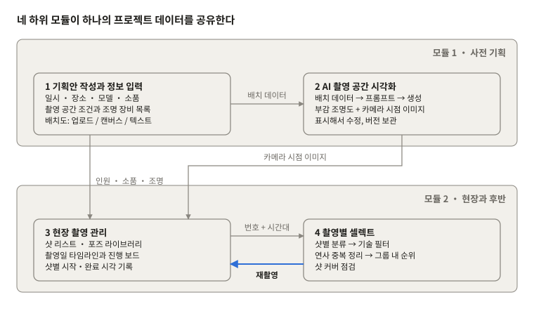
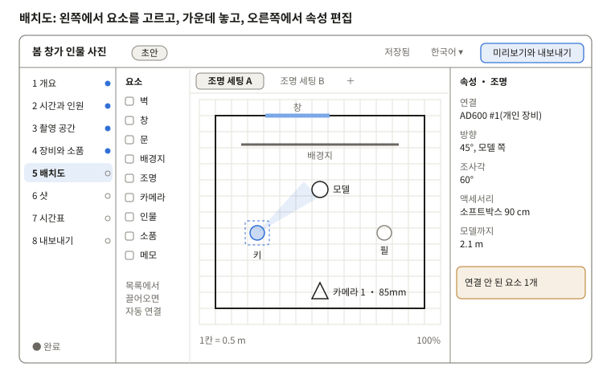
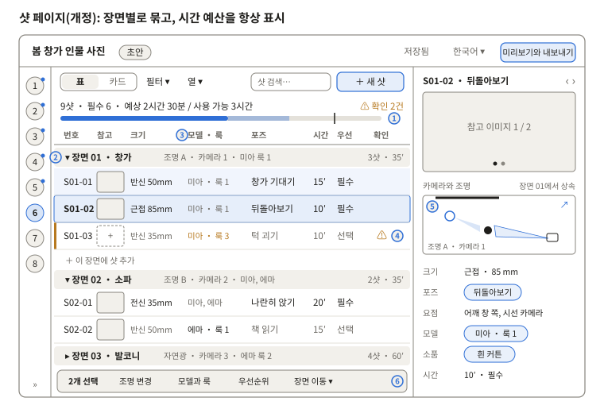

# portrait-guidance 인물 촬영 기획 가이드 · 기획안과 모듈 설계

Oct 27, 2026

> **설계 문서 스냅샷**: Claude의 4개 언어 온라인 설계 문서에서 2026-10-29에 내보낸 것입니다. 원본은 온라인 문서이며, 여기는 그림을 SVG로 바꾼 읽기 전용 사본입니다. 페이지 번호는 설계 당시 번호이고, 앱과의 대응은 「구현 현황」 절을 보세요. 앱의 현재 버전은 [README](../../README.md)를 보세요.
>
> 다른 언어: [中文](zh.md) · [English](en.md) · [日本語](ja.md)


## 구현 현황(0.3.0)

프로그램은 0.3.0입니다. S0–S9 열 개 페이지와 새 EX 조명비 페이지를 쓸 수 있습니다. 바탕화면의 Claude-portrait-guidance 폴더에 있으며 「启动人像策划指导」를 더블클릭하면 실행됩니다. 페이지 순서를 Grok 안에 맞췄기 때문에 아래 「페이지 목록」과 와이어프레임 두 장은 설계 당시 번호 그대로입니다. 대응은 아래 표와 같습니다.

| 프로그램 페이지 | 설계 번호 | 0.3.0 상태 |
| --- | --- | --- |
| S0 프로젝트 목록 | S0 | 사용 가능. JSON 가져오기(Grok 옛 형식 포함) |
| S1 기본 정보 | S1 + S2 통합 | 사용 가능. 시간대 추가 |
| S2 공간과 장비 | S3 + S4 통합 | 사용 가능. 장비 크기 라이브러리, 흡광판 |
| S3 모델과 참고 이미지 | S2 인원 + S1 무드보드 | 사용 가능. 무드보드 출처 링크 |
| S4 포즈 라이브러리 | S7 | 사용 가능 |
| S5 샷 리스트 | S6(와이어프레임 「S6 샷 페이지」) | 사용 가능. 개정 설계대로 구현 |
| S6 배치도 | S5(와이어프레임 「S5 배치도 페이지」) | 사용 가능. 카메라 위치 20 mm 3D 미리보기와 측광값 추가 |
| S7 타임라인 | S8 | 사용 가능 |
| S8 진행 보드 | 보류에서 이번 단계로 | 사용 가능. 상태와 시간만 기록, Photo-cull용 샷 시간창 내보내기 |
| S9 미리보기와 내보내기 | S9 | 사용 가능. 조명표에 측광값과 키 대비 표시 |
| EX 조명비 | 신규 | 사용 가능(아래 참고) |

**EX 조명비**: S6 배치도와 같은 배치를 쓰므로 어느 쪽에서 조명을 옮기거나 모디파이어를 바꿔도 다른 쪽에 반영됩니다. 오른쪽에서 카탈로그 값(가이드 넘버 또는 1 m 조도), 출력 설정, 피사체까지 거리, 모디파이어 손실 경험값으로 각 조명의 조리개나 조도를 추정하고, 현장 측광값과 비교해 키 라이트와 각 조명의 조명비를 보여 줍니다. 피사체가 빔 밖에 있거나 실측과 추정이 1 EV 넘게 차이 나면 알려 줍니다. 기획 완성도에는 넣지 않습니다.

**장비 카탈로그**: Godox, Broncolor, Aputure / amaran 광학 데이터 98건(참고값). Profoto는 나중에 추가합니다.

계속 보류: AI 관련 기능, 현장판, 고객 공유, 셀렉트와 결과물 비교, 세코닉 측광 기록 가져오기(내보내기 샘플 대기).

## 전체 구조

portrait-guidance(인물 촬영 기획 가이드)는 사전 기획(정보 입력 + AI 촬영 공간 시각화)과 현장과 후반(촬영 관리 + 셀렉트) 두 모듈로 이루어집니다. 네 하위 모듈은 하나의 프로젝트 데이터를 공유하므로, 한 번 입력한 내용을 다음 단계에서 그대로 참조합니다.



*전체 구조 · 2개 모듈, 4개 하위 모듈*

데이터는 입력에서 셀렉트로 흐릅니다. 셀렉트에서 쓸 만한 컷이 없는 샷이 발견되면 촬영 관리에 ‘재촬영’으로 되돌려 기록해 흐름이 닫힙니다.

## 현재 범위(2026-10-28 변경)

이 도구는 ‘기획안 만들기’가 주목적입니다. 정보 입력, 촬영 공간 배치도 그리기, 샷과 포즈 계획부터 촬영일 시간표 작성, 완성된 기획안 내보내기까지 다룹니다. 이번 단계에서는 기능 명세와 GUI 정의만 작성하고, 프로그램 작성과 테스트는 하지 않습니다.

| 내용 | 상태 |
| --- | --- |
| 하위 모듈 1 기획안 작성과 정보 입력 | 이번 단계 핵심 |
| 하위 모듈 2 시각화: 부감 조명도(벡터) | 이번 단계 핵심 |
| 하위 모듈 2 시각화: AI 참고 이미지 | 진입점만 두고 기능은 보류 |
| 하위 모듈 3 샷, 포즈 라이브러리, 촬영일 시간표 | 이번 단계 핵심 |
| 하위 모듈 3 현장 진행 보드 | 보류 |
| 하위 모듈 4 셀렉트, Photo-cull 연동, 결과물 비교 | 보류 |
| AI 이미지 생성 검증, Photo-cull 연동 검증 | 보류 |

‘보류’로 표시한 장은 앞으로의 설계 참고용으로 문서 뒷부분에 남겨 둡니다.

**플랫폼 전제**: Photo-cull과 같이 내 컴퓨터에서 돌아가는 프로그램(로컬 서비스 + 웹 화면, Mac 앱으로 패키징 가능). 데스크톱 우선, 최소 창 너비 1280 px. ‘현장용’ 페이지는 태블릿에서 볼 수 있음. 이 부분은 확인 대기.

## 기능 명세(기획안)

기획안 기능은 모두 38개입니다. P0는 첫 버전에 반드시 필요(28개), P1은 첫 버전 뒤 빠르게 추가(5개), P2는 AI나 미확인 사항에 달림(5개). 우선순위는 표에서 바로 바꿀 수 있습니다.

### A · 프로젝트

| 번호 | 기능 | 설명과 규칙 | 우선순위 |
| --- | --- | --- | --- |
| F01 | 프로젝트 목록 | 새로 만들기, 복제, 보관, 검색. 카드에 표지(무드보드 첫 이미지), 촬영일, 상태, 완성도 표시 | P0 |
| F02 | 기획안 상태 | 초안 / 확인 대기 / 확정. 확정 후 수정하려면 먼저 ‘확정 해제’를 해야 하며, 이때 버전이 자동 저장됨 | P0 |
| F03 | 템플릿 | 프로젝트를 템플릿으로 저장(촬영 공간, 장비, 자주 쓰는 샷과 포즈)하고 새 프로젝트를 만들 때 선택 | P1 |
| F04 | 자동 저장과 버전 | 바꿀 때마다 자동 저장. ‘버전 저장’으로 메모를 붙여 남기고, 보기·복원 가능 | P0 |

### B · 개요와 무드보드

| 번호 | 기능 | 설명과 규칙 | 우선순위 |
| --- | --- | --- | --- |
| F05 | 기본 정보 | 프로젝트명, 주제 설명, 스타일 키워드(태그, 여러 개), 고객과 용도(선택) | P0 |
| F06 | 무드보드 | 이미지를 끌어다 놓고 격자나 자유 배치. 이미지마다 메모와 태그. 한 번에 샷 참고 이미지로 지정 | P0 |
| F07 | AI 설명 초안 | 키워드와 무드보드로 주제 설명 초안을 만들고, 사람이 확인한 뒤 반영 | P2 |

### C · 시간과 인원

| 번호 | 기능 | 설명과 규칙 | 우선순위 |
| --- | --- | --- | --- |
| F08 | 촬영 시간 | 날짜, 시작 / 종료, 공간 사용 가능 시간, 메이크업과 세팅 준비 시간. 각자의 도착 시각을 자동 계산 | P0 |
| F09 | 인원 | 모델(키, 사이즈, 룩 수, 촬영 가능 시간)과 스태프(역할, 연락처). 룩 수로 ‘룩’ 항목을 자동 생성해 샷에서 참조 | P0 |

### D · 촬영 공간

| 번호 | 기능 | 설명과 규칙 | 우선순위 |
| --- | --- | --- | --- |
| F10 | 공간 라이브러리 | 촬영 공간을 따로 저장해 여러 프로젝트에서 재사용: 주소, 담당자, 크기, 실내외, 사진, 조건(창과 방향, 자연광 시간대, 벽과 바닥의 재질·색, 전원, 사용 가능 구역과 금지 구역) | P0 |
| F11 | 공간 제공 장비 | 공간이 제공하는 장비를 종류별(조명, 액세서리, 스탠드, 배경, 반사판, 기타)로 모델과 수량을 등록. 공간과 함께 저장해 다음에도 사용 | P0 |

### E · 장비와 소품

| 번호 | 기능 | 설명과 규칙 | 우선순위 |
| --- | --- | --- | --- |
| F12 | 장비 목록 | 공간 제공 장비와 개인 장비를 합치고 출처 표시. ‘배치도 사용 / 전체’를 보여 주고, 한 조명 세팅에서 수량을 넘으면 경고 | P0 |
| F13 | 소품 목록 | 이름, 수량, 크기, 출처, 담당자, 준비 상태(준비 중 / 완료) | P0 |
| F14 | 짐 목록 | 개인 장비와 직접 준비한 소품으로 체크·인쇄 가능한 목록 생성 | P1 |

### F · 촬영 공간 배치도(핵심)

| 번호 | 기능 | 설명과 규칙 | 우선순위 |
| --- | --- | --- | --- |
| F15 | 캔버스 | 공간 크기로 축척에 맞는 격자 생성(기본 1칸 = 0.5 m). 요소: 벽, 창, 문, 기둥, 배경지, 조명(방향, 조사각, 액세서리, 출력 단계), 카메라 위치(초점거리와 화각), 인물, 소품, 텍스트 메모 | P0 |
| F16 | 요소 연결 | 조명·소품·인물을 목록에서 끌어오면 해당 항목과 연결. 연결되지 않은 요소는 노란색 표시 | P0 |
| F17 | 밑그림 | 평면도나 사진을 밑그림으로 올리고 두 점으로 축척 지정. 투명도 조절과 잠금 가능 | P0 |
| F18 | 조명 세팅 | 한 공간에 여러 조명 세팅을 저장하고, 샷은 그중 하나를 참조. 복제와 나란히 비교 가능 | P0 |
| F19 | 거리 표시와 보조 | 조명—인물, 인물—배경, 카메라—인물 거리 표시. 정렬, 격자 맞춤, 회전 | P1 |
| F20 | 조명도 내보내기 | PNG / PDF, 범례와 거리 포함 | P0 |
| F21 | 텍스트로 배치 | 텍스트 설명으로 요소 초안을 만들고 캔버스에서 확인한 뒤 반영 | P2 |
| F22 | AI 참고 이미지 | 조명 세팅 + 카메라 위치로 참고 이미지 생성. 이번 단계에서는 진입점만 | P2 |

### G · 샷과 포즈

| 번호 | 기능 | 설명과 규칙 | 우선순위 |
| --- | --- | --- | --- |
| F23 | 샷 리스트 | 항목은 하위 모듈 3과 같음(‘상태’는 현장 진행 보드 소관이라 보류). 장면별로 묶고, 장면에 기본 조명 세팅·카메라·모델과 룩을 두며 샷에는 다른 점만 입력. 표와 카드 보기 전환, 끌어서 순서 변경, 번호는 ‘장면-순번’으로 자동 부여 | P0 |
| F24 | 참조 항목 | 장면과 카메라 위치, 조명 세팅, 모델, 룩, 소품, 포즈는 모두 기존 항목에서 선택(태그 방식). 참조된 항목을 삭제하기 전에 영향받는 샷을 표시 | P0 |
| F25 | 참고 이미지 | 샷마다 여러 장: 무드보드, 업로드, 조명도 스냅샷에서 | P0 |
| F26 | 포즈 라이브러리 | 항목: 이름, 그림, 요점(무게중심, 손 위치, 시선), 어울리는 화면 크기, 인원, 태그. 걸러 보기 가능. 샷에서 바로 새 항목 만들기 | P0 |
| F27 | 일괄 편집 | 여러 샷을 선택해 조명 세팅·모델·우선순위를 한꺼번에 변경 | P1 |
| F28 | AI 샷 제안 | 주제와 무드보드로 샷과 포즈 조합 초안을 만들고 하나씩 채택 | P2 |

### H · 촬영일 시간표

| 번호 | 기능 | 설명과 규칙 | 우선순위 |
| --- | --- | --- | --- |
| F29 | 자동 일정 | 도착 시각, 메이크업 준비 시간, 샷별 예상 시간으로 편성. 같은 조명 세팅·같은 룩의 샷을 묶고, 환복과 조명 변경에 여유 시간 삽입(기본 10분, 변경 가능) | P0 |
| F30 | 수동 조정 | 시간 막대 끌기, 샷 시각 잠금. 합계가 공간 사용 가능 시간을 넘으면 초과분을 표시하고 빼도 되는 ‘선택’ 샷을 보여 줌 | P0 |

### I · 미리보기와 내보내기

| 번호 | 기능 | 설명과 규칙 | 우선순위 |
| --- | --- | --- | --- |
| F31 | 기획안 미리보기 | 내보내기 판형으로 모든 장을 미리 보고 포함할 장을 선택 | P0 |
| F32 | PDF 내보내기 | 표지, 개요와 무드보드, 시간표, 인원, 장비와 소품, 조명도, 샷 리스트(참고 이미지 포함). 선택한 언어로 출력 | P0 |
| F33 | 현장용 보기 | 태블릿에 맞춘 읽기 전용 페이지: 시간표 + 샷 카드(큰 참고 이미지, 포즈 요점). 오프라인으로 열림 | P1 |
| F34 | 공유와 고객 확인 | 읽기 전용 링크나 내보내기 패키지. 고객이 의견을 남기고 승인. ‘고객용인지’에 따라 결정 | P2 |

### J · 공통

| 번호 | 기능 | 설명과 규칙 | 우선순위 |
| --- | --- | --- | --- |
| F35 | 4개 언어 UI | 중국어, 영어, 일본어, 한국어. 모든 문구는 언어 팩에. 내보내기도 선택한 언어로 | P0 |
| F36 | 실행 취소 / 다시 실행 | 캔버스와 표 모두, 50단계 이상 | P0 |
| F37 | 완성도 점검 | 필수 항목으로 단계별 완성도 계산. 내보내기 전에 빠진 항목과 충돌을 목록으로 보여 주고 클릭하면 해당 위치로 이동 | P0 |
| F38 | 로컬 저장과 백업 | 프로젝트마다 폴더 하나(데이터 + 이미지). 통째로 복사·백업 가능. 계정 불필요 | P0 |

### 필수 항목과 일관성 점검(F37 규칙)

| 점검 | 수준 | 조건 |
| --- | --- | --- |
| 프로젝트명, 촬영일, 촬영 공간 | 필수 | 하나라도 비어 있음 |
| 공간 크기 | 필수 | 비어 있으면 축척 캔버스를 만들 수 없음 |
| 샷의 조명 세팅과 모델 | 필수 | 선택하지 않은 샷이 있음 |
| 장비 초과 사용 | 경고 | 한 조명 세팅에서 사용 수 > 수량 |
| 연결되지 않은 요소 | 경고 | 캔버스의 조명이나 소품이 목록과 연결되지 않음 |
| 룩과 모델 불일치 | 경고 | 샷의 룩이 해당 모델의 것이 아님 |
| 시간 초과 | 경고 | 합계 시간이 공간 사용 가능 시간이나 모델 촬영 가능 시간을 넘음 |
| 소품 미준비 | 알림 | ‘확정’했는데 ‘준비 중’ 소품이 남아 있음 |

## GUI 정의

화면은 창 하나에 고정 영역 네 개로 이루어집니다. 상단 바, 왼쪽 단계 내비게이션, 주 작업 영역, 오른쪽 속성 패널입니다. 왼쪽 내비게이션이 곧 기획 순서이며, ‘개요’부터 ‘내보내기’까지 차례로 진행하고 단계마다 완성도를 표시합니다.

### 설계 원칙

- Photo-cull과 같은 외관: 그 디자인 변수(tokens.css)와 버튼, 세그먼트 컨트롤, 단계 표시 등의 구성 요소를 함께 씁니다. 이미지와 캔버스 주변에는 중립 회색만 씁니다.
- 흐름이 보인다: 왼쪽 내비게이션이 곧 단계이고, 점으로 완성도를 보여 주며, 내보내기 전에 빠진 항목 목록을 보여 줍니다.
- 다시 입력하지 않고 참조한다: 다른 페이지의 데이터는 모두 태그(칩)로 나타나고, 클릭하면 원본 항목으로 이동하며, 한 곳을 고치면 모든 곳에 반영됩니다.
- 단계적으로 펼친다: 페이지마다 자주 쓰는 항목만 보이고, 부차적인 항목은 ‘더 보기’에 접어 둡니다.
- 네 언어를 동등하게: 글자를 담는 요소에 고정 너비를 쓰지 않고 가장 긴 영어를 기준으로 설계합니다. 일본어는 line-break: strict, 한국어 글꼴 스택에는 Apple SD Gothic Neo, Malgun Gothic을 넣습니다.
- 주요 조작은 키보드로도 할 수 있고, 오프라인으로 동작하며, 글꼴과 아이콘은 프로그램에 포함합니다.

### 창 구성

| 영역 | 크기 | 내용 |
| --- | --- | --- |
| 상단 바 | 높이 56 px | 프로젝트 이름, 기획안 상태 배지(초안 / 확인 대기 / 확정), 저장 상태, 언어 전환, ‘미리보기와 내보내기’ 버튼 |
| 왼쪽 단계 내비게이션 | 너비 220 px, 64 px 아이콘 바로 접기 가능 | 8단계와 완성도 점, 맨 위에 ‘프로젝트 목록으로’ |
| 주 작업 영역 | 가변 | 현재 단계의 내용 |
| 오른쪽 속성 패널 | 너비 320 px, 접기 가능 | 선택한 대상의 상세, 안내와 충돌 |

최소 창 크기는 1280 × 800입니다. 너비가 1440보다 작으면 오른쪽 패널은 기본으로 접혀 밀어서 여는 서랍이 됩니다.

### 페이지 목록

| 번호 | 페이지 | 해당 기능 | 주 작업 영역 | 오른쪽 패널 |
| --- | --- | --- | --- | --- |
| S0 | 프로젝트 목록 | F01–F03 | 프로젝트 카드 격자, 검색, 상태 필터, ‘새로 만들기 / 템플릿에서 만들기’ | 없음 |
| S1 | 개요와 무드보드 | F05–F07 | 위: 기본 정보 양식, 아래: 무드보드(격자 / 자유 배치) | 선택한 이미지의 메모와 태그 |
| S2 | 시간과 인원 | F08–F09 | 왼쪽: 촬영 시간과 준비 시간, 도착 시각 자동 계산. 오른쪽: 인원 카드 | 선택한 사람의 상세와 룩 |
| S3 | 촬영 공간 | F10–F11 | 공간 라이브러리에서 선택하거나 새로 만들기. 공간 정보, 사진 띠, 공간 제공 장비 표 | 공간 조건 안내(자연광 시간대 등) |
| S4 | 장비와 소품 | F12–F14 | ‘장비 / 소품 / 챙길 목록’ 탭 3개, 모두 편집 가능한 표 | 항목 상세, 어느 조명 세팅과 샷에서 쓰이는지 |
| S5 | 배치도 | F15–F22 | 왼쪽: 요소 패널, 가운데: 캔버스와 조명 세팅 탭, 아래: 축척과 확대 | 선택한 요소의 속성, 거리, 미연결 경고 |
| S6 | 샷 | F23–F28 | 장면별로 묶은 표 / 카드, 시간 예산 막대, 필터와 열 설정, 일괄 편집 바 | 샷 상세: 참고 이미지, 카메라와 조명 미리보기, 항목, 확인 결과 |
| S7 | 포즈 라이브러리 | F26 | 포즈 격자 + 태그 필터. S6에서 대화상자로도 열 수 있음 | 포즈 상세와 사용 기록 |
| S8 | 시간표 | F29–F30 | 간트식 시간축: 샷마다 막대 하나, 조명 세팅별 색, 끌기와 잠금 가능 | 시간 초과와 충돌 목록, 뺌 수 있는 ‘선택’ 샷 |
| S9 | 미리보기와 내보내기 | F31–F34 | 왼쪽: 장 선택, 가운데: 페이지별 미리보기 | 내보낼 언어, 용지, 참고 이미지 포함 여부 |

### 주요 페이지 와이어프레임



*S5 배치도 페이지 와이어프레임(예시 데이터)*

배치도는 이 도구의 핵심 페이지입니다. 요소를 왼쪽에서 캔버스로 끌어오고, 장비 목록에서 끌어온 조명은 해당 항목과 자동으로 연결됩니다. 위쪽 탭으로 같은 공간의 조명 세팅을 전환합니다.



*S6 샷 페이지 와이어프레임(개정, 예시 데이터)*

개정한 샷 페이지는 샷을 장면별로 묶습니다. 장면 제목 행에서 그 묶음이 함께 쓰는 조명 세팅, 카메라 위치, 모델과 룩을 정하고, 각 샷에는 다른 점만 입력합니다. 페이지 위쪽에는 시간 예산을 항상 표시합니다. 오른쪽 상세에는 배치도 미리보기가 더해져 이 샷을 어디서 찍고 빛을 어떻게 다루는지 볼 수 있습니다.

### S6 샷 페이지 상세 설계

**이전 버전에서 바뀐 점**

| 이전 버전의 문제 | 변경 |
| --- | --- |
| 샷마다 같은 조명 세팅·모델·룩을 다시 고름 | 장면을 묶음으로 하고 기본값을 두어 샷이 상속. 바꾼 값은 진한 글자로 표시 |
| 총 시간이 공간 사용 시간을 넘는지 S8에 가야 알 수 있음 | 페이지 위쪽에 시간 예산 막대를 항상 표시 |
| 빠진 항목과 충돌을 내보내기 직전에야 볼 수 있음 | 행마다 ‘확인’ 열, 위쪽에 ‘확인 필요’ 건수. 클릭하면 해당 위치로 이동 |
| 표에 카메라 위치·소품이 없고 참고 이미지가 너무 작음 | 카메라 위치는 장면 행에 표시. 소품은 상세에 두고 ‘열’에서 추가 가능. 썸네일을 키우고, 참고 이미지가 없으면 점선 자리 표시 |
| 상세가 항목 나열뿐이고 배치도와 따로 놆 | 상세에 배치도 미리보기를 넣어 이 샷의 카메라와 쓰는 조명을 강조, 클릭하면 S5로 |
| 왼쪽 내비게이션이 220 px를 차지해 표 열이 다 들어가지 않음 | 샷 페이지에서는 내비게이션을 64 px 아이콘 바로 접어서 엶 |

**그림의 번호**

| 번호 | 영역 | 규칙 |
| --- | --- | --- |
| ① | 시간 예산 | 진한 부분 = 필수, 연한 부분 = 선택, 세로선 = 쓸 수 있는 시간(공간 사용 시간과 모델 촬영 가능 시간 중 짧은 쪽). 합계에는 룩 변경과 조명 변경 여유 시간(F29, 기본 10분) 포함. 초과하면 ‘x분 초과, 뺌 수 있는 선택 샷 n개’ 표시 |
| ② | 장면 제목 행 | 장면 이름, 기본 조명 세팅 · 카메라 · 모델과 룩, 샷 수와 소계. ▾로 접기. 기본값을 클릭해 바로 바꿀 수 있고, 바꾸지 않은 샷도 따라서 바뀜 |
| ③ | 상속과 변경 | 회색 = 장면에서 상속, 진한 글자 = 이 샷에서 바꾼 값. 바꾼 칸에 마우스를 올리면 ‘장면 기본값으로 되돌리기’ |
| ④ | 확인 | F37 규칙으로 행마다 점검. 필수 항목 누락은 빨강, 룩과 모델 불일치·장비 초과 사용·참고 이미지 없음은 노랑. 마우스를 올리면 이유, 클릭하면 상세를 열고 그 항목으로 이동 |
| ⑤ | 카메라와 조명 미리보기 | 이 샷의 조명 세팅 배치도에서 이 샷의 카메라 부채꼴과 쓰는 조명만 강조. ↗로 같은 세팅을 S5에서 열기 |
| ⑥ | 일괄 편집 바 | 여러 행을 고르면 나타남: 조명 세팅, 모델과 룩, 우선순위 변경, 다른 장면으로 이동 |

**표의 열**

기본 8열: 번호, 참고, 크기(초점거리 포함), 모델 · 룩, 포즈, 시간, 우선, 확인. ‘열 ▾’에서 소품, 카메라, 조명 세팅, 메모를 추가할 수 있고, 열 표시와 순서는 프로젝트별로 저장. 번호는 장면과 순서에 따라 자동으로 다시 매기고, 잠근 번호는 바뀌지 않음.

**카드 보기**

카드마다 큰 참고 이미지(4:3), 번호와 포즈, 크기 · 초점거리, 모델 태그, 시간과 우선순위, 확인 아이콘. 장면별로 나누고 한 줄에 3–4장. 모델이나 고객과 기획을 함께 볼 때 쓰고, ‘현장판’(F33) 샷 카드도 이 모양을 따름.

**상세 서랍**

위에서부터: 참고 이미지(좌우로 넘기기, 무드보드에서 끌어오거나 업로드) → 카메라와 조명 미리보기 → 크기 · 초점거리 → 포즈(태그, 열면 포즈 라이브러리 항목)와 요점 → 모델 · 룩 → 소품 → 시간과 우선순위 → 메모. 모든 항목을 그 자리에서 편집할 수 있고, ‹ › 또는 ↑↓로 이전·다음 샷으로 이동.

**포즈 고르기**

포즈 칸을 클릭하거나 ⌘K를 누르면 포즈 라이브러리 선택 창이 열림. 위는 검색과 태그 필터(크기, 인원, 분위기), 아래는 스케치 격자. 맞는 것이 없으면 ‘새 포즈’로 바로 항목을 만듬(F26).

**페이지 상태**

| 상태 | 표시 |
| --- | --- |
| 장면이 아직 없음 | 설명 한 줄과 ‘새 장면’ 버튼. S5에 조명 세팅이 있으면 ‘조명 세팅으로 장면 만들기’ 제안 |
| 장면에 샷이 없음 | 장면 제목 행 아래에 ‘＋ 이 장면에 샷 추가’만 표시 |
| 경고 있음 | 행 왼쪽에 노란 세로줄, 위쪽 건수 증가 |
| 시간 초과 | 예산 막대가 경고색으로 바뀌고, 선택 샷에 ‘삭제 권장’ 표시 |
| 필터 사용 중 | 도구 모음에 쓰고 있는 필터를 표시하고 한 번에 해제. 시간 예산은 모든 샷 기준으로 계산 |

**키보드**

⌘N 새 샷(현재 샷 뒤에 추가), ⌘⇧N 새 장면, ⌘D 복제, ⌘K 포즈 라이브러리, Enter 상세 열기, ↑↓ 샷 이동, ⌥↑↓ 샷 순서 옮기기, Delete 삭제(확인 후).

### 조작 규칙

| 상황 | 규칙 |
| --- | --- |
| 저장 | 수정 후 약 1초 뒤 자동 저장, 상단 바에 ‘저장 중 / 저장됨’ 표시. ⌘S는 메모를 붙인 버전을 저장 |
| 실행 취소 | ⌘Z 실행 취소, ⇧⌘Z 다시 실행. 캔버스와 표 공통 |
| 참조 태그 | 클릭하면 원본 항목으로 이동, 마우스를 올리면 요약. 원본이 삭제되면 태그가 빨간색과 취소선으로 바뀜 |
| 끌어다 놓기 | 목록 → 캔버스(연결), 무드보드 → 샷 참고 이미지, 샷 행 끌어서 순서 변경, 시간 막대 끌어서 시간 변경 |
| 캔버스 | Space + 끌기로 이동, 휠로 확대·축소, R로 15° 회전, 방향키로 조금씩, Shift + 방향키로 크게 이동, Delete로 삭제 |
| 샷 | ⌘N 새 샷, ⌘⇧N 새 장면, ⌘D 복제, ⌘K 포즈 라이브러리, Enter 상세 서랍 열기, ⌥↑↓ 샷 순서 옮기기 |
| 완성도 | 내비게이션 점: 빈 원 = 시작 안 함, 반쯤 = 빠진 항목 있음, 채운 원 = 완료. 내보내기 전 빠진 항목과 충돌 목록을 띄우고 클릭하면 바로 이동 |
| 빈 상태 | 페이지마다 ‘다음에 할 일’ 한 줄과 버튼. 예: 배치도에서 공간 크기가 비어 있으면 ‘먼저 공간 크기를 입력하세요’ |
| 위험한 조작 | 참조된 항목을 지우기 전에 영향받는 샷을 보여 줌. ‘확정 해제’는 확인 필요 |
| 다국어 | 버튼과 태그 너비는 글자에 맞춤. 날짜와 숫자는 선택한 언어 형식. 언어를 바꿔도 현재 페이지와 선택 대상은 유지 |

### 디자인할 구성 요소와 상태

구성 요소: 단계 내비게이션 항목, 기획안 상태 배지, 참조 태그, 편집 가능한 표, 카드, 속성 패널 묶음, 캔버스 도구 모음과 요소, 조명 세팅 탭, 장면 제목 행, 시간 예산 막대, 시간 막대, 일괄 편집 바, 빈 상태, 확인 대화상자.

구성 요소마다 기본, 마우스 올림, 선택, 비활성, 경고, 오류 상태를 그리고, 페이지는 빈 상태, 불러오는 중, 정상, 경고 포함 상태를 그립니다.

다음 단계: 와이어프레임을 확정한 뒤 디자인 도구로 S0–S9를 고해상도 화면(밝은 / 어두운 테마 × 네 언어)으로 그립니다.

## 1 · 기획안 작성과 정보 입력

촬영 전 정보를 모두 구조화된 데이터로 기록합니다. 나머지 세 하위 모듈이 여기서 데이터를 가져가므로 중복 입력이 없습니다.

### 입력 양식

| 구분 | 항목 | 용도 |
| --- | --- | --- |
| 기본 정보 | 프로젝트명, 주제, 스타일 키워드, 무드보드 이미지 | 스타일 키워드는 AI 프롬프트에 바로 들어감 |
| 시간 | 촬영일, 시작·종료, 공간 사용 가능 시간, 메이크업과 세팅 준비 시간 | 촬영일 타임라인 생성 |
| 장소 | 이름, 주소, 담당자, 실내 / 실외, 크기(길이 × 폭 × 층고) | 크기로 배치도 축척 결정 |
| 공간 조건 | 창문 위치와 방향, 자연광 시간대, 벽과 바닥의 재질·색, 전원 위치와 용량, 사용 가능 구역과 금지 구역 | 조명과 AI 이미지에 영향 |
| 공간 제공 장비 | 조명 모델, 종류, 출력, 수량; 액세서리(소프트박스, 뷰티디시, 그리드); 스탠드, 배경지 / 천, 반사판 | 개인 장비와 합쳐 하나의 목록으로, 출처 표시 |
| 개인 장비 | 바디, 렌즈, 조명, 트리거 | 위와 같음 |
| 소품 | 이름, 수량, 크기, 출처(개인 / 대여 / 공간), 담당자 | 소품 목록 생성, 샷에서 참조 |
| 인원 | 모델 수; 모델별 이름, 키, 옷 사이즈, 룩 수; 메이크업, 어시스턴트 | 샷을 사람별로 배정 |
| 의상과 메이크업 | 룩 수, 해당 장면 | 환복 횟수를 줄이도록 일정 배치 |

### 배치도 입력

세 가지 방법을 섞어 쓸 수 있고, 최종적으로 같은 ‘배치 데이터’(요소 목록 + 좌표 + 방향 + 연결된 장비·소품)가 됩니다. 이 데이터가 하위 모듈 2의 입력입니다.

1. 업로드: 공간 평면도나 현장 사진을 올리고 축척을 표시.
2. 캔버스: 실제 치수의 격자 위에 벽, 창문, 문, 배경, 조명(방향과 조사각 포함), 카메라 위치, 모델 위치, 소품을 끌어다 놓음. 각 요소는 양식의 항목과 연결.
3. 텍스트: 배치를 자유롭게 설명하면 AI가 요소 초안으로 바꾸고, 캔버스에서 고침.

### 기획안 출력

한 번의 클릭으로 기획안을 만들고 PDF로 내보낼 수 있습니다. 개요, 일정표, 인원표, 장비·소품 목록, 배치도, 무드보드를 담고, 주제 설명과 스타일 설명은 AI가 초안을 돕습니다.

## 2 · AI 촬영 공간 시각화

배치 데이터를 자동으로 프롬프트로 바꿔 촬영 전에 현장 이미지를 만듭니다. 조명의 정확한 위치는 벡터 조명도를 따르고, AI 이미지는 분위기와 느낌만 보여 줍니다.

### 생성 흐름

1. 데이터 정리: 배치 데이터에서 공간 치수, 재질, 광원(종류·위치·방향·액세서리), 소품, 모델 위치를 읽음.
2. 장면 설명: 공간 → 배경과 바닥 → 광원 → 소품 → 인물 → 스타일 키워드 순서로 문장을 구성.
3. 프롬프트 편집: 시점마다 템플릿이 있고, 생성 전에 고칠 수 있음.
4. 생성: 텍스트만 있으면 텍스트→이미지 생성. 평면도나 현장 사진이 있으면 구도 참조(깊이, 선화 등 구조 제어)로 써서 공간 관계를 실제에 가깝게 함.
5. 여러 시점:
   - 부감 조명도: 캔버스 데이터로 벡터를 직접 그림. AI를 쓰지 않아 위치가 정확.
   - 카메라 시점 이미지: 특정 카메라 위치에서 모델을 바라본 이미지. AI 생성, 샷 참고 이미지로도 사용.
   - 전체 분위기 이미지: 공간 전체의 느낌. AI 생성.
6. 수정과 버전: 이미지에서 문제 부분을 표시하고, 배치 데이터나 프롬프트를 고쳐 다시 생성. 버전마다 해당 배치 데이터 버전과 함께 저장.

### 프롬프트 템플릿 예시

```
[시점] {카메라 위치}에서 눈높이, {초점거리}
[공간] {길이}×{폭} m 실내, {벽 재질과 색}, {바닥}
[배경] {배경지 색}, 모델에서 {거리} m
[광원] 키라이트 {조명 종류}+{소프트박스}, 모델 {방향} 45°; 필 …; 림 …
[인물] 모델 {인원}명, {위치와 자세}, {의상}
[스타일] {스타일 키워드}, {색감}
```

### 설계 요점

- 생성 서비스는 교체 가능한 인터페이스(입력: 프롬프트 + 선택적 참조 이미지 + 시점, 출력: 이미지)로 두고 특정 업체에 묶이지 않음.
- 같은 공간의 이미지는 스타일 매개변수와 난수 시드를 고정해 느낌을 맞춤.
- 모든 AI 이미지에 ‘참고 이미지’ 표시를 붙여 세트 시공 도면으로 오해하지 않게 함.

## 3 · 현장 촬영 관리: 샷과 포즈

샷 리스트를 중심으로 사전 데이터를 촬영 당일의 체크리스트로 바꾸고, 샷마다 완료 상태와 시각을 바로 기록합니다.

### 샷 리스트 항목

| 항목 | 내용 |
| --- | --- |
| 샷 번호 | 자동 번호. 예: S01-03(장면 01의 3번째 샷) |
| 장면과 카메라 위치 | 배치도의 세트 구역과 카메라 위치를 참조 |
| 화면 크기와 초점거리 | 전신 / 반신 / 클로즈업; 초점거리 |
| 모델 | 인원표에서 선택, 여러 명 가능 |
| 룩 | 의상과 메이크업 번호 |
| 포즈 | 포즈 라이브러리에서 선택 또는 자유 기술 |
| 조명 세팅 | 배치도의 조명 조합을 참조. 하나의 세팅을 여러 샷에서 재사용 |
| 소품 | 소품 목록을 참조 |
| 참고 이미지 | 무드보드 이미지 또는 하위 모듈 2의 카메라 시점 이미지 |
| 예상 시간 | 분 |
| 우선순위 | 필수 / 선택. 시간이 모자라면 선택 샷부터 제외 |
| 상태 | 대기 / 촬영 중 / 완료 / 재촬영 필요 |
| 메모 | 현장 텍스트, 음성, 휴대폰 사진 |

### 포즈 라이브러리

- 포즈마다: 이름, 그림(간단한 스케치나 참고 사진), 요점(무게중심, 손 위치, 시선), 어울리는 화면 크기, 인원(1인 / 2인 / 단체), 감정·스타일 태그.
- 태그로 걸러 보고, 지난 촬영에서 새 항목을 쌓아 갈 수 있음.
- 현장에서 모델에게 전체 화면으로 보여 주어 말로 설명하는 일을 줄임.

### 촬영일 관리

- 타임라인: 일시 정보와 샷 예상 시간으로 자동 편성 — 도착, 메이크업, 세팅, 각 장면 촬영, 환복·세트 변경 여유 시간, 철수. 조명 세팅과 룩별로 샷을 묶어 조명 변경과 환복을 줄임.
- 진행 보드: 상태별 열로 표시. ‘완료’를 누르면 시작과 완료 시각이 자동 기록(하위 모듈 4가 이 시간대로 사진을 분류).
- 지연 알림: 타임라인보다 늦어지면 알리고, 빼도 되는 ‘선택’ 샷을 보여 줌.
- AI 보조: 주제와 공간 이미지를 바탕으로 샷과 포즈 조합을 제안하고, 남은 시간에 맞게 순서를 다시 짜 줌.
- 사용 형태: 태블릿 우선, 네트워크가 약해도 사용 가능(기기에 저장했다가 연결되면 동기화).

## 4 · 촬영별 셀렉트(보류)

이 하위 모듈은 바탕화면에 있는 Photo-cull(사진 도구 1.7-beta)을 호출해 셀렉트합니다. portrait-guidance는 Photo-cull에 없는 네 가지만 더합니다: 샷별 분류, 커버 점검, 재촬영 기록, 결과물과 기획의 비교.

### Photo-cull에 이미 있는 기능(소스에서 확인)

| 기능 | 방식 | 기본값 |
| --- | --- | --- |
| 초점 나감 / 흔들림 | ‘재블러’ 지표를 가장 선명한 영역에서만 측정해 배경을 흐린 인물 사진을 오판하지 않음 | 0.58 경고, 0.75 탈락 |
| 노출 | 평균 휘도, 하이라이트 날아감과 암부 뛰김 비율 | 휘도 18 미만 또는 238 초과 시 탈락 |
| 얼굴과 눈 감음 | OpenCV Haar 검출. 알림만 하고 탈락시키지 않음 | — |
| 연사 / 같은 장면 재촬영 묶기 | 촬영 간격 + 이미지 유사도 | 연사 15초, 같은 장면 60초, 유사도 0.6 |
| 로컬 점수 | 선명도 60% + 노출 30% + 얼굴 10%. 그룹 내 최고점을 대표로 | — |
| AI 세부 평가 | 후보를 1024 px로 줄여 구도·빛·피사체·타이밍·기술 5개 항목(1\~10점), 1\~5성, 장르, 코멘트, 개선점을 냄. ‘서비스 + 모델 + 언어 + 이미지’별 캐시 | Claude, ChatGPT, Grok, Gemini, DeepSeek 또는 OpenAI 호환 엔드포인트 |
| 별점 기록 | XMP 별점과 색 라벨. RAW는 사이드카, JPEG는 내장. Lightroom Classic과 Capture One에서 읽힘 | 셀렉트 4\~5★ 녹색, 사용 가능 3★ 노랑, 연사 후보 최대 2★, 탈락은 거부 + 빨강 |
| 기타 | RAW + JPEG 짝 맞추기, 휴지통으로 삭제, 정리 출력과 이름 변경, HTML 리포트와 results.csv, 중·영·일 3개 언어 UI | — |

### 셀렉트 흐름

1. Photo-cull 실행: 촬영 폴더에 대해 명령줄(cull.py)이나 GUI로 실행하고, 결과는 폴더 안 photo-cull-report/에 저장.
2. 샷별 분류: Photo-cull이 읽은 촬영 시각을 하위 모듈 3에 기록된 샷별 ‘시작\~완료’ 시간대와 맞춰 번호를 붙임. 맞지 않는 사진은 ‘미분류’로.
3. 검토: Photo-cull 리포트에서 평소처럼 별점, 거부, 삭제.
4. 커버 점검: 샷마다 3★ 이상 장수를 세고, 0장이면 빨간색으로 표시하고 하위 모듈 3을 ‘재촬영 필요’로 바꿈.
5. 결과물 비교: 아래 ‘결과물과 기획의 비교’ 참조.
6. 내보내기: 별점과 라벨은 Photo-cull이 이미 XMP에 기록. portrait-guidance는 샷 순서 목록을 따로 만듬.

### portrait-guidance가 사진마다 추가하는 항목

Photo-cull의 항목은 그대로 두고 다음 네 가지만 추가합니다.

| 항목 | 내용 |
| --- | --- |
| 샷 번호 | 시간대로 자동 분류, 또는 수동 지정 |
| 분류 방식 | 자동 / 수동 |
| 커버 포함 여부 | 3★ 이상이고 삭제되지 않았으면 해당 샷에 포함 |
| 비교 결론 | 일치 / 차이 있음 / 의도적 변경, 설명 포함 |

## 데이터 모델, 단계별 개발, 미확인 사항

모든 모듈이 하나의 프로젝트 데이터베이스를 공유하며, 각 개체는 한 번만 입력하고 다른 모듈에서 참조합니다.

### 핵심 개체

| 개체 | 주요 내용 | 사용 모듈 |
| --- | --- | --- |
| 프로젝트 | 주제, 일시, 스타일 키워드, 상태 | 전체 |
| 촬영 공간 | 크기, 조건, 담당자 | 1, 2 |
| 장비 | 모델, 종류, 수량, 출처(공간 / 개인) | 1, 2, 3 |
| 소품 | 이름, 수량, 출처, 담당자 | 1, 3 |
| 인원 | 모델과 스태프 | 1, 3 |
| 배치 | 요소 목록, 좌표, 방향, 버전 번호 | 2, 3 |
| 참고 이미지 | 시점, 프롬프트, 이미지, 해당 배치 버전 | 2, 3 |
| 샷 | 하위 모듈 3 항목 참조 | 3, 4 |
| 포즈 | 포즈 라이브러리 항목 | 3 |
| 촬영 기록 | 샷별 실제 시작·완료 시각, 메모 | 3, 4 |
| 사진 | 파일, EXIF, 샷 번호, 셀렉트 기록 | 4 |

### 단계별 개발 제안

1. 1단계: 하위 모듈 1의 정보 입력과 기획안 출력 + 하위 모듈 3의 샷 리스트와 진행 보드. AI에 의존하지 않고 데이터 뼈대부터 완성.
2. 2단계: 하위 모듈 4 셀렉트. Photo-cull을 재사용하고 시간대 분류와 커버 점검을 추가.
3. 3단계: 하위 모듈 2 AI 촬영 공간 시각화와 AI 샷·포즈 제안. 품질은 앞서 입력한 데이터가 얼마나 충실한지에 달려 있음.

### 미확인 사항

- 사용 형태: 웹, 데스크톱 앱, 태블릿 앱 중 무엇인가. 촬영 당일 사진가, 어시스턴트, 메이크업 담당이 동시에 봐야 하는가.
- 여러 카메라로 촬영할 때 바디별 시계를 어떻게 맞출지(샷 분류에 영향).
- 이미지 생성 서비스 선호: 클라우드인가, 직접 구축인가.
- 고객용으로 쓸지: 기획안을 고객에게 확인받거나, 셀렉트를 고객에게 맡길지.

## AI 이미지 생성 타당성 검증(보류)

하위 모듈 2를 개발하기 전에 약 135장, 약 $7로 비교 검증을 한 번 합니다. 기준을 넘으면 개발하고, 못 넘으면 ‘벡터 조명도 + 참고 이미지 라이브러리’ 방식으로 돌아갑니다.

### 답해야 할 네 가지 질문

1. 공간 배치를 통제할 수 있는가: 조명, 배경, 모델 위치가 배치 데이터대로 나오는가.
2. 빛이 그럴듯한가: 키라이트 방향, 경연, 명암비가 조명 위치와 맞는가.
3. 시점 간 일관성이 있는가: 전체 이미지와 카메라 시점 이미지가 같은 곳으로 보이는가.
4. 비용과 대기 시간을 감당할 수 있는가: 쓸 만한 이미지 한 장을 얻기까지 평균 몇 번, 얼마나 걸리는가.

### 후보 방식

| 방식 | 방법 | 후보 모델 | 참고 가격 |
| --- | --- | --- | --- |
| A 텍스트만 | 템플릿 프롬프트만 사용 | Gemini Nano Banana 2.1 | 장당 $0.0336(1K) |
| B 사진 편집 | 현장 사진을 바탕으로 프롬프트로 조명·배경·인물을 추가 | Nano Banana 2.1 편집; GPT Image 2.5 Sunburst 편집 | 위와 같음; GPT Image 2.5는 출력 100만 token당 $30 |
| C 구조 제어 | 평면도나 사진을 깊이 / 선화로 변환해 구도 제약으로 사용 | FLUX.1 \[dev\] + ControlNet(fal) | 메가픽셀당 $0.075 |

### 테스트 샘플과 채점

- 샘플: 실제 촬영 공간 3곳(작은 스튜디오, 창이 있는 실내, 실외). 각 공간의 현장 사진을 대조용으로 준비.
- 공간 × 방식 × 3개 시점(전체, 카메라 1, 카메라 2) × 각 5회 생성 = 135장.
- 이미지마다 채점: 배치 일치(1\~5), 빛 방향 정확(예 / 아니오), 시점 간 일관성(1\~5), 사용 가능 여부, 생성 시간.

### 통과 기준 제안

| 지표 | 기준 |
| --- | --- |
| 사용 가능률(사용 가능 장수 ÷ 생성 장수) | 50% 이상, 즉 평균 2회 이내에 한 장 |
| 배치 일치 평균 점수 | 4 이상 |
| 빛 방향 정확도 | 70% 이상 |
| 장면당 비용(3개 시점) | $1 이하 |

### 검증 예산

방식 A: 45장 × $0.0336 ≈ $1.51, 방식 B: 약 $1.6(이미지 입력비 약간 별도), 방식 C: 45장 × $0.075 ≈ $3.38. 합계 약 $7.

모델 교체가 빠릅니다. OpenAI는 gpt-image-1을 2026-10-23에 종료했고 gpt-image-1.5도 2026-12-01 종료 예정입니다. 검증 결과에 모델 버전을 기록하고, 생성 서비스는 교체 가능하게 둠니다.

## 전체 모듈 비용 점검표

호출당 과금되는 AI 비용은 하위 모듈 2에 몰려 있고, 다른 모듈은 로컬에서 무료로 처리하거나 호출이 아주 적습니다. 항목별로 확인한 뒤 마지막 열의 상태를 바꾸세요. 가격은 2026-10 기준 미국 달러 정가입니다.

| 모듈 | 비용 항목 | 과금 방식 | 참고 단가(USD) | 점검 |
| --- | --- | --- | --- | --- |
| 1 | AI 기획안 초안, 텍스트 공간 설명 해석 | token 단위 | Gemini 3.5 Flash-Lite: 입력 $0.30, 출력 $2.50 / 100만 token | 점검 전 |
| 1 | 기획안 PDF 내보내기 | 로컬 생성 | $0 | 점검 전 |
| 2 | 카메라 시점 이미지, 전체 분위기 이미지(방식 A/B) | 장 단위 | Nano Banana 2.1: 1K $0.0336, 2K $0.0504 | 점검 전 |
| 2 | 구조 제어 생성(방식 C) | 메가픽셀 단위, 올림 | FLUX.1 \[dev\] + ControlNet: MP당 $0.075 | 점검 전 |
| 2 | 고품질 대안 | 장 단위 | Nano Banana Pro: 1K/2K $0.134 | 점검 전 |
| 2 | 부감 조명도 | 로컬 벡터 그리기 | $0 | 점검 전 |
| 2 | 이미지 생성 타당성 검증 | 일회성 | 약 $7 | 점검 전 |
| 3 | AI 샷·포즈 제안 | token 단위 | 모듈 1과 같음 | 점검 전 |
| 4 | 초점·눈 감음·노출 검출, 연사 중복 정리 | 로컬(Photo-cull) | $0(내 컴퓨터 사용) | 점검 전 |
| 4 | 클라우드 AI 세부 평가(선택) | token 단위 | Flash-Lite 이미지 입력 100만 token당 $0.30 | 점검 전 |
| 공통 | 미리보기와 생성 이미지 저장 | GB·월 단위 | Cloudflare R2: GB·월당 $0.015, 처음 10 GB 무료, 전송 무료 | 점검 전 |
| 공통 | 앱 호스팅과 데이터베이스 | 월 단위 | 기술 선정 후 견적 | 점검 전 |
| 공통 | 개발 인력 | 일회성 | 이 표에는 포함하지 않음 | 점검 전 |

RAW 원본은 내 컴퓨터에 두고 압축한 미리보기만 업로드합니다. 저장 비용을 낮게 유지하는 전제입니다.

## 운영 비용 추정(업체별 token 단가)

한 달 8회 촬영 기준으로 절약형 조합은 월 약 $8, 고품질 조합은 월 약 $54입니다. 차이는 이미지 생성 모델과 Photo-cull AI 세부 평가에 고른 모델에서 생깁니다. 단가는 2026-10 기준 각 업체 공식 표준 요금(배치 제외)이며 미국 달러입니다.

### 촬영 1회당 token 사용량 가정

| 용도 | 입력 token | 출력 token | 설명 |
| --- | --- | --- | --- |
| 하위 모듈 1 초안·해석 + 하위 모듈 3 샷 제안 | 2만 | 1.2만 | 텍스트 호출 5회 |
| 하위 모듈 4 AI 세부 평가(Photo-cull이 호출, 선택) | 90만 | 15만\~48만 | 후보 600장. Photo-cull 자체 추정으로 장당 입력 약 1,500 token, 출력은 Claude / Gemini 약 250, OpenAI 약 800 token |
| 하위 모듈 2 이미지 생성 | — | 24장 | 필요한 6장 × 평균 4회 생성 |

Photo-cull은 세부 평가 전에 장수와 예상 사용량을 보여 주고 확인을 받은 뒤 호출합니다. 이미 평가한 사진은 캐시되어 다시 과금되지 않습니다. 실제 사용량은 API가 돌려주는 usage 기준입니다. 2단계에서 결과물 비교를 같은 평가 호출에 합치면 별도 비용이 없습니다.

### 텍스트·이미지 이해 모델: 촬영 1회당 비용

| 업체 | 모델 | 입력 / 출력(100만 token당) | 1회당 |
| --- | --- | --- | --- |
| Anthropic | Claude Haiku 5.5 | $0.10 / $0.50(프롬프트 10만 token 이하) | $0.17 |
| OpenAI | gpt-6-luna | $0.10 / $0.50 | $0.34 |
| Google | Gemini 3.5 Flash-Lite | $0.30 / $2.50 | $0.68 |
| Google | Gemini 3.8 Flash(Photo-cull의 Gemini 기본값) | $0.75 / $3.75 | $1.30 |
| OpenAI | gpt-6.1-terra | $1.00 / $5.00 | $3.38 |
| Anthropic | Claude Sonnet 5.5(Photo-cull의 Claude 기본값) | $2.00 / $10.00 | $3.46 |

AI 세부 평가를 쓰지 않으면 하위 모듈 1, 3의 텍스트 호출만 남아 1회 $0.17 미만입니다.

### 이미지 생성 모델: 촬영 1회당 비용(24장)

| 업체 | 모델 | 과금 | 장당 | 1회당 |
| --- | --- | --- | --- | --- |
| Google | Nano Banana 2.1 | 이미지 출력 100만 token당 $30, 1K 이미지 1,120 token | $0.0336 | $0.82 |
| Google | Nano Banana Pro | 이미지 출력 100만 token당 $120 | $0.134 | $3.23 |
| OpenAI | gpt-image-2.5-flare / sunburst | 이미지 출력 100만 token당 $30, 장당 token 수는 품질에 따라 달라짐 | 약 $0.03\~0.15(1,000\~5,000 token 기준) | 약 $0.72\~3.60 |
| fal | FLUX.1 \[dev\] + ControlNet | 메가픽셀 단위(token 아님) | $0.075 | $1.80 |
| Anthropic | — | 이미지 생성 미제공 | — | — |

### 조합별 1회당·월별 비용

| 조합 | 텍스트 / 이미지 이해 | 이미지 생성 | 1회 | 월(8회) |
| --- | --- | --- | --- | --- |
| 절약형 | Claude Haiku 5.5 | Nano Banana 2.1 | $0.99 | $7.95 |
| 균형형 | Gemini 3.5 Flash-Lite | Nano Banana 2.1 | $1.50 | $12.00 |
| 구조 제어형 | Gemini 3.5 Flash-Lite | FLUX + ControlNet | $2.48 | $19.85 |
| 고품질형 | Claude Sonnet 5.5 | Nano Banana Pro | $6.69 | $53.50 |

여기에 저장 비용이 첫해 월 약 $0\~0.93(R2, 처음 10 GB 무료) 더해집니다. 가격에는 기한이 있어 Gemini 3.8 Flash의 현재 가격은 2026-12-31까지이고 2027-01-01부터 두 배가 됩니다.

## Photo-cull 연동 검토(보류)

결론: 동기화하지 않고 재사용만 합니다. Photo-cull의 핵심은 이미 UI와 분리되어 있고 결과를 데이터 파일로 저장하므로, portrait-guidance는 명령줄을 호출하고 결과를 읽기만 하면 됩니다. 1단계에서는 Photo-cull을 고치지 않고, 2단계에서 선택적 매개변수 하나만 추가합니다.

### Photo-cull 현황(폴더에서 확인)

- 버전 1.7-beta, MIT 라이선스 오픈소스, 내 컴퓨터에서 돌아가는 Python 프로그램.
- cull.py는 셀렉트 핵심과 명령줄, gui.py는 내 컴퓨터(127.0.0.1)에서만 도는 웹 서비스. 화면은 web/에 있고 Mac 앱으로 패키징 가능. 별도로 사진 편집용 editor.py가 있음.
- 결과는 사진 폴더의 photo-cull-report/에 저장: 결과 데이터, results.csv, report.html, ai\_cache.json.
- 문제 표시와 장르는 코드로 저장(blur, soft, under, eyes…; portrait, street…). UI 언어와 무관해 프로그램에서 읽기 쉬움.
- UI 언어는 중국어 간체, 영어, 일본어. 한국어는 아직 없음.

### 세 가지 방법 비교

| 방법 | 방식 | 장점 | 비용 |
| --- | --- | --- | --- |
| A 완전 연동 | 두 앱이 샷·사진·셀렉트 결과를 실시간 양방향 동기화 | 어느 화면에서든 모든 정보를 볼 수 있음 | Photo-cull에는 기획 데이터가 없어 동기화 계층이 필요. 불일치 원인을 찾기 어려움 |
| B 명령줄 호출, 결과 읽기(권장) | portrait-guidance가 cull.py를 실행하고 photo-cull-report/를 읽어 시각으로 샷에 매핑 | 1단계에서 Photo-cull 변경 없음. 검토, XMP 기록, 정리 출력을 그대로 사용 | 샷 분류가 촬영 시각에 의존. 여러 카메라는 먼저 시계를 맞춰야 함 |
| C 통합 | Photo-cull을 portrait-guidance에 합침 | 코드가 하나 | Photo-cull은 사진 편집과 기획 없는 일상 셀렉트에도 쓰여 둘 다 무거워짐 |

### 두 단계로 연결

1. 1단계, Photo-cull 변경 없음: `cull.py <폴더>` 실행(AI 세부 평가는 `--ai --provider …` 추가), photo-cull-report/의 결과를 읽고 촬영 시각으로 샷 번호를 붙임.
2. 2단계, Photo-cull에 선택적 매개변수 하나 추가(예: `--plan 샷 파일`). 쓰지 않으면 동작은 그대로:
   - 결과에 샷 번호를 직접 포함;
   - AI 세부 평가 프롬프트에 해당 샷의 기획 의도(화면 크기, 포즈, 빛 방향)를 넣어 같은 호출로 ‘기획과 일치하는가’도 받음. 결과물 비교에 추가 비용 없음;
   - 한국어 언어 팩 ko.json을 추가해 portrait-guidance의 4개 언어와 맞춤.

### 역할 분담

| 기능 | 담당 |
| --- | --- |
| 초점·노출·눈 감음 검출, 연사 묶기, 로컬 점수 | Photo-cull(기존) |
| AI 세부 평가, 캐시, 호출 전 사용량 확인 | Photo-cull(기존) |
| 별점 검토, XMP 기록, 휴지통 삭제, 정리 출력 | Photo-cull(기존) |
| 샷별 분류, 커버 점검, 재촬영 기록 | portrait-guidance |
| 결과물 비교와 리포트 | portrait-guidance(2단계에서 Photo-cull의 AI 호출 활용) |

### 검증 절차

1. 실제 촬영 한 번으로 cull.py를 돌려, 결과의 촬영 시각 정밀도가 샷 매핑에 충분한지 확인.
2. 여러 카메라일 때 ‘시계를 찍어 차이를 계산하는’ 방법을 시험: 촬영 전 모든 바디로 같은 태블릿 시계를 찍음.
3. 2단계 변경은 Photo-cull 브랜치에서 하고, 기존 자동 테스트를 다시 돌림.

## 결과물과 기획의 비교(보류)

만드는 것을 권장합니다. 다만 두 단계로, 먼저 AI 비용이 없는 ‘참고 이미지와 선택 컷 나란히 보기 + 수동 체크’를 만들고, 필요하면 AI 차이 분석을 더합니다. 촬영 1회당 약 $0.01\~0.13이라 비용은 걸림돌이 아닙니다.

### 무엇을 채우는가

하위 모듈 4의 커버 점검은 ‘이 샷에 쓸 만한 컷이 있는가’만 답합니다. 비교는 ‘찍은 것이 기획과 어떻게 다른가’에 답합니다. 앞의 것은 재촬영 판단에, 뒤의 것은 납품 확인과 되돌아보기에 씁니다.

| 용도 | 누가 보나 | 가치 |
| --- | --- | --- |
| 현장·당일 검토 | 사진가 | 철수 전에 화면 크기나 빛 방향이 어긋난 샷을 발견 |
| 납품 확인 | 고객 | 기획안과 샷별로 대조해 ‘약속과 다르다’는 분쟁을 줄임 |
| 되돌아보기와 축적 | 사진가 | 어떤 조명과 포즈가 잘 됐는지 기록해 포즈 라이브러리와 다음 기획에 반영 |

### 비교 항목

| 항목 | 판단 근거 | 1단계(수동) | 2단계(AI) |
| --- | --- | --- | --- |
| 화면 크기와 초점거리 | 샷 항목 vs EXIF 초점거리와 화면 | 일치하면 체크 | 화면 크기 자동 판단 |
| 카메라 위치와 구도 | 참고 이미지 vs 결과물 | 나란히 눈으로 확인 | 구도 차이 설명 |
| 포즈 | 포즈 라이브러리 항목 vs 결과물 | 일치하면 체크 | 요점(손 위치, 시선)이 맞는지 판단 |
| 빛 방향과 명암비 | 조명 세팅 vs 결과물 | 일치하면 체크 | 키라이트 방향과 명암 판단 |
| 소품과 의상 | 샷의 참조 vs 결과물 | 등장하면 체크 | 등장 여부 검출 |
| 색감과 분위기 | 무드보드 vs 결과물 | 1\~5점 | 차이를 글로 설명 |

### 설계 요점

- 샷의 구조화 항목을 주된 근거로 삼고, 이미지 유사도는 참고로만 씁니다. 참고 이미지는 대부분 AI 참고 이미지라 실제 공간과 원래 차이가 있어, 픽셀로 비교하면 오판합니다.
- 차이는 기록만 하고 감점하지 않습니다. 현장의 즉흥이 더 좋은 결과를 내는 경우가 많아, 화면에서 ‘의도적 변경’으로 표시할 수 있게 합니다.
- 샷별 대조 리포트를 한 페이지로 내보내 고객에게 주거나 샷 메모에 되돌려 기록합니다.

### 진행 순서

1. 1단계, 하위 모듈 4와 함께 구축: 선택한 컷을 해당 샷에 자동으로 연결하고, 참고 이미지와 나란히 보여 주며 수동 체크리스트를 붙임.
2. 2단계, 선택: 샷마다 이미지 이해 모델로 참고 이미지·샷 항목·결과물을 비교해 차이 설명을 만듦. 2단계 개발에서는 Photo-cull의 AI 세부 평가 호출에 합쳐, 프롬프트에 기획 의도를 넣고 같은 호출로 일치 판단을 받으므로 비용이 거의 늘지 않음. 따로 호출하면 30개 샷 기준 촬영 1회당 약 $0.01\~0.13.
3. 3단계, 촬영이 5\~10회 쌓이면: 조명 세팅과 포즈별로 기획대로 수행된 비율을 집계해 다음 기획을 개선.

### 검증 방법

최근 끝난 촬영 한 번으로 샷별 대조표를 손으로 하나 만들어 봅니다. 그동안 못 본 차이가 드러나는지, 고객이 이 리포트를 보려 하는지 확인합니다. 둘 다 아니라면 1단계의 나란히 보기만 남깁니다.

## 가격 출처

- [Gemini Developer API 가격](https://ai.google.dev/gemini-api/docs/pricing): Nano Banana 2.1, Nano Banana Pro, Gemini 3.5 Flash-Lite, Gemini 3.8 Flash
- [OpenAI API 가격](https://developers.openai.com/api/docs/pricing): gpt-6-luna, gpt-6.1-terra, gpt-image-2.5
- [Claude API 가격](https://platform.claude.com/docs/en/about-claude/pricing): Claude Haiku 5.5, Claude Sonnet 5.5
- [fal · FLUX.1 \[dev\](ControlNet 지원)](https://fal.ai/models/fal-ai/flux-general)
- [GPT Image 2 가격과 gpt-image-1 / 1.5 종료일](https://unifically.com/de/blogs/gpt-image-2)
- [Cloudflare R2 가격 정리](https://www.spendbase.co/?p=35561)
