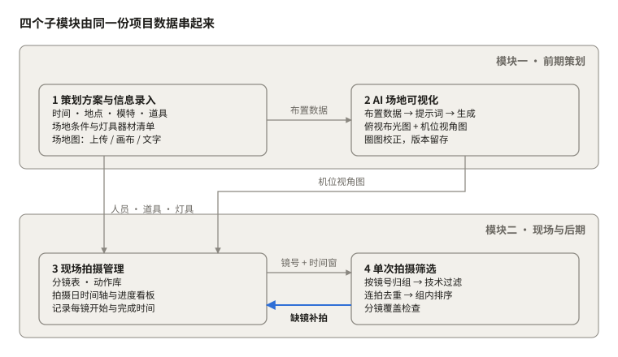
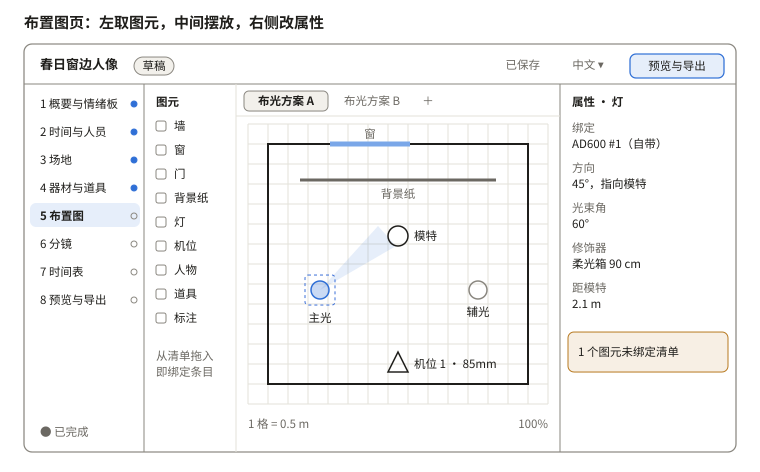
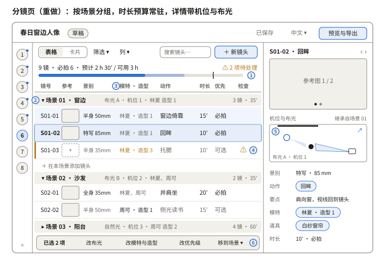

# portrait-guidance 人像策划指导 · 方案与模块设计

Oct 27, 2026 · @Hastin

> **设计稿快照**：本文导出自 Claude 在线四语文档《portrait-guidance 人像策划指导 · 方案与模块设计》（导出于 2026-10-29）。在线文档是原稿，这里是它的只读副本，图示已转成 SVG。文中的页面编号是设计稿编号，和程序里的对照见「实现进度」一节；程序当前版本以 [README](../../README.md) 为准。
>
> 其他语言：[English](en.md) · [日本語](ja.md) · [한국어](ko.md)


## 实现进度（0.3.0）

程序已到 0.3.0：S0–S9 十个页面和新增的 EX 光比都能用，在桌面 Claude-portrait-guidance 文件夹，双击「启动人像策划指导」即可。页面顺序按 Grok 方案调整过，下面的「页面清单」和两张线框图仍是设计稿编号，对照见下表。

| 程序里的页面 | 设计稿编号 | 0.3.0 状态 |
| --- | --- | --- |
| S0 项目列表 | S0 | 可用；支持导入 JSON（含 Grok 旧版） |
| S1 基础信息 | S1 + S2 合并 | 可用；新增时区 |
| S2 场地与器材 | S3 + S4 合并 | 可用；器材尺寸库、吸光板 |
| S3 模特与样图 | S2 人员 + S1 情绪板 | 可用；情绪板来源链接 |
| S4 动作库 | S7 | 可用 |
| S5 分镜表 | S6（线框图「S6 分镜页」） | 可用；按重做后的设计实现 |
| S6 场地图 | S5（线框图「S5 布置图页」） | 可用；新增机位 20 mm 三维预览、测光读数 |
| S7 时间轴 | S8 | 可用 |
| S8 进度看板 | 原「暂缓」，改为本期 | 可用；只记状态和时间，可导出给 Photo-cull 的分镜时间窗 |
| S9 预览导出 | S9 | 可用；布光表带测光读数与相对主光 |
| EX 光比 | 新增 | 可用；见下 |

**EX 光比**：和 S6 场地图是同一份布置，在任一边移动灯位或换修饰器，另一边同步。右侧按灯的目录参数（闪光指数或 1 m 照度）、功率档、到被摄者的距离和修饰器经验损耗估算每盏灯的光圈或照度，再和现场测光读数对照，给出主光与各灯的光比；被摄者不在光束内、实测与估算相差超过 1 EV 时提示。不计入策划完成度。

**器材目录**：神牛、Broncolor、爱图仕 / amaran 共 98 条光电参数，只作参考；Profoto 之后补。

仍暂缓：AI 相关功能、现场版、分享给客户、筛片与成片对比、世光测光表导入（等导出样例）。

## 总体架构

人像策划指导（portrait-guidance）分两大模块：前期策划（信息录入 + AI 场地可视化）与现场与后期（拍摄管理 + 筛片），四个子模块共用一份项目数据，前面录入的内容后面直接引用。



*总体架构 · 2 大模块、4 个子模块*

数据从录入一路流向筛片；筛片发现某个镜头没有合格片时，回写到现场管理标记补拍，形成闭环。

## 当前范围（2026-10-28 调整）

工具以“做策划案”为主：从录入信息、画场地布置图、排分镜动作，到排出拍摄日时间表、导出一份完整方案。本阶段只写功能规格和 GUI 界定，不写程序、不做测试。

| 内容 | 状态 |
| --- | --- |
| 模块 1 策划方案与信息录入 | 本阶段核心 |
| 模块 2 场地可视化：俯视布光图（矢量） | 本阶段核心 |
| 模块 2 场地可视化：AI 意向图 | 保留界面入口，功能暂缓 |
| 模块 3 分镜、动作库、拍摄日时间轴 | 本阶段核心 |
| 模块 3 现场进度看板 | 暂缓 |
| 模块 4 筛片、Photo-cull 接入、成片对比 | 暂缓 |
| AI 生图可行性验证、Photo-cull 接入验证 | 暂缓 |

标“暂缓”的章节保留在本文后部，作为以后的设计参考。

**平台假设**：与 Photo-cull 一致，做成本机运行的程序（本地服务 + 网页界面，可打包成 Mac 应用），桌面优先，最小窗口宽度 1280 px；“现场版”页面适配平板查看。这一条仍待你确认。

## 功能规格（策划案）

策划案共 38 项功能：P0 第一版必须有（28 项），P1 第一版之后尽快补上（5 项），P2 依赖 AI 或待确认事项（5 项）。优先级可直接在表里改。

### A · 项目

| 编号 | 功能 | 说明与规则 | 优先级 |
| --- | --- | --- | --- |
| F01 | 项目列表 | 新建、复制、归档、搜索；卡片显示封面（情绪板首图）、拍摄日期、状态、完整度 | P0 |
| F02 | 方案状态 | 草稿 / 待确认 / 已定稿；定稿后要编辑须先“解除定稿”，并自动存一个版本 | P0 |
| F03 | 模板 | 把项目存成模板（场地、器材、常用分镜与动作），新建时选用 | P1 |
| F04 | 自动保存与版本 | 每次修改自动保存；手动“存版本”可加备注；版本可查看、恢复 | P0 |

### B · 概要与情绪板

| 编号 | 功能 | 说明与规则 | 优先级 |
| --- | --- | --- | --- |
| F05 | 基本信息 | 项目名、主题说明、风格关键词（标签，可多个）、客户与用途（可选） | P0 |
| F06 | 情绪板 | 拖入图片，网格或自由排列；每张可加标注和标签；可一键设为某镜的参考图 | P0 |
| F07 | AI 起草说明 | 按关键词和情绪板生成主题说明草稿，人工确认后才写入 | P2 |

### C · 时间与人员

| 编号 | 功能 | 说明与规则 | 优先级 |
| --- | --- | --- | --- |
| F08 | 拍摄时间 | 日期、开始 / 结束、场地可用时段、化妆与布景提前量；自动算出各人到场时间 | P0 |
| F09 | 人员 | 模特（身高、尺码、造型套数、可拍时段）与工作人员（角色、联系方式）；造型套数自动生成“造型”条目供分镜引用 | P0 |

### D · 场地

| 编号 | 功能 | 说明与规则 | 优先级 |
| --- | --- | --- | --- |
| F10 | 场地库 | 场地独立保存、可被多个项目引用：地址、联系人、尺寸、室内外、照片、条件（窗位朝向、自然光时段、墙地材质颜色、电源、可用区与禁区） | P0 |
| F11 | 场地器材 | 场地提供的器材按类型登记（灯具、修饰、支架、背景、反光、其他），记型号和数量；随场地保存，下次直接复用 | P0 |

### E · 器材与道具

| 编号 | 功能 | 说明与规则 | 优先级 |
| --- | --- | --- | --- |
| F12 | 器材清单 | 合并场地器材与自带器材并标来源；显示“布置图已用 / 总数”，一套布光方案里用量超过数量时警告 | P0 |
| F13 | 道具清单 | 名称、数量、尺寸、来源、负责人、准备状态（待准备 / 已备齐） | P0 |
| F14 | 打包清单 | 从自带器材和自备道具生成可勾选、可打印的清单 | P1 |

### F · 场地布置图（核心）

| 编号 | 功能 | 说明与规则 | 优先级 |
| --- | --- | --- | --- |
| F15 | 画布 | 按场地尺寸生成等比网格（默认 1 格 = 0.5 m）；图元：墙、窗、门、柱、背景纸、灯（方向、光束角、修饰器、功率档）、机位（焦段与视角扇形）、人物、道具、文字标注 | P0 |
| F16 | 图元绑定 | 灯、道具、人物从清单拖入即绑定对应条目；未绑定的图元标黄提示 | P0 |
| F17 | 底图 | 上传平面图或照片作底图，两点标定比例尺，可调透明度、可锁定 | P0 |
| F18 | 布光方案 | 同一场地可存多套布光方案，分镜引用其一；方案可复制、并排对比 | P0 |
| F19 | 测距与辅助 | 显示灯—人、人—背景、机位—人距离；对齐、吸附网格、旋转 | P1 |
| F20 | 导出布光图 | PNG / PDF，带图例与距离标注 | P0 |
| F21 | 文字转布置 | 用文字描述生成图元草稿，在画布上确认后才生效 | P2 |
| F22 | AI 意向图 | 从布光方案 + 机位生成意向图；本阶段只留入口 | P2 |

### G · 分镜与动作

| 编号 | 功能 | 说明与规则 | 优先级 |
| --- | --- | --- | --- |
| F23 | 分镜表 | 字段同模块 3（“状态”属现场看板，暂缓）；按场景分组，场景设默认布光方案、机位、模特与造型，镜头只填不同之处；表格视图与卡片视图切换；拖动排序；镜号按“场景-序号”自动编排 | P0 |
| F24 | 引用字段 | 场景与机位、布光方案、模特、造型、道具、动作都从已有条目中选（标签式），不手打；被引用的条目删除前提示影响哪些镜头 | P0 |
| F25 | 参考图 | 每镜可挂多张：来自情绪板、上传、布光图截图 | P0 |
| F26 | 动作库 | 条目：名称、示意图、要点（重心、手位、视线）、适用景别、人数、标签；可筛选；可在分镜里直接新建条目 | P0 |
| F27 | 批量操作 | 多选分镜后批量改布光方案、模特、优先级 | P1 |
| F28 | AI 分镜建议 | 按主题与情绪板生成分镜和动作组合草稿，逐条采纳 | P2 |

### H · 拍摄日时间表

| 编号 | 功能 | 说明与规则 | 优先级 |
| --- | --- | --- | --- |
| F29 | 自动排程 | 按到场时间、化妆提前量、每镜预计时长排程；同布光方案、同造型的镜头排在一起；换装、换灯处插入缓冲（默认 10 分钟，可改） | P0 |
| F30 | 手动调整 | 时间条拖动、锁定某镜时间；总时长超出场地可用时段时显示超出量，并列出可删的“可选”镜头 | P0 |

### I · 预览与导出

| 编号 | 功能 | 说明与规则 | 优先级 |
| --- | --- | --- | --- |
| F31 | 方案预览 | 按导出版式预览全部章节，可勾选包含哪些章节 | P0 |
| F32 | 导出 PDF | 封面、概要与情绪板、时间表、人员、器材与道具、布光图、分镜表（带参考图）；按所选语言输出 | P0 |
| F33 | 现场版 | 平板友好的只读页面：时间表 + 分镜卡片（大参考图、动作要点），可离线打开 | P1 |
| F34 | 分享与客户确认 | 只读链接或导出包，客户可留言确认；取决于“是否面向客户” | P2 |

### J · 通用

| 编号 | 功能 | 说明与规则 | 优先级 |
| --- | --- | --- | --- |
| F35 | 四语界面 | 中、英、日、韩；所有文字走语言包；导出文件跟随所选语言 | P0 |
| F36 | 撤销 / 重做 | 画布与表格都支持，至少 50 步 | P0 |
| F37 | 完整度检查 | 每一步按必填项计算完成度；导出前列出缺项与冲突，可点击跳到对应位置 | P0 |
| F38 | 本地存储与备份 | 每个项目存成一个文件夹（数据 + 图片），可整体拷走或备份；不需要账号 | P0 |

### 必填项与一致性检查（F37 的规则）

| 检查 | 级别 | 触发条件 |
| --- | --- | --- |
| 项目名、拍摄日期、场地 | 必填 | 任一为空 |
| 场地尺寸 | 必填 | 为空时不能生成等比画布 |
| 分镜的布光方案与模特 | 必填 | 有分镜未选 |
| 器材超用 | 警告 | 同一布光方案中某器材用量 > 数量 |
| 未绑定图元 | 警告 | 画布上有灯或道具未关联清单 |
| 造型与模特不匹配 | 警告 | 分镜选了不属于该模特的造型 |
| 时间超出 | 警告 | 排程总时长超过场地可用时段或模特可拍时段 |
| 道具未备齐 | 提示 | 方案设为“已定稿”时仍有“待准备”道具 |

## GUI 界定

界面是一个窗口、四个固定区域：顶栏、左侧步骤导航、主工作区、右侧属性面板；左侧导航就是策划流程，按顺序从“概要”走到“导出”，每步显示完成度。

### 设计原则

- 与 Photo-cull 同一套外观：共用它的设计变量（tokens.css）和按钮、分段控件、步骤条等组件；图片和画布周围只用中性灰。
- 流程看得见：左侧导航即步骤，圆点显示完成度，导出前给出缺项清单。
- 引用而不重填：跨页数据一律以标签（chip）出现，点击跳回源条目，改一处处处更新。
- 渐进展开：每页只露常用字段，次要字段折叠在“更多”里。
- 四种语言同等对待：不用固定宽度承载文字，按最长的英文设计；日文 `line-break: strict`；韩文字体栈加 Apple SD Gothic Neo、Malgun Gothic。
- 键盘可完成主要操作；本地离线，字体和图标随程序发布。

### 窗口外壳

| 区域 | 尺寸 | 内容 |
| --- | --- | --- |
| 顶栏 | 高 56 px | 项目名、方案状态徽标（草稿 / 待确认 / 已定稿）、保存状态、语言切换、“预览与导出”按钮 |
| 左侧步骤导航 | 宽 220 px，可收起为 64 px 图标栏 | 8 个步骤 + 完成度圆点；最上方“返回项目列表” |
| 主工作区 | 自适应 | 当前步骤的内容 |
| 右侧属性面板 | 宽 320 px，可收起 | 选中对象的详情、提示与冲突 |

最小窗口 1280 × 800；宽度不足 1440 时右侧面板默认收起，变为可滑出的抽屉。

### 页面清单

| 编号 | 页面 | 对应功能 | 主工作区 | 右侧面板 |
| --- | --- | --- | --- | --- |
| S0 | 项目列表 | F01–F03 | 项目卡片网格、搜索、状态筛选、“新建 / 从模板新建” | 无 |
| S1 | 概要与情绪板 | F05–F07 | 上：基本信息表单；下：情绪板（网格 / 自由排列） | 选中图片的标注与标签 |
| S2 | 时间与人员 | F08–F09 | 左：拍摄时间与提前量，自动算出到场时间；右：人员卡片 | 选中人员详情与造型 |
| S3 | 场地 | F10–F11 | 从场地库选择或新建；场地信息、照片条、场地器材表 | 场地条件提示（如自然光时段） |
| S4 | 器材与道具 | F12–F14 | “器材 / 道具 / 打包清单”三个标签页，均为可编辑表格 | 条目详情、被哪些布光方案和分镜使用 |
| S5 | 布置图 | F15–F22 | 左：图元面板；中：画布与布光方案标签；底：比例与缩放 | 选中图元的属性、距离、未绑定警告 |
| S6 | 分镜 | F23–F28 | 按场景分组的表格 / 卡片、时长预算条、筛选与列设置、批量操作条 | 单镜详情：参考图、机位与布光缩略图、字段、检查结果 |
| S7 | 动作库 | F26 | 动作网格 + 标签筛选；也可在 S6 中以弹窗打开 | 动作详情与使用记录 |
| S8 | 时间表 | F29–F30 | 甘特式时间轴：每镜一条，按布光方案着色；可拖动、锁定 | 超时与冲突列表、可删的“可选”镜头 |
| S9 | 预览与导出 | F31–F34 | 左：章节勾选；中：分页预览 | 导出语言、纸张、是否含参考图 |

### 关键页面线框图



*S5 布置图页线框图（示例数据）*

布置图是本工具最核心的页面：图元从左侧拖入画布，从器材清单拖入的灯会自动绑定条目；顶部标签切换同一场地的不同布光方案。



*S6 分镜页线框图（重做，示例数据）*

重做后的分镜页按场景分组：场景标题行定下这一组共用的布光方案、机位、模特与造型，组内镜头只填不同之处。页顶常驻时长预算。右侧详情加了一张布置图缩略图，能看到这一镜在哪拍、灯怎么打。

### S6 分镜页详细设计

**相比上一版改了什么**

| 上一版的问题 | 改法 |
| --- | --- |
| 每个镜头都要重复选布光、模特、造型 | 以场景为分组并设默认值，镜头继承；改写过的值用深色显示 |
| 看不出总时长有没有超出场地可用时段，要到 S8 才知道 | 页顶常驻时长预算条 |
| 缺项和冲突要到导出前才看到 | 每行加“检查”列，顶部显示“待处理”数量，点击定位 |
| 表格缺机位、道具，参考图太小 | 机位随场景显示；道具放在详情里，也可从“列”里调出；缩略图加大，没有参考图时显示虚线占位 |
| 详情只罗列字段，和布置图脱节 | 详情加布置图缩略图，高亮本镜机位和用到的灯，点击跳到 S5 |
| 左侧导航占 220 px，表格列放不下 | 进入分镜页时导航默认收成 64 px 图标栏 |

**图中标注**

| 标注 | 区域 | 规则 |
| --- | --- | --- |
| ① | 时长预算 | 深色段为必拍，浅色段为可选，竖线为可用时长（场地可用时段与模特可拍时段取较短者）。合计含换装、换灯缓冲（F29，默认 10 分钟）。超出时显示“超出 x 分钟，可删可选镜头 n 个” |
| ② | 场景标题行 | 场景名、默认布光方案 · 机位 · 模特与造型、镜头数与小计时长；点 ▾ 折叠；点默认值可直接修改，组内未改写的镜头随之更新 |
| ③ | 继承与改写 | 灰字为继承自场景，深色为本镜改写；悬停改写过的单元格可“恢复为场景默认” |
| ④ | 检查 | 按 F37 规则逐行检查：必填缺失标红；造型与模特不匹配、器材超用、无参考图标黄。悬停看原因，点击打开详情并定位到该字段 |
| ⑤ | 机位与布光缩略图 | 取该镜布光方案的布置图，只高亮本镜机位扇形和用到的灯；↗ 在 S5 打开同一方案 |
| ⑥ | 批量操作条 | 选中多行后出现：改布光、改模特与造型、改优先级、移到场景 |

**表格列**

默认 8 列：镜号、参考、景别（含焦段）、模特 · 造型、动作、时长、优先、检查。“列 ▾”里可加道具、机位、布光方案、备注；列的显示和顺序随项目保存。镜号按场景和排序自动重编，手动锁定的镜号不变。

**卡片视图**

每张卡片有大参考图（4:3）、镜号与动作、景别 · 焦段、模特标签、时长与优先级、检查图标；按场景分段，每行 3–4 张。用于和模特、客户过方案，也是“现场版”（F33）分镜卡片的样式来源。

**详情抽屉**

从上到下：参考图（左右切换，可从情绪板拖入或上传）→ 机位与布光缩略图 → 景别 · 焦段 → 动作（标签，点开看动作库条目）与要点 → 模特 · 造型 → 道具 → 时长与优先级 → 备注。字段都可直接编辑；‹ › 或 ↑↓ 切换上一镜、下一镜。

**选动作**

点动作单元格或按 ⌘K，弹出动作库选择器：上方搜索和标签筛选（景别、人数、情绪），下方示意图网格；找不到就点“新建动作”直接建条目（F26）。

**页面状态**

| 状态 | 表现 |
| --- | --- |
| 还没有场景 | 一句说明 + “新建场景”按钮；S5 已有布光方案时，提示“按布光方案生成场景” |
| 场景里没有镜头 | 场景标题行下只显示“＋ 在本场景添加镜头” |
| 有警告 | 该行左侧黄色竖条，顶部计数加一 |
| 超时 | 预算条变警告色，可选镜头标“建议删减” |
| 筛选中 | 工具栏显示正在用的筛选，可一键清除；时长预算仍按全部镜头计算 |

**键盘**

⌘N 新镜头（插在当前镜头后），⌘⇧N 新场景，⌘D 复制，⌘K 动作库，Enter 打开详情，↑↓ 切换镜头，⌥↑↓ 移动镜头，Delete 删除（需确认）。

### 交互规则

| 场景 | 规则 |
| --- | --- |
| 保存 | 修改后约 1 秒自动保存，顶栏显示“保存中 / 已保存”；⌘S 存一个带备注的版本 |
| 撤销 | ⌘Z 撤销、⇧⌘Z 重做，画布与表格通用 |
| 引用标签 | 点击跳到源条目；悬停显示摘要；源条目被删除时标签变红并划线 |
| 拖放 | 清单 → 画布（绑定）；情绪板 → 分镜参考图；分镜行拖动排序；时间条拖动改时间 |
| 画布 | 空格 + 拖动平移，滚轮缩放，R 旋转 15°，方向键微移、Shift + 方向键大步，Delete 删除 |
| 分镜 | ⌘N 新镜头，⌘⇧N 新场景，⌘D 复制，⌘K 打开动作库，Enter 打开详情抽屉，⌥↑↓ 移动镜头 |
| 完整度 | 导航圆点：空心 = 未开始，半满 = 有缺项，实心 = 完成；导出前弹出缺项与冲突清单，点击直达 |
| 空状态 | 每页一句“下一步做什么” + 按钮，例如布置图在场地尺寸为空时提示“先填写场地尺寸” |
| 危险操作 | 删除被引用的条目前列出受影响的镜头；“解除定稿”需确认 |
| 多语言 | 按钮与标签宽度自适应，日期与数字按所选语言格式化；切换语言不丢失当前页面与选中对象 |

### 需要设计的组件与状态

组件：步骤导航项、方案状态徽标、引用标签、可编辑表格、卡片、属性面板分组、画布工具栏与图元、布光方案标签、时间条、批量操作条、空状态、确认弹窗。

每个组件都要画出：默认、悬停、选中、禁用、警告、错误；页面要画出：空状态、加载中、正常、含警告。

下一步：线框图确认后，可以用设计稿把 S0–S9 画成高保真页面（浅色 / 深色 × 四种语言）。

## 1 · 策划方案撰写与信息录入

本模块把一次拍摄的全部前期信息录成结构化数据，后面三个模块都从这里取数，不重复录入。

### 录入表单

| 分组 | 字段 | 用途 |
| --- | --- | --- |
| 基本信息 | 项目名、主题、风格关键词、情绪板参考图 | 风格关键词直接进入 AI 提示词 |
| 时间 | 拍摄日期、开始/结束、场地可用时段、化妆与布景提前量 | 生成拍摄日时间轴 |
| 地点 | 名称、地址、联系人、室内/室外、尺寸（长×宽×层高） | 尺寸决定场地图比例 |
| 场地条件 | 窗位与朝向、自然光时段、墙面与地面材质颜色、电源位置与功率、可用区与禁区 | 影响布光与 AI 视图 |
| 场地提供器材 | 灯具型号、类型、功率、数量；附件（柔光箱、雷达罩、蜂巢）；灯架、背景纸/布、反光板 | 与自带器材合并为器材清单，标注来源 |
| 自带器材 | 机身、镜头、灯具、引闪器 | 同上 |
| 道具 | 名称、数量、尺寸、来源（自备/租借/场地）、负责人 | 生成道具清单，供分镜引用 |
| 人员 | 模特人数；每位模特的姓名、身高、服装尺码、造型套数；化妆、助理 | 分镜按人分配 |
| 服装造型 | 套数、对应场景 | 排程时减少换装次数 |

### 场地图录入

三种方式可以混用，最后都落成同一份“场地布置数据”：图元列表 + 坐标 + 朝向 + 关联的器材或道具条目。这份数据是模块 2 的输入。

1. 上传：场地平面图或现场照片，在图上标注比例尺。
2. 画布：按真实尺寸的网格画布，拖放墙、窗、门、背景、灯（带朝向和光束角）、机位、模特站位、道具；每个图元绑定上表中的条目。
3. 文字描述：自由描述场地布置，由 AI 解析成图元草稿，再在画布上校正。

### 方案文档输出

一键生成策划方案，可导出 PDF：概要、时间表、人员表、器材与道具清单、场地布置图、情绪板。主题说明与风格描述可由 AI 辅助起草。

## 2 · AI 场地可视化

场地布置数据自动转成提示词，生成拍摄前就能看的现场效果图；灯位的准确位置以矢量布光图为准，AI 图只表达氛围与观感。

### 生成流程

1. 数据整理：从场地布置数据读取空间尺寸、材质、光源（类型、位置、朝向、修饰附件）、道具、模特站位。
2. 场景描述：按固定顺序拼成自然语言——空间 → 背景与地面 → 光源 → 道具 → 人物 → 风格关键词。
3. 提示词编排：每个视角一个模板，生成前用户可改写。
4. 生成：只有文字时用文生图；有平面图或场地照片时，以其为构图参考（深度、线稿等结构控制），让空间关系更接近真实。
5. 多视角输出：
   - 俯视布光图：由画布数据直接矢量绘制，不走 AI，保证位置准确。
   - 机位视角图：从某个机位看向模特，AI 生成，可作分镜参考图。
   - 全景氛围图：整体场地观感，AI 生成。
6. 校正与版本：在图上圈出问题，回改布置数据或提示词后重新生成；每一版都与对应的布置数据版本绑定保存。

### 提示词模板示例

```
[视角] 从 {机位} 平视拍摄，{焦段} 视角
[空间] {长}×{宽} 米室内，{墙面材质颜色}，{地面}
[背景] {背景纸颜色}，距模特 {距离} 米
[光源] 主光 {灯型}+{柔光箱}，位于模特 {方位} 45°；辅光 …；轮廓光 …
[人物] {人数} 名模特，{站位与姿态}，{服装}
[风格] {风格关键词}，{色调}
```

### 设计要点

- 生成服务做成可替换接口（输入：提示词 + 可选参考图 + 视角；输出：图片），不绑定单一厂商。
- 同一场地的多张图固定风格参数与随机种子，保持画面一致。
- 所有 AI 图标注“意向图”，避免被当成布景施工图。

## 3 · 现场拍摄管理：分镜与动作

以分镜表为核心，把前期数据变成拍摄当天可执行的清单，并实时记录每个镜头的完成状态和时间。

### 分镜表字段

| 字段 | 内容 |
| --- | --- |
| 镜号 | 自动编号，如 S01-03（场景 01 第 3 镜） |
| 场景与机位 | 引用场地图中的布景区和机位 |
| 景别与焦段 | 全身 / 半身 / 特写；焦段 |
| 模特 | 引用人员表，可多选 |
| 造型 | 服装与妆面套数 |
| 动作 | 引用动作库条目，或自由描述 |
| 灯光方案 | 引用场地图中的灯位组合，一套布光可被多个镜头复用 |
| 道具 | 引用道具清单 |
| 参考图 | 情绪板图片，或模块 2 的机位视角图 |
| 预计时长 | 分钟 |
| 优先级 | 必拍 / 可选，时间不够时据此删减 |
| 状态 | 待拍 / 在拍 / 完成 / 需补拍 |
| 备注 | 现场文字、语音或手机照片 |

### 动作库

- 每个动作：名称、示意图（简笔或参考照）、要点（重心、手位、视线）、适用景别、人数（单人 / 双人 / 群像）、情绪与风格标签。
- 按标签筛选，可从历次拍摄中沉淀新条目。
- 现场可全屏展示给模特看，减少口头沟通。

### 拍摄日管理

- 时间轴：由时间信息和分镜预计时长自动排程——到场、化妆、布景、各场景拍摄、换装换景缓冲、收工；按布光方案和造型给分镜分组排序，减少换灯换装次数。
- 进度看板：按状态分列，拍完一镜点“完成”，自动记录开始与完成时间（模块 4 用这个时间窗给照片归组）。
- 偏差提醒：实际进度落后时间轴时提示，并列出可删减的“可选”镜头。
- AI 辅助：根据主题和场地视图建议分镜与动作组合；按剩余时间重排顺序。
- 使用形态：平板优先，弱网可用（本地缓存，联网后同步）。

## 4 · 单次拍摄筛选（暂缓）

本模块直接调用桌面上的 Photo-cull（照片工具 1.7-beta）完成筛选；portrait-guidance 只补上 Photo-cull 没有的四件事：按分镜归组、覆盖检查、补拍回写、成片对比。

### Photo-cull 已有的能力（读源码确认）

| 能力 | 实现 | 默认参数 |
| --- | --- | --- |
| 失焦 / 抖动 | “再模糊”指标，只看最锐区域，背景虚化的人像不会误判 | 0.58 提示，0.75 淘汰 |
| 曝光 | 平均亮度、高光溢出与暗部死黑比例 | 亮度低于 18 或高于 238 淘汰 |
| 人脸与闭眼 | OpenCV Haar 检测，只提示不淘汰 | — |
| 连拍 / 同场景重拍分组 | 拍摄时间间隔 + 画面相似度 | 连拍 15 秒，同场景 60 秒，相似度 0.6 |
| 本地评分 | 锐度 60% + 曝光 30% + 人脸 10%，组内最高分为主选 | — |
| AI 细评 | 入围照片缩到 1024 px，评构图、光线、主体、时机、技术 5 项（1–10 分），给 1–5 星、题材、评语和改进点；按“服务商 + 模型 + 语言 + 图片”缓存 | Claude、ChatGPT、Grok、Gemini、DeepSeek 或任意 OpenAI 兼容接口 |
| 星级写入 | XMP 星级与色标：RAW 写边车、JPEG 写内嵌，Lightroom Classic 和 Capture One 可读 | 精选 4–5★ 绿，可用 3★ 黄，连拍备选最多 2★，淘汰为拒绝 + 红 |
| 其他 | RAW + JPEG 配对、删除进废纸篓、整理输出与重命名、HTML 报告与 results.csv、中英日三语界面 | — |

### 筛选流程

1. 运行 Photo-cull：对本次拍摄文件夹调用其命令行（cull.py）或图形界面，结果写入照片文件夹下的 photo-cull-report/。
2. 按镜号归组：用 Photo-cull 读出的拍摄时间，对照模块 3 记录的每镜“开始—完成”时间窗写入镜号；对不上的进入“未归组”，手动拖入。
3. 人工复核：在 Photo-cull 报告里打星、拒绝、删除，操作与平时一致。
4. 覆盖检查：统计每个镜号 3★ 及以上的张数，为 0 的标红，并回写模块 3 状态为“需补拍”。
5. 成片对比：见“成片对比功能评估”。
6. 导出：星级和色标已由 Photo-cull 写进 XMP；portrait-guidance 另出一份按镜号排列的清单。

### portrait-guidance 为每张照片新增的字段

Photo-cull 的字段原样保留，只增加下面四项。

| 字段 | 内容 |
| --- | --- |
| 镜号 | 自动按时间窗归组，或手动指定 |
| 归组方式 | 自动 / 手动 |
| 计入覆盖 | 3★ 及以上且未删除时计入该镜 |
| 成片对比结论 | 一致 / 有偏差 / 有意调整，附说明 |

## 数据模型、分期与待确认

所有模块共用一个项目数据库，每个实体只录一次，其他模块引用。

### 核心实体

| 实体 | 主要内容 | 使用模块 |
| --- | --- | --- |
| 项目 | 主题、时间、风格关键词、状态 | 全部 |
| 场地 | 尺寸、条件、联系人 | 1、2 |
| 器材 | 型号、类型、数量、来源（场地 / 自带） | 1、2、3 |
| 道具 | 名称、数量、来源、负责人 | 1、3 |
| 人员 | 模特与工作人员信息 | 1、3 |
| 场地布置 | 图元列表、坐标、朝向、版本号 | 2、3 |
| 效果图 | 视角、提示词、图片、对应布置版本 | 2、3 |
| 分镜 | 见模块 3 字段 | 3、4 |
| 动作 | 动作库条目 | 3 |
| 拍摄记录 | 每镜实际开始与完成时间、备注 | 3、4 |
| 照片 | 文件、EXIF、所属镜号、筛选记录 | 4 |

### 分期建议

1. 第一期：模块 1 信息录入与方案导出 + 模块 3 分镜表与进度看板。不依赖 AI，先打通数据主线。
2. 第二期：模块 4 筛选，复用 Photo-cull 并加入按时间窗归组与覆盖检查。
3. 第三期：模块 2 AI 场地可视化，以及 AI 分镜与动作建议；这部分效果取决于前面录入数据的完整度。

### 待确认

- 使用形态：网页、桌面软件还是平板 App？拍摄当天是否需要摄影师、助理、化妆多人同时查看？
- 多机位拍摄时各机身时钟如何对齐（影响镜号归组）。
- AI 生图服务的偏好：云端服务还是本地部署？
- 是否面向客户：方案给客户确认、选片交给客户挑选？

## AI 生图可行性验证（暂缓）

模块 2 进入开发前，先用约 $7、135 张图做一轮对比验证；达标才开发，不达标则退回“矢量布光图 + 参考图库”方案。

### 要回答的四个问题

1. 空间关系可控吗：灯、背景、模特站位是否落在布置数据所写的位置。
2. 光效可信吗：主光方向、软硬、明暗比是否与灯位一致。
3. 多视角一致吗：同一场地的全景图与机位视角图能否看出是同一个地方。
4. 成本与耗时可接受吗：得到一张可用图平均要生成几次、等多久。

### 候选方案

| 方案 | 做法 | 候选模型 | 参考单价 |
| --- | --- | --- | --- |
| A 纯文生图 | 只用模板提示词 | Gemini Nano Banana 2.1 | $0.0336 / 张（1K） |
| B 照片编辑 | 以场地实拍照为底图，用提示词加灯具、背景、人物 | Nano Banana 2.1 编辑；GPT Image 2.5 Sunburst 编辑 | 同上；GPT Image 2.5 为 $30 / 百万输出 token |
| C 结构控制 | 平面图或照片转深度/线稿，作为构图约束 | FLUX.1 \[dev\] + ControlNet（fal） | $0.075 / 百万像素 |

### 测试样本与评分

- 样本：3 个真实场地（小影棚、带窗室内、户外），每个场地准备实拍照作对照。
- 每个场地 × 每个方案 × 3 个视角（全景、机位 1、机位 2）× 各生成 5 次 = 135 张。
- 每张图打分：布局一致（1–5）、光方向正确（是 / 否）、跨视角一致（1–5）、是否可用、生成耗时。

### 建议通过标准

| 指标 | 阈值 |
| --- | --- |
| 可用率（可用张数 ÷ 生成张数） | ≥ 50%，即平均 2 次内得到一张可用图 |
| 布局一致平均分 | ≥ 4 |
| 光方向正确率 | ≥ 70% |
| 单个场景（3 视角）成本 | ≤ $1 |

### 验证预算

方案 A 45 张 × $0.0336 ≈ $1.51；方案 B 约 $1.6（另含少量图片输入费）；方案 C 45 张 × $0.075 ≈ $3.38。合计约 $7。

模型更替很快：OpenAI 的 gpt-image-1 已于 2026-10-23 停用，gpt-image-1.5 计划 2026-12-01 停用。验证结果要记录模型版本，生成服务保持可替换接口。

## 全模块成本核对清单

按次计费的 AI 调用集中在模块 2；其余模块要么本地运算不花钱，要么调用量很小。逐项核对后在最右列改状态。价格为 2026-10 查到的美元标价。

| 模块 | 成本项 | 计费方式 | 参考单价（USD） | 核对 |
| --- | --- | --- | --- | --- |
| 1 | AI 起草方案、解析文字场地描述 | 按 token | Gemini 3.5 Flash-Lite：输入 $0.30、输出 $2.50 / 百万 token | 待核对 |
| 1 | 方案 PDF 导出 | 本地生成 | $0 | 待核对 |
| 2 | 机位视角图、全景氛围图（方案 A/B） | 按张 | Nano Banana 2.1：1K $0.0336，2K $0.0504 | 待核对 |
| 2 | 结构控制生图（方案 C） | 按百万像素，向上取整 | FLUX.1 \[dev\] + ControlNet：$0.075 / MP | 待核对 |
| 2 | 高质量备选 | 按张 | Nano Banana Pro：1K/2K $0.134 | 待核对 |
| 2 | 俯视布光图 | 本地矢量绘制 | $0 | 待核对 |
| 2 | 生图可行性验证 | 一次性 | 约 $7 | 待核对 |
| 3 | AI 分镜与动作建议 | 按 token | 同模块 1 | 待核对 |
| 4 | 失焦、闭眼、曝光检测，连拍去重 | 本地运算 | $0（占用本机算力） | 待核对 |
| 4 | 云端视觉评分（可选） | 按 token | Flash-Lite 图片输入 $0.30 / 百万 token | 待核对 |
| 公共 | 预览图与生成图存储 | 按 GB·月 | Cloudflare R2：$0.015 / GB·月，前 10 GB 免费，下载流量免费 | 待核对 |
| 公共 | 应用托管与数据库 | 按月 | 待选型后报价 | 待核对 |
| 公共 | 开发人力 | 一次性 | 未纳入本清单 | 待核对 |

原片（RAW）留在本机，只上传压缩预览图，这是存储成本保持低位的前提。

## 运行成本预估（按各家 token 单价）

按每月 8 次拍摄计算，经济组合约 $8 / 月，高质量组合约 $54 / 月；差距来自生图模型和 Photo-cull AI 细评所选的模型。单价为 2026-10 各家官方价格页的标准档（非批量），美元计。

### 每次拍摄的 token 用量假设

| 用途 | 输入 token | 输出 token | 说明 |
| --- | --- | --- | --- |
| 模块 1 方案起草、场地解析 + 模块 3 分镜建议 | 2.0 万 | 1.2 万 | 共 5 次文字调用 |
| 模块 4 AI 细评（由 Photo-cull 调用，可选） | 90 万 | 15–48 万 | 600 张入围照片；按 Photo-cull 自带的估算，每张约 1,500 输入 token，Claude / Gemini 约 250、OpenAI 约 800 输出 token |
| 模块 2 生图 | — | 24 张 | 6 张所需图 × 平均生成 4 次 |

Photo-cull 细评前会弹窗显示张数和预计用量，确认后才调用；评过的照片走缓存不再收费。实际用量以接口返回的 usage 为准。第二期把成片对比并入同一次细评调用后，不单列费用。

### 文字与视觉模型：每次拍摄成本

| 厂商 | 模型 | 输入 / 输出（每百万 token） | 每次拍摄 |
| --- | --- | --- | --- |
| Anthropic | Claude Haiku 5.5 | $0.10 / $0.50（单次提示 ≤ 10 万 token） | $0.17 |
| OpenAI | gpt-6-luna | $0.10 / $0.50 | $0.34 |
| Google | Gemini 3.5 Flash-Lite | $0.30 / $2.50 | $0.68 |
| Google | Gemini 3.8 Flash（Photo-cull 的 Gemini 默认） | $0.75 / $3.75 | $1.30 |
| OpenAI | gpt-6.1-terra | $1.00 / $5.00 | $3.38 |
| Anthropic | Claude Sonnet 5.5（Photo-cull 的 Claude 默认） | $2.00 / $10.00 | $3.46 |

不开 AI 细评时，这一项只剩模块 1、3 的文字调用，每次拍摄不到 $0.17。

### 生图模型：每次拍摄成本（24 张）

| 厂商 | 模型 | 计价 | 每张 | 每次拍摄 |
| --- | --- | --- | --- | --- |
| Google | Nano Banana 2.1 | 图片输出 $30 / 百万 token，1K 图 1,120 token | $0.0336 | $0.82 |
| Google | Nano Banana Pro | 图片输出 $120 / 百万 token | $0.134 | $3.23 |
| OpenAI | gpt-image-2.5-flare / sunburst | 图片输出 $30 / 百万 token；每张 token 数随质量档变化 | 约 $0.03–0.15（按 1,000–5,000 token 估） | 约 $0.72–3.60 |
| fal | FLUX.1 \[dev\] + ControlNet | 按百万像素，非 token | $0.075 | $1.80 |
| Anthropic | — | 不提供图像生成 | — | — |

### 组合方案：每次与每月成本

| 组合 | 文字 / 视觉 | 生图 | 每次 | 每月（8 次） |
| --- | --- | --- | --- | --- |
| 经济 | Claude Haiku 5.5 | Nano Banana 2.1 | $0.99 | $7.95 |
| 均衡 | Gemini 3.5 Flash-Lite | Nano Banana 2.1 | $1.50 | $12.00 |
| 结构控制 | Gemini 3.5 Flash-Lite | FLUX + ControlNet | $2.48 | $19.85 |
| 高质量 | Claude Sonnet 5.5 | Nano Banana Pro | $6.69 | $53.50 |

另加存储：第一年内约 $0–0.93 / 月（R2，前 10 GB 免费）。价格有期限：Gemini 3.8 Flash 的现价标注到 2026-12-31，2027-01-01 起翻倍。

## Photo-cull 联动评估（暂缓）

结论：只复用，不联动。Photo-cull 的核心已经和界面分开，结果存成数据文件，portrait-guidance 调用它的命令行、读取结果即可；第一期不用改 Photo-cull，第二期只加一个可选参数。

### 读取到的 Photo-cull 现状

- 版本 1.7-beta，MIT 开源，Python 本地程序。
- cull.py 是筛选核心与命令行；gui.py 是只在本机（127.0.0.1）运行的网页服务；界面在 web/，可打包成 Mac 应用。另有 editor.py 照片编辑程序。
- 结果在照片文件夹的 photo-cull-report/：结果数据、results.csv、report.html、ai\_cache.json。
- 问题标记和题材存成代码（blur、soft、under、eyes…；portrait、street…），与界面语言无关，程序好读。
- 界面语言为简体中文、English、日本語，还没有韩语。

### 三种做法对比

| 做法 | 怎么做 | 好处 | 代价 |
| --- | --- | --- | --- |
| A 完整联动 | 两个应用实时双向同步分镜、照片和筛选结果 | 两边界面都能看到全部信息 | Photo-cull 没有策划数据，要新加同步层；数据不一致时难排查 |
| B 调用命令行、读结果（推荐） | portrait-guidance 调用 cull.py，读 photo-cull-report/ 的结果后按时间映射镜号 | 第一期不改 Photo-cull；复核、写 XMP、整理输出全部沿用 | 镜号归组依赖拍摄时间，多机位要先对时钟 |
| C 合并 | Photo-cull 并入 portrait-guidance | 代码只有一份 | Photo-cull 还有照片编辑和无策划的日常筛片用途，合并后都变重 |

### 分两期接入

1. 第一期，不改 Photo-cull：调用 `cull.py <文件夹>`（需要 AI 细评时加 `--ai --provider …`），读取 photo-cull-report/ 的结果，按拍摄时间写入镜号。
2. 第二期，给 Photo-cull 加一个可选参数（例如 `--plan 分镜文件`），不带它时行为完全不变：
   - 结果里直接带镜号；
   - AI 细评的提示词加入该镜的策划意图（景别、动作、光向），同一次调用顺带返回“与策划是否一致”，成片对比不再另外花钱；
   - 增加韩语语言包 ko.json，与 portrait-guidance 的四语对齐。

### 复用的边界

| 能力 | 归属 |
| --- | --- |
| 失焦、曝光、闭眼检测，连拍分组，本地评分 | Photo-cull（已有） |
| AI 细评、缓存、调用前的用量确认 | Photo-cull（已有） |
| 复核打星、XMP 写入、废纸篓删除、整理输出 | Photo-cull（已有） |
| 按镜号归组、覆盖检查、补拍回写 | portrait-guidance |
| 成片对比与报告 | portrait-guidance（第二期借用 Photo-cull 的 AI 调用） |

### 验证步骤

1. 用一次真实拍摄跑 cull.py，确认结果里的拍摄时间精度足够映射镜号。
2. 多机位时试一次“拍时钟—计算偏差”的对时办法：开拍前各机拍同一个平板时钟。
3. 第二期改动在 Photo-cull 的分支上做，并重跑它现有的自动化测试。

## 成片对比功能评估（暂缓）

建议做，但分两步：先做不花 AI 费用的“参考图 vs 选用片”并排对照和人工核对，再视需要加 AI 偏差分析；AI 分析每次拍摄约 $0.01–0.13，成本不是障碍。

### 它补上的是什么

模块 4 的覆盖检查只回答“这个镜头有没有合格片”；成片对比回答“拍出来的和策划的差在哪”。前者决定要不要补拍，后者用于交付确认和复盘。

| 用途 | 谁看 | 价值 |
| --- | --- | --- |
| 现场或当天复核 | 摄影师 | 在收工前发现景别、光向拍偏的镜头 |
| 交付确认 | 客户 | 逐镜对照策划案，减少“和说好的不一样”的争议 |
| 复盘与沉淀 | 摄影师 | 记录哪些布光方案、动作执行效果好，回流到动作库和下次策划 |

### 对比维度

| 维度 | 判定依据 | 第一步（人工） | 第二步（AI） |
| --- | --- | --- | --- |
| 景别与焦段 | 分镜字段 vs EXIF 焦段与画面 | 勾选是否一致 | 自动判断景别 |
| 机位与构图 | 参考图 vs 成片 | 并排目视 | 描述构图差异 |
| 动作与姿态 | 动作库条目 vs 成片 | 勾选是否一致 | 判断要点（手位、视线）是否到位 |
| 光方向与光比 | 灯光方案 vs 成片 | 勾选是否一致 | 判断主光方向与明暗 |
| 道具与服装 | 分镜引用 vs 成片 | 勾选是否出现 | 识别是否出现 |
| 色调与情绪 | 情绪板 vs 成片 | 1–5 分 | 给出差异描述 |

### 设计要点

- 以分镜的结构化字段为主要依据，图像相似度只作参考：参考图多为 AI 意向图，与真实场地本就有差距，直接比像素会误判。
- 偏差只记录、不扣分：现场即兴改动常常是好结果，界面上让摄影师标注“有意调整”。
- 输出一页逐镜对照报告，可导出给客户，也可写回分镜备注。

### 分步落地

1. 第一步，随模块 4 一起做：选用片自动挂到对应分镜旁，并排显示参考图与成片，附人工核对清单。
2. 第二步，可选：对每个镜头用视觉模型比较参考图、分镜字段与成片，生成偏差说明。第二期并入 Photo-cull 的 AI 细评调用：提示词里加上该镜的策划意图，同一次调用返回一致性判断，几乎不增加费用；单独调用时按 30 个镜头估算，每次拍摄约 $0.01–0.13。
3. 第三步，积累 5–10 次拍摄后，按布光方案和动作统计执行一致率，用于改进策划。

### 验证方法

拿最近一次已完成的拍摄，手工做一份逐镜对照，看是否真的发现了此前没注意到的偏差、客户是否愿意看这份报告。两项都是否定的话，只保留第一步的并排视图即可。

## 价格来源

- [Gemini Developer API 价格页](https://ai.google.dev/gemini-api/docs/pricing)：Nano Banana 2.1、Nano Banana Pro、Gemini 3.5 Flash-Lite
- [fal · FLUX.1 \[dev\] 带 ControlNet 端点](https://fal.ai/models/fal-ai/flux-general)
- [GPT Image 2 价格与 gpt-image-1 / 1.5 停用日期](https://unifically.com/de/blogs/gpt-image-2)
- [Cloudflare R2 价格汇总](https://www.spendbase.co/?p=35561)

* [OpenAI API 价格页](https://developers.openai.com/api/docs/pricing)：gpt-6-luna、gpt-6.1-terra、gpt-image-2.5
* [Claude API 价格页](https://platform.claude.com/docs/en/about-claude/pricing)：Claude Haiku 5.5、Claude Sonnet 5.5
